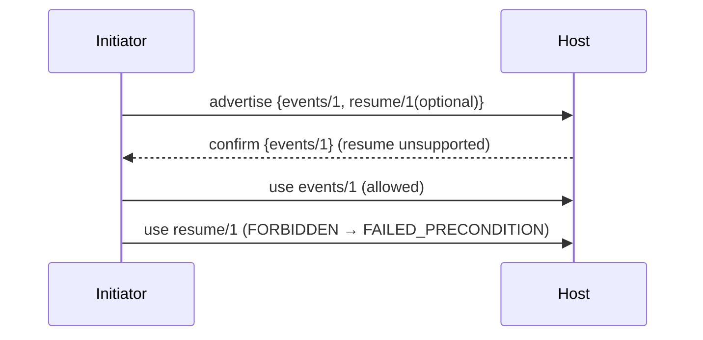

# Syntra v1 Core — Capability Negotiation and Extensions

- Identifier: `specifications/core/capabilities.md`
- Title: Mandatory vs Optional Capabilities and Extension Rules
- Status: Draft (pending maintainer approval via RFC)
- Version: 1.0.0-draft.1 (2026-10-19)
- Normative references: BCP 14; `protocol.md` (SNTR-CORE-004); `handshake.md`; `versioning.md`; `GOVERNANCE.md`; ADR-009
- Scope: How peers advertise, negotiate, and use OPTIONAL behavior (event streams, resumption, extensions) without breaking mandatory interop. Capability identifiers and extension payloads themselves are defined by their respective RFCs; this document defines only the negotiation mechanics and rules.
- Terminology: Per `protocol.md`. **Mandatory** = required for interop (handshake, RPC, cancel, errors, versioning). **Optional** = negotiated (streams, resumption, extensions). **Extension** = RFC-defined optional addition.

The key words "MUST", "MUST NOT", etc. are per BCP 14.

## 1. Protocol requirements

**SNTR-CAP-001** — Every optional behavior MUST have a stable capability identifier (ASCII, e.g., `syntra.events/1`, `syntra.resume/1`) defined by its RFC. Identifiers MUST be versioned; unversioned or ambiguous identifiers MUST be rejected.

**SNTR-CAP-002** — Negotiation MUST be explicit. A peer MUST NOT assume support, MUST NOT probe by sending optional frames, and MUST NOT require an unnegotiated option. Initiators advertise desired capabilities; hosts confirm only those they support (binding mechanism: handshake extensions when defined, otherwise application-level negotiation RPC — the capability's RFC MUST state which; probing via optional `Frame` variants without prior agreement is FORBIDDEN). No resumption, session-extension, multi-round-auth, event-stream, or replay capability exists in default v1: any such identifier — including the `syntra.events/1` and `syntra.events.replay/1` names proposed (not allocated) in `events.md` §1A — is unnegotiated until its RFC defines the binding, confirmation, bounds, and failure semantics (see `sessions.md` §1C–§1E, `authentication.md` §1A, `events.md` §1A/§1I, `open-questions.md` blockers 1–2, `rfcs/0002-auth-session-lifecycle.md`).

**SNTR-CAP-003** — Mandatory interop MUST NOT depend on any optional capability. A minimal implementation supporting only mandatory behavior MUST interoperate (with reduced functionality) against a full implementation.

**SNTR-CAP-004** — Unknown capabilities MUST be ignored if advertised as optional-by-peer, and MUST cause `UNIMPLEMENTED` only when the peer *requires* them. A host MUST NOT fail a handshake solely because the initiator advertised an unknown optional capability.

**SNTR-CAP-005** — Extensions MUST NOT alter mandatory state machines, envelope validation (SNTR-WIRE-*), or error semantics. They MAY add new `Frame.body` variants (minor, with capability gating), new methods, or new transports — each via RFC.

**SNTR-CAP-006** — Experimental capabilities MUST be clearly marked (identifier contains `exp`, documented as unstable) and MUST NOT affect mandatory interop or conformance claims.

**SNTR-CAP-007** — Deprecation: withdrawing an optional capability REQUIRES an RFC, a deprecation notice period, and a `versioning.md` entry. Peers MUST tolerate withdrawal gracefully (`UNIMPLEMENTED` + fallback, not connection failure where fallback exists).

**SNTR-CAP-008** — Reliable-session capability `syntra.reliable-session/1` (OPTIONAL, minor-additive, no envelope change): negotiation is explicit post-`ACTIVE` generic-RPC control (no handshake binding, no new `Frame` variant, reserved values preserved). Initiators advertise the identifier; hosts confirm only the subset implemented for the bound principal and per connection (confirmation on one connection never enables another). Unconfirmed use MUST fail with `FAILED_PRECONDITION` (RPC context) per §4; required-but-unsupported MUST fail with `UNIMPLEMENTED`. Confirmation MUST cite this identifier and the bounds in `sessions.md` §1H / `reliability.md` §1C. Mandatory-only peers MUST interoperate without it (SNTR-CAP-003). Draft-proposal notice: this SNTR-CAP-008 is proposal-only and carries no normative force until its authorizing RFC is accepted. Until acceptance, implementations MUST NOT ship behavior from it, and no test, claim, or release MAY cite it as authority.

No accepted reliable-session negotiation method or payload schema is
recorded. The identifier above is proposed, not an allocation or shipping
authorization. The `CONF-RS-*` plans in `sessions.md` §7.1 are not executable
wire fixtures. Local implementation APIs/unit tests and runner aggregates
do not establish negotiation conformance. RFC 0002 still defers resumption;
the separate Draft recovery RFC 0006 does not resolve this blocker.

## 2. Client behavior

- **SNTR-CAP-010** — The client MUST advertise only capabilities it implements, MUST handle partial acceptance (subset confirmed), and MUST fall back to mandatory-only operation when an option is unavailable.
- **SNTR-CAP-011** — The client MUST NOT send extension frames for unconfirmed capabilities.

## 3. Server behavior

- **SNTR-CAP-020** — The server MUST confirm only capabilities it implements for the bound principal, MUST reject required-but-unsupported capabilities with `UNIMPLEMENTED`, and MUST document supported capabilities per deployment.
- **SNTR-CAP-021** — The server MUST isolate capability state per connection; negotiation on one connection MUST NOT enable options on another.

## 4. Failure handling

Required-but-unsupported → `UNIMPLEMENTED` (RPC context) or handshake failure (if handshake-gated). Use of unconfirmed option → `FAILED_PRECONDITION`. Unknown optional advertisement → ignored with diagnostic.

## 5. Security considerations

Capability confusion (downgrade to weaker option) is a threat: negotiated sets MUST be integrity-protected by the secure transport; hosts MUST NOT silently downgrade security-relevant capabilities. Experimental options MUST NOT bypass authentication or bounds.

## 6. Compatibility considerations

Capabilities are the minor-evolution path (ADR-009). New mandatory behavior is never a capability — it is a major version. Capability identifiers are frozen once accepted; renaming REQUIRES a new identifier + deprecation of the old.

## 7. Conformance requirements

- **SNTR-CAP-900** — Fixtures: mandatory-only interop against full peer; unknown optional ignored; required-but-unsupported → `UNIMPLEMENTED`; unconfirmed-option use → `FAILED_PRECONDITION`; experimental marked and isolated.
- **SNTR-CAP-901** — Negotiation trace: each optional feature exercised MUST cite its capability identifier and RFC.
- **SNTR-CAP-902** — Proposed reliable-session negotiation coverage (OPTIONAL, gated after acceptance): advertise `syntra.reliable-session/1` post-`ACTIVE`; explicit confirmation; partial acceptance falls back to mandatory-only; unconfirmed session control → `FAILED_PRECONDITION`; confirmation remains connection-scoped. `CONF-RS-001` is a non-executable draft plan in `sessions.md` §7.1 pending an accepted canonical negotiation contract. Former attach/drain rows did not exercise negotiation and provide no evidence for this requirement. This requirement has the same proposal-only status as SNTR-CAP-008.

