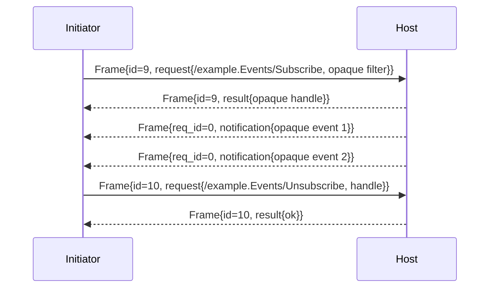
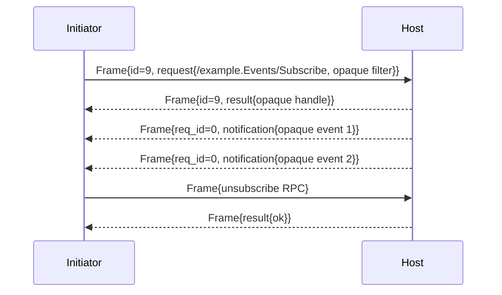

# Syntra v1 Core — Generic Events and Optional Subscriptions

- Identifier: `specifications/core/events.md`
- Title: Server-Originated Events and Event Streams
- Status: Partially accepted (2026-10-30) — pre-`ACTIVE` notification fail-close and handshake-failure fixture semantics accepted per [RFC 0003](../../rfcs/0003-handshake-failure-signaling.md) ([Decision 0002](../../docs/decisions/0002-sdd-acceptance-wave.md)); the event-stream/replay capability itself remains proposal-only (unallocated identifiers; see `capabilities.md` §1)
- Version: 1.0.0-draft.1 (2026-10-19)
- Normative references: BCP 14; `proto/syntra/v1/events.proto` (`Notification`); `protocol.md`; `framing.md`; `rpc.md`; `capabilities.md`; `reliability.md`; `errors.md`; ADR-007
- Scope: Generic host→initiator push: event identity, optional stream identity, subscription lifecycle, ordering scope, delivery guarantees, optional replay and continuation cursors, cancellation, and unsupported-capability behavior. No chat messages, typing indicators, or application event types are defined. Topic/filter semantics belong to the application above generic subscription RPCs.
- Terminology: Per `protocol.md`. **Event** = one `Notification{payload}` (`request_id == 0`). **Stream** = an OPTIONAL negotiated sequence of events established via generic RPC. **Cursor** = OPTIONAL opaque application token marking a stream position.

The key words "MUST", "MUST NOT", etc. are per BCP 14.

## 1. Protocol requirements

**SNTR-EVENT-001** — Events are OPTIONAL. Hosts MAY support none; initiators MUST NOT assume subscription success. Support MUST be advertised/negotiated per `capabilities.md`; unnegotiated use MUST be rejected with `UNIMPLEMENTED` (SNTR-EVENT-011). Within the accepted recovery contract this refusal is mapped by connection state (`SYN-URP-010` in accepted [RFC 0006](../../rfcs/0006-update-recovery-profile.md)): a known profile operation on a connection that has not confirmed the profile — like an unknown operation — is refused with `UNIMPLEMENTED` while mandatory service continues, and `FAILED_PRECONDITION` is reserved for use of an unconfirmed option on a connection that has confirmed the profile, or for missing/mismatched confirmed-version payloads (SYN-URP-020).

**SNTR-EVENT-002** — Event identity: the core defines no event ID. If the application needs identity/dedup, it MUST embed it inside the opaque `Notification.payload`. The core MUST NOT synthesize IDs.

**SNTR-EVENT-003** — Stream identity (optional): streams have no core stream ID. Subscription RPCs (e.g., `/example.Events/Subscribe`) return opaque handles inside their `RpcResult.payload`; the core MUST NOT interpret them. Multiplexing of multiple subscriptions over one connection is application-defined.

**SNTR-EVENT-004** — Subscription lifecycle: subscriptions are established ONLY via generic RPC after ACTIVE, modified/cancelled via generic RPC (or `cancel` of the subscribing RPC if the subscription is bound to it — application-defined and documented). Host termination of a subscription MUST be signaled by an application-defined terminal event or RPC error, never by silent cessation, except on connection loss.

**SNTR-EVENT-005** — Emission rules: hosts MUST NOT emit `notification` before ACTIVE or after CLOSING. A `notification` received while the connection is pre-ACTIVE (CONNECTED/NEGOTIATING/AUTHENTICATING) is a protocol violation: the initiator MUST fail the handshake by fail-close (per `handshake.md` SNTR-HS-012 and accepted [RFC 0003](../../rfcs/0003-handshake-failure-signaling.md) D2) — it records a local `FAILED_PRECONDITION`, discards the notification without application delivery, proceeds to CLOSING→CLOSED, and MUST NOT queue the event for later delivery nor treat it as establishing a subscription. `notification` MUST use `request_id == 0` and MUST NOT complete any RPC.

**SNTR-EVENT-006** — Ordering scope: the core guarantees NO cross-stream ordering and NO cross-connection ordering. Within one connection, `notification`s from one subscription SHOULD preserve send order where the transport preserves order (TCP/TLS/WS); where it does not (HTTP bindings), order is undefined unless the stream spec adds sequence metadata in the payload. Applications needing order MUST embed sequence data in payloads.

**SNTR-EVENT-007** — Delivery guarantees: default is at-most-once, unordered (within §6 bounds), non-durable. Stronger guarantees (at-least-once, replay, persistence) REQUIRE an explicit negotiated stream specification; initiators MUST NOT assume them.

**SNTR-EVENT-008** — Optional replay: hosts MAY offer replay from an application-defined point, but MUST NOT be required to. Replay, if offered, MUST be documented with retention, ordering, and duplicate behavior; replayed events MAY duplicate live events (initiators MUST tolerate duplicates — see `reliability.md`).

**SNTR-EVENT-009** — Optional opaque continuation cursor: cursors, if used, MUST be opaque bytes embedded in payloads or subscription RPCs, MUST be treated as opaque by Syntra, and MUST expire per application policy. The core MUST NOT parse cursor structure or promise cross-transport validity.

**SNTR-EVENT-010** — Stream cancellation: the initiator MAY cancel a subscription via the application-defined RPC; the host SHOULD stop delivery promptly. Pending events MAY still arrive (race); initiators MUST tolerate post-cancel events. `Cancel{}` of the subscribing RPC cancels only that RPC, not necessarily the stream, unless the stream spec binds them.

**SNTR-EVENT-011** — Unsupported capability: subscription attempts for unimplemented streams MUST fail with `UNIMPLEMENTED`; hosts MUST NOT silently ignore them or emit unrelated events.

## 1A. Event capability (optional, not mandatory)

Event delivery is OPTIONAL negotiated behavior, never core-mandatory (SNTR-CAP-003, SNTR-CORE-004). A minimal implementation supporting only handshake, RPC, cancel, and typed errors MUST interoperate with a full implementation (SNTR-CAP-003); initiators MUST NOT assume subscription success (SNTR-EVENT-001).

No event or replay capability identifier is allocated in v1. The recommended identifiers for the future events RFC are `syntra.events/1` (subscription and live delivery) and, as a subordinate capability, `syntra.events.replay/1` (replay from a cursor). Until that RFC is accepted, these identifiers are PROPOSED ONLY: peers MUST NOT advertise, confirm, require, or probe them, and any use of an unconfirmed event option MUST fail per SNTR-CAP-011 and SNTR-EVENT-001. Capability examples using these strings elsewhere in the suite are illustrations of the identifier shape, not allocations (SNTR-CAP-001).

## 1B. Event model (only `payload` is a wire field)

An event is exactly one `Notification{payload}` with `request_id == 0`, host→initiator, post-`ACTIVE` (SNTR-EVENT-001/005). The table states which concepts exist on the wire versus inside opaque application bytes under a negotiated stream specification:

| Field | Wire? | Mandatory? | Rule |
|---|---|---|---|
| Opaque payload (`Notification.payload`) | Yes (`bytes`, field 1) | Yes — every event carries it; empty is valid (SNTR-WIRE-007) | Bit-preserved, never interpreted by the core (SNTR-OPQ-001) |
| Event ID | No wire field | Only if the negotiated stream spec requires it | If the application needs identity/dedup, it MUST embed it inside the opaque payload; the core MUST NOT synthesize IDs (SNTR-EVENT-002) |
| Event type | No wire field | Only if the negotiated stream spec requires it | Application-defined inside the payload; the core has no type registry |
| Optional stream ID | No wire field | Only if the negotiated stream spec requires it | Subscription RPCs return opaque handles inside `RpcResult.payload`; the core MUST NOT interpret them (SNTR-EVENT-003) |
| Optional ordering metadata | No wire field | Only if the negotiated stream spec requires it | Applications needing order MUST embed sequence data in payloads (SNTR-EVENT-006) |
| Optional replay cursor | No wire field | Only if the negotiated replay spec requires it | Opaque bytes embedded in payloads or subscription RPCs; the core MUST NOT parse cursor structure or promise cross-transport validity (SNTR-EVENT-009) |

Server database sequence numbers MUST NOT be exposed unless the negotiated stream specification explicitly defines them as the ordering metadata — and the recommended practice is opaque continuation state instead, so storage layout never becomes wire contract.

## 1C. Event identity and duplicates

The core defines no identity and therefore no uniqueness scope (not global, per-stream, or per-session). Where a negotiated stream specification defines identifiers, that specification MUST state the scope (recommended: unique per stream) and retention/validity rules. Regardless of scope:

- Initiators MUST tolerate duplicates and MUST NOT treat a duplicate as a protocol violation or trigger error storms (SNTR-EVENT-007/008, SNTR-RPL-014, SNTR-REL-005).
- Hosts SHOULD minimize duplicates but MAY emit them under replay, recovery, or reconnect.
- Duplicate detection, where needed, is application-defined using payload-embedded identity; the core provides no dedup (SNTR-REL-004).

## 1D. Event streams (only where negotiated)

Streams have no core stream ID (SNTR-EVENT-003). Where a negotiated stream specification defines streams, it MUST define, and the following defaults apply absent such definition:

- **Who creates:** the subscription RPC (application-defined, after `ACTIVE`) establishes the stream; the host returns an opaque handle inside `RpcResult.payload`. No stream exists before a confirmed subscription.
- **Scope:** one subscription's event sequence on one connection, unless the stream spec explicitly defines multiplexing (application-defined per SNTR-EVENT-003).
- **Lifetime:** from subscription confirmation until application-defined cancellation, host termination with a typed terminal signal, connection close/loss, or principal revocation/expiry. No stream survives its connection by default (§1M).
- **Ordering:** §1G. Reuse: stream handles MUST NOT be reused across connections unless a resumption RFC explicitly binds them; a new subscription yields a new handle.
- **Closure:** initiator cancels via the application-defined RPC; the host SHOULD stop promptly; post-cancel events MAY still arrive and MUST be tolerated (SNTR-EVENT-010).
- **Relationship to subscription:** the stream is the delivery sequence of exactly one subscription. `Cancel{}` of the subscribing RPC cancels only that RPC, not necessarily the stream, unless the stream spec binds them (SNTR-EVENT-010).

No application is required to create streams; hosts MAY support no streams at all (SNTR-EVENT-001).

## 1E. Subscriptions (generic-RPC pattern, not wire messages)

v1 defines NO `SubscribeRequest`, `SubscribeResponse`, or `UnsubscribeRequest` wire messages. Proposing such messages would add core schema without an approved binding (see RFC 0001 B11) and is deferred to the events capability RFC. Subscriptions use this pattern instead (SNTR-EVENT-004):

- **Subscribe:** one application-defined generic RPC after `ACTIVE` (e.g., `/example.Events/Subscribe` with an opaque filter in `RpcRequest.payload`). The opaque result handle authorizes nothing by itself; delivery begins only after the host confirms.
- **Subscription ID:** the opaque handle returned in `RpcResult.payload`. Host-generated, connection-scoped by default, never interpreted by the core, never a credential.
- **Lifetime:** from confirmation until application-cancelled, host-terminated with a typed signal, or connection/session end. No implicit persistence.
- **Authentication:** every subscription is an authorization point for the bound principal (SNTR-EVENT-030/031, SNTR-ASEC-022). Hosts MUST authorize before emitting and MUST terminate subscriptions on revocation/expiry.
- **Capability requirement:** subscriptions for a stream type REQUIRE the negotiated capability for that type; unnegotiated use MUST fail with `UNIMPLEMENTED` (SNTR-EVENT-001/011), and use of an unconfirmed option on a connection that has confirmed the profile fails with `FAILED_PRECONDITION` per the owning profile's accepted contract (SYN-URP-010) and `capabilities.md` §4.
- **Filters:** opaque and application-defined, carried in subscription RPC payloads. Syntra defines no filter grammar and no query language; inventing one is unnecessary and out of scope. Hosts MUST bound filter sizes within the envelope limit and MUST NOT interpret filter semantics at the core layer.
- **Maximum subscriptions:** deployments MUST document a per-connection/per-principal maximum; excess attempts fail with `RESOURCE_EXHAUSTED` (SNTR-REL-007, SNTR-ASEC-020).
- **Failure behavior:** unknown stream → `UNIMPLEMENTED`; unauthorized → `PERMISSION_DENIED`/`UNAUTHENTICATED`; overload → `RESOURCE_EXHAUSTED` on subscribe or the documented live-stream drop policy.
- **Reconnect behavior:** subscriptions MUST be re-established explicitly after reconnect (SNTR-EVENT-020, SNTR-SESS-008); resumption of subscriptions requires a negotiated resumption capability and is otherwise forbidden.

## 1F. Delivery guarantees (default fixed; stronger only per negotiated stream)

- **Default (no stream spec):** at-most-once, unordered within §1G bounds, non-durable (SNTR-EVENT-007). Receipt proves nothing about application processing (SNTR-CORE-005, SNTR-REL-001).
- **`BEST_EFFORT` vs `AT_MOST_ONCE`:** in this suite both describe the default — best-effort transport with no core retry and no duplicate promise. Implementations MUST NOT claim a stronger distinction between them unless a stream spec defines one.
- **`AT_LEAST_ONCE`:** only where a negotiated stream specification explicitly provides it (retention, redelivery, duplicate-tolerant initiators). It is per-stream (per capability), never a global Syntra property, and MUST be documented with retention, ordering, and duplicate behavior (SNTR-EVENT-008).
- **Exactly-once:** never claimed (SNTR-REL-010). Any effectively-once behavior is application-level idempotency above Syntra.

## 1G. Event ordering scope

The core guarantees NO cross-stream ordering and NO cross-connection ordering (SNTR-EVENT-006). Within one connection, `notification`s from one subscription SHOULD preserve send order where the transport preserves order (TCP/TLS/WS); over bindings where order is undefined (HTTP profiles), order is undefined unless the stream spec adds payload sequence metadata. Gaps and duplicates are stream-spec concerns: the default policy is tolerate-and-continue (no gap detection at the core); a stream spec that promises gap detection MUST define sequence format, gap signaling, and recovery, and initiators MUST still tolerate duplicates. Global ordering MUST NOT be claimed.

## 1H. Acknowledgements (absent in the v1 core)

v1 defines NO event acknowledgment. The three levels stay distinct:

- **Transport receipt** (bytes reached the adapter) proves nothing about Syntra or the application.
- **Syntra event receipt** (a `Notification` decoded) proves delivery to the initiator core, not processing.
- **Application processing** is proven only by application-defined confirmation above Syntra (e.g., a follow-up RPC), never by any core ACK.

A stream specification MAY define application-level confirmation inside payloads or RPCs under its capability, but such confirmation MUST NOT imply application business success beyond what that specification explicitly states. ACKs are therefore absent by default, optional only under an approved stream RFC, and never mandatory.

## 2. Client behavior

- **SNTR-EVENT-020** — The client MUST negotiate support before subscribing, MUST NOT correlate `notification` to any `request_id`, MUST handle interleaved events during RPCs, and MUST re-subscribe after reconnect (see `sessions.md` SNTR-SESS-008) unless resumption was negotiated.
- **SNTR-EVENT-021** — The client MUST be duplicate-tolerant (replay + at-least-once streams MAY duplicate) and MUST NOT assume ordering beyond §6.

## 3. Server behavior

- **SNTR-EVENT-030** — The server MUST authorize each subscription per bound principal, MUST enforce per-connection event rate/buffer bounds (see `reliability.md`), and MUST drop-or-error (never unboundedly queue) on backpressure with a documented policy.
- **SNTR-EVENT-031** — The server MUST NOT emit events for revoked/expired principals and MUST terminate affected subscriptions with a typed signal where possible.

## 4. Failure handling

Pre-ACTIVE event → protocol violation + handshake failure (both directions context: a host sending one is a host-side violation; an initiator receiving one is an initiator-detected violation → local `FAILED_PRECONDITION`, fail-close per `handshake.md`/accepted RFC 0003 D2 — no delivery, no queueing). Unknown stream → `UNIMPLEMENTED`. Expired cursor → `FAILED_PRECONDITION` or `NOT_FOUND` (application-defined, documented). Overload → `RESOURCE_EXHAUSTED` on subscribe or documented drop policy for live streams.

## 1I. Replay (capability-gated; no core replay store)

Replay is OPTIONAL and capability-gated (SNTR-EVENT-007/008). Default v1 offers no replay; hosts MAY offer replay from an application-defined point only under a negotiated stream specification, and initiators MUST NOT assume it. Where offered, the stream specification MUST define — the core defines none of these:

- **Cursor opacity:** cursors are opaque bytes to Syntra, embedded in payloads or subscription RPCs (SNTR-EVENT-009). Hosts MUST NOT require the core to parse them; initiators MUST treat them as opaque handles.
- **Cursor scope:** per stream specification (recommended: one cursor space per stream). Cursors MUST NOT be valid across streams/sessions/connections unless the specification explicitly binds them.
- **Cursor lifetime:** retention window and expiry policy, documented. Expired cursors map to `FAILED_PRECONDITION` or `NOT_FOUND` per the documented mapping — never silent restart from an unrelated point.
- **Replay request:** an application-defined generic RPC (e.g., re-invoking subscribe with a cursor in the payload). There is no core `ReplayRequest` wire message.
- **Maximum batch behavior:** documented maximum events (or bytes) per replay response; larger histories are paged with an explicit continuation cursor.
- **Has-more indication:** where paging exists, the stream specification MUST define how the initiator learns more remains (e.g., a has-more flag inside the opaque payload or result). The core provides no has-more bit.
- **Expired cursor:** documented `FAILED_PRECONDITION`/`NOT_FOUND`; recovery is re-subscribing from a documented point (live-only or oldest-retained), never guessing.
- **Invalid cursor:** forged, malformed, cross-stream, or cross-principal cursors MUST be rejected (`FAILED_PRECONDITION` or `UNAUTHENTICATED` where token-like) without leaking other principals' stream state.
- **Recovery recommendation:** after any gap or loss, re-subscribe explicitly and, where replay is negotiated, replay from the last application-confirmed cursor; otherwise resume live and accept the documented gap.

Application snapshot formats MUST NOT be defined by Syntra, and replay storage MUST NOT be assumed on any server: a host without retention responds as if the cursor were expired (or rejects replay with `UNIMPLEMENTED` if it offers no replay at all).

## 1J. Live + replay race (no hidden race)

Problem: the client asks for replay; a new live event is generated; replay completes. Without coordination the client can miss the new event (if it arrived before the replay window closed) or double-process it (if replay re-emits it). The default v1 position eliminates the race by elimination: with no negotiated replay there is only live delivery, so no coordination exists. Where a stream specification offers replay, that specification MUST define exactly one coordination strategy — implementers MUST NOT invent a third:

- **Recommended strategy — replay-then-live with overlap and dedup:** the host replays from the cursor through a documented overlap window that includes live events generated during replay; the initiator deduplicates using stream-spec-defined event identity and continues live after the replay terminator. Duplicates across the boundary are expected and MUST be tolerated.
- **Alternative strategy — live held during replay:** the stream specification explicitly states live events are queued (within documented bounds) until the replay terminator is sent, then delivered in order. If the queue would exceed bounds, the specification MUST state the overflow behavior (terminate with a typed signal; never silently drop).

A specification that offers replay without stating its strategy is non-conformant for replay claims. Application sequence/cursor semantics own the coordination; the core contributes only bit-exact carriage and duplicate tolerance.

## 1K. HTTP transport (push needs a bidirectional or persistent binding)

Plain HTTP/1.1 request/response cannot receive unsolicited server events: a client that only issues short requests has no channel for host-originated `Notification`s. Therefore:

- Event push REQUIRES an appropriate bidirectional or persistent transport binding (persistent connection, WebSocket, or a future approved HTTP profile binding). Initiators MUST NOT expect `Notification`s over plain request/response HTTP.
- For HTTP/HTTPS in v1, the approved baseline is **no event delivery** over plain request/response. Polling and long polling are NOT approved mechanisms — they are possible future transport-profile work and MUST NOT be described as implemented (charter deferred-profile rules, SYN-ARCH-051).
- HTTP/2 server push MUST NOT be used as Syntra event delivery.
- Where a future transport profile approves an HTTP-compatible mechanism, it MUST define framing, ordering interaction with §1G, timeout/cancellation mapping, and authorization per subscription; until then, HTTP-only deployments MUST document “no server push; clients poll application state via RPC where the application permits.”

## 1L. Backpressure (clarifies SNTR-EVENT-030, SNTR-REL-007/008, SNTR-ASEC-020)

- **Maximum pending events:** deployments MUST document per-connection and per-subscription queue bounds; unbounded queues are non-conformant.
- **Slow receiver:** hosts MUST apply the documented policy — reject new work with `RESOURCE_EXHAUSTED` and/or drop events per the stream policy — never retain unboundedly, never silently deadlock.
- **Queue overflow:** drop follows the documented stream policy (e.g., drop-oldest with a gap signal inside the payload, or terminate the subscription); silent truncation without a documented signal is forbidden.
- **Event dropping:** permitted only per documented stream policy; dropped events are at-most-once losses the initiator MUST tolerate.
- **Stream termination under pressure:** hosts SHOULD signal termination with a typed application-defined terminal event or RPC error where possible; on connection loss the mapping is `UNAVAILABLE` per SNTR-REL-009.
- **Required recovery:** re-subscribe explicitly; where replay is negotiated, recover from the last confirmed cursor per §1I, else resume live.
- **Replay interaction:** replay responses are subject to the same bounds; oversized replays MUST be paged per §1I, never burst beyond the documented queue.

## 1M. Session loss (subscriptions never survive by default)

| Condition | Subscription survives? | Resume path |
|---|---|---|
| Normal disconnect (graceful close) | No | Re-subscribe explicitly on a new connection (SNTR-SESS-008, SNTR-EVENT-020) |
| Unexpected disconnect (abrupt loss) | No | Same; in-flight RPCs get `UNAVAILABLE`, outcome unknown |
| Session expiration (max lifetime) | No; terminated with typed signal where possible | Re-authenticate + re-subscribe; expired cursors rejected per §1I |
| Session resumption (future RFC only) | Only if the resumption RFC AND the stream specification both explicitly bind subscriptions to resumed sessions | Otherwise re-subscribe; never assume continuity |
| New session creation | No | Fresh handshake, fresh subscriptions, fresh ID space |

Revocation/expiry of the principal terminates affected subscriptions with a typed signal where possible (SNTR-EVENT-031); events MUST NOT be emitted for revoked or expired principals.

## 5. Security considerations

Events are post-auth only; subscription is an authorization point. Payloads are attacker-influenced (host application is trusted, but its inputs may not be) — initiators MUST bound and validate before acting. Flooding via subscriptions is a DoS vector: rate/buffer caps are mandatory.

## 6. Compatibility considerations

New stream types are additive capabilities. Changing default delivery (e.g., to durable) is a major version. Cursor/sequence formats are application-versioned, not Syntra-versioned.

## 7. Conformance requirements

- **SNTR-EVENT-900** — Fixtures: no-stream host rejects subscribe with `UNIMPLEMENTED`; subscribe→events→cancel lifecycle with generic payloads; pre-ACTIVE notification MUST be rejected by fail-close — the fixture asserts the handshake failure (local `FAILED_PRECONDITION`, CLOSING/CLOSED, no delivery, no subscription state; accepted RFC 0003 D2); duplicate tolerance; reconnect requires re-subscribe; cursor expiry mapping.
- **SNTR-EVENT-901** — Generic-proof: fixtures MUST use neutral payloads (e.g., `{"seq":N, "data":"..."}` as opaque bytes) and MUST NOT reference chat/typing/domain types. No fixture uses chat updates, message delivery/read receipts, presence, or typing events.

## 8. Sequence diagrams (views of §1; no new behavior)

Subscribe, live events, unsubscribe (all subscription mechanics are generic RPCs; payloads opaque):



Reconnect always re-subscribes (no continuity by default):

```mermaid
sequenceDiagram
  participant C as Initiator
  participant H as Host
  C->>H: Frame{id=9, request{/example.Events/Subscribe, filter}}
  H-->>C: Frame{id=9, result{handle A}}
  H-->>C: Frame{req_id=0, notification{event 1}}
  Note over C,H: abrupt transport loss; session ends
  C->>H: new transport + handshake (fresh IDs)
  C->>H: Frame{id=40, request{/example.Events/Subscribe, filter}}
  H-->>C: Frame{id=40, result{handle B}}
  Note over C,H: handle B is new; cursor from A is meaningless without replay
```

Replay from a cursor under a negotiated stream specification:

```mermaid
sequenceDiagram
  participant C as Initiator
  participant H as Host
  C->>H: Frame{id=50, request{/example.Events/Subscribe, filter}}
  H-->>C: Frame{id=50, result{handle C}}
  H-->>C: Frame{req_id=0, notification{event 1}}
  Note over C,H: disconnect; cursor K (last confirmed) retained by application
  C->>H: new handshake + Frame{id=60, request{/example.Events/Subscribe, filter + cursor K}}
  H-->>C: Frame{id=60, result{handle D}}
  H-->>C: Frame{req_id=0, notification{replayed event 2}}
  H-->>C: Frame{req_id=0, notification{replay terminator per spec}}
```

Live + replay coordination (overlap + dedup strategy):

```mermaid
sequenceDiagram
  participant C as Initiator
  participant H as Host
  C->>H: Frame{id=60, request{subscribe + cursor K}}
  H-->>C: replayed events (K+1 .. K+N, may overlap live)
  Note over H: live event X generated during replay
  H-->>C: Frame{req_id=0, notification{live event X}}
  H-->>C: replay terminator per spec
  Note over C: dedup by stream-spec identity; continue live, none missed
```

## 9. IDL consistency — protobuf review (no changes proposed)

Reviewed `proto/syntra/v1/events.proto`, `capabilities.proto`, and the `Notification`/`Frame` declarations they depend on:

- **Generic naming:** `Notification`, `payload` — no chat/message/presence/typing/product terms anywhere in `proto/` (enforced by `test_no_domain_types_or_transport_dependencies`).
- **No domain-specific fields:** `Notification` carries exactly `bytes payload = 1`; no event-type enum, topic string, or sequence number exists, and none is proposed.
- **Cursor definition:** none exists at the IDL layer by design (§1B/§1I: cursors live inside opaque payloads under a negotiated spec). No cursor field is proposed.
- **Event ID / subscription ID:** none exists by design (§1B–§1E); handles live inside opaque `RpcResult.payload`. No ID field is proposed.
- **Replay messages:** none exists by design; replay uses generic RPCs (§1I). No `ReplayRequest`/`ReplayResponse` is proposed (cf. RFC 0001 B11).
- **Optional fields:** proto3 implicit presence throughout; `Notification.payload` empty is valid (§1B). No `optional`/`repeated`/`map` additions are needed.
- **Capability gating:** capabilities have no wire representation by design (`capabilities.proto` is documentation-only pending an RFC binding); event/replay use MUST be gated by an RFC-defined identifier once allocated (§1A).
- **Conclusion:** no compatible correction is required. Any future event/replay wire type would be minor-additive (new `oneof` member or method + capability) via RFC, never a silent reinterpretation of `Notification.payload`.


