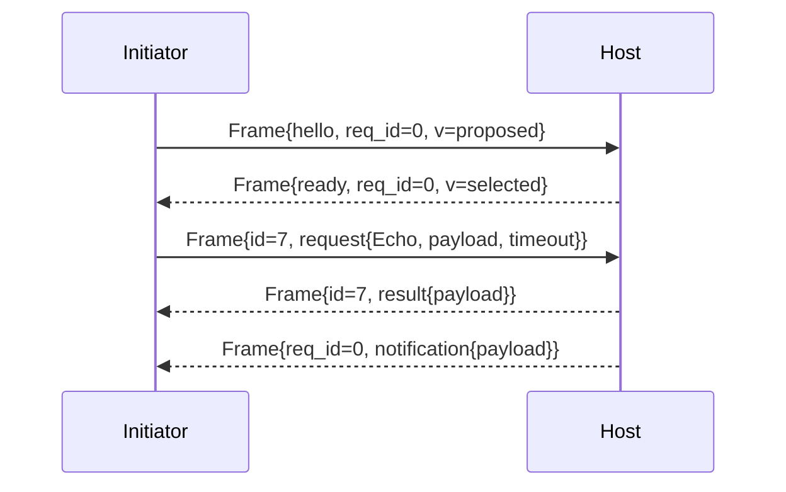

# Syntra v1 Core — Wire Envelope and Framing

- Identifier: `specifications/core/framing.md`
- Title: Transport-Independent Wire Envelope and Framing
- Status: Draft (pending maintainer approval via RFC)
- Version: 1.0.0-draft.1 (2026-10-19)
- Normative references: BCP 14; `proto/syntra/v1/envelope.proto` (`Frame`), `proto/syntra/v1/errors.proto`; `protocol.md`; `serialization.md`; `errors.md`; `handshake.md`; transport profile specs (forthcoming, own length-prefix/HTTP/WS bindings)
- Scope: The transport-independent `Frame` envelope: allowed variants, invalid combinations, unknown variants, validation, size, empty-payload rules. Byte-on-transport framing (how a serialized `Frame` is delimited per TCP/TLS/HTTP/WS) belongs to transport specs and is referenced, not defined, here.
- Terminology: Per `protocol.md`. **Envelope** = `Frame{version, request_id, body}`. **Variant** = one `oneof body` member. **Framing** = transport-specific delimiting of serialized envelopes.

The key words "MUST", "MUST NOT", etc. are per BCP 14.

## Accepted secure-record mapping

[RFC 0007](../../rfcs/0007-secure-channel-device-authorization.md)
keeps the `Frame` schema, validation and 1 MiB default envelope bound.
[Accepted carrier binding](../transports/noise-bindings.md) separate Noise
records from envelopes: the 65,535-byte ciphertext cap requires bounded
segmentation for large frames. Only complete reconstructed envelopes reach
the core. TCP lengths, WebSocket message boundaries and future UDP headers
are mapping concerns, not universal Protobuf fields or current support claims.

## 1. Protocol requirements (envelope)

**SNTR-WIRE-001** — Every Syntra unit on every transport MUST be exactly one serialized `Frame`. Implementations MUST NOT send bare `RpcRequest`/`RpcResult`/`Notification` without the envelope, and MUST NOT batch multiple `Frame`s inside one Protobuf message. Batching at the transport layer (e.g., multiple length-prefixed frames in one TCP segment) is framing, not envelope batching, and is governed by transport specs.

**SNTR-WIRE-002** — Allowed variants: `hello`, `ready`, `request`, `result`, `cancel`, `notification` — exactly one per `Frame`. Producers MUST set exactly one; the `oneof` MUST NOT be empty, and validators MUST enforce that. More than one occurrence of an alternative in the `Frame.body` oneof — including two occurrences of the same alternative — is a raw-wire validation failure rejected before decode semantics (target `INVALID_ARGUMENT`), per accepted [RFC 0008](../../rfcs/0008-mobile-lifecycle-and-v1-acceptance.md) D1 step 3 and `serialization.md` SNTR-SER-003: exactly one body is permitted.

**SNTR-WIRE-003** — Invalid combinations (MUST be rejected before any application effect):
- empty `body` (no variant);
- `request_id != 0` with `hello`, `ready`, or `notification` (these use `request_id == 0`; `hello`/`ready` are handshake-scoped, `notification` is uncorrelated);
- `request_id == 0` with `request`, `result`, or `cancel` (these are correlated);
- `result` without exactly one `outcome` (`payload` XOR `error`);
- `hello`/`ready` outside handshake states (see `handshake.md`);
- `request`/`cancel`/`notification` before ACTIVE.

**SNTR-WIRE-004** — Body-tag partition (accepted [RFC 0008](../../rfcs/0008-mobile-lifecycle-and-v1-acceptance.md) D1): field numbers 10..15 are the defined `Frame.body` alternatives; 16/17 are permanently forbidden (`reserved`; rejected `INVALID_ARGUMENT` in every `Frame`/body position per SNTR-SER-008); 18..31 are the future body space; fields outside 10..31 are ordinary unknown metadata, tolerated (ignored) only within the byte/depth limits of `serialization.md` SNTR-SER-003. A sole structurally valid body with a tag in 18..31 is a future-body variant: it MUST be rejected with `ERROR_CODE_UNIMPLEMENTED` if an RPC/connection context can carry the error, or with connection closure during handshake. The initiator treats an unknown future body as an unknown required feature, not an ignorable optional one; the variant MUST NOT be silently dropped or treated as success (SYN-ARCH-021). Unknown-body rejection never interacts silently with result delivery: `RpcResult.outcome` mirrors the same raw-occurrence policy per RFC 0008 D1 (multiple outcomes `INVALID_ARGUMENT`, future outcome `UNIMPLEMENTED`, no outcome `INVALID_ARGUMENT`).

**SNTR-WIRE-005** — Validation rules (in order): (1) Protobuf well-formedness + size/depth per `serialization.md`; (2) `version` equals negotiated version (post-handshake) or within `min/max` range (handshake); (3) `request_id` discipline per SNTR-WIRE-003; (4) variant-state legality per `handshake.md`; (5) per-variant semantic checks per `rpc.md`/`events.md`/`errors.md`. First failure determines the error; validation MUST complete before dispatch.

**SNTR-WIRE-006** — Maximum envelope size: `DEFAULT_MAX_FRAME_BYTES = 1 MiB` (1,048,576 bytes) of the complete serialized `Frame` — opaque payload plus envelope overhead (tags, lengths, version, correlation, method and budget fields) — unless a transport profile or an explicitly accepted profile contract states a different bound. Exactly 1,048,576 encoded bytes is within the default bound; 1,048,577 (MAX+1) is rejected before dispatch. A payload alone at 1 MiB does not fit the default envelope; no accepted fixture silently raises this ceiling (resolves RFC 0001 B8 per accepted [RFC 0005](../../rfcs/0005-negotiation-bounds-identifiers.md) D3). Unknown well-formed fields count toward the encoded size even when ignored semantically. Envelopes exceeding the bound MUST be rejected with `RESOURCE_EXHAUSTED` (or connection closure if unbounded pre-handshake). Bounds MUST be documented per deployment; insecure/offline profiles MUST NOT silently raise them.

**SNTR-WIRE-007** — Empty payload handling: `payload` fields are `bytes`; empty (zero-length) is valid and meaningful. `RpcRequest.payload == ""` invokes the method with empty input; `RpcResult.payload == ""` (with `outcome=payload` set) explicitly means success with empty output — it MUST NOT be confused with unset `outcome`. `Notification.payload == ""` is a valid empty event. Presence is determined by `oneof`/field presence, never by length.

**SNTR-WIRE-008** — Reserved values: field numbers 16, 17 and names `event`, `resume`, `ack` MUST NOT be emitted or accepted; receipt of a reserved number MUST be treated as malformed per SNTR-SER-008.

## 2. Client behavior

- **SNTR-WIRE-010** — The client MUST set `version` to the negotiated version after handshake (proposed range before), MUST use nonzero connection-scoped `request_id` values in strictly increasing request-Frame emission order (gaps allowed), and MUST NOT reuse a request ID on that connection for any reason — never after a terminal `result`, timeout, cancellation, overload rejection, successful completion, or arbitrarily long idle; allocated, skipped, and retired IDs stay retired (accepted [RFC 0004](../../rfcs/0004-correlation-identity-carriage.md) §3 D1). `request_id == 0` remains reserved for handshake/uncorrelated frames. The client MUST enforce SNTR-WIRE-006 on receive before parsing fully.
- **SNTR-WIRE-011** — The client MUST reject variant/state violations locally (e.g., `notification` before ACTIVE) per §1 without invoking application callbacks except to report the error. A `result` `Frame` is decoded only for correlation by the RPC layer: a result for an ID the initiator does not track is ignored with a diagnostic and MUST NOT fail the connection (late/unknown result; correlation, terminal-selection and race rules are owned by `rpc.md` per [accepted RFC 0004](../../rfcs/0004-correlation-identity-carriage.md)).

## 3. Server behavior

- **SNTR-WIRE-020** — The server MUST apply identical validation, MUST enforce max concurrent envelopes/RPCs (see `reliability.md`), and MUST NOT dispatch handlers for envelopes failing §1.
- **SNTR-WIRE-021** — The server MUST set `version` to the selected version in every post-handshake envelope and MUST NOT change it mid-connection.

## 4. Failure handling

Framing-layer failures (oversize, empty body, unknown variant, version mismatch) are terminal for the affected RPC; duplicate/out-of-order/reused nonzero `request_id` values are a connection violation per accepted [RFC 0004](../../rfcs/0004-correlation-identity-carriage.md) §3 D2 — ordered admission fails, no result is emitted under the offending ID, and the connection terminates through the native close signal with a local `FAILED_PRECONDITION` cause (remaining in-flight calls fail `UNAVAILABLE` under the connection-loss rule); handshake-phase failures are terminal for the connection (see `handshake.md`). Errors use `errors.md` codes: `INVALID_ARGUMENT` (shape), `FAILED_PRECONDITION` (state), `UNIMPLEMENTED` (unknown variant), `RESOURCE_EXHAUSTED` (size/concurrency), `UNAUTHENTICATED` (pre-ready access).

## 5. Security considerations

Size caps and ordered validation are DoS boundaries. Validators MUST bound before allocating; MUST NOT echo raw envelope bytes in errors; MUST NOT treat `connection_id` or `request_id` as authenticators.

## 6. Compatibility considerations

Envelope shape evolves only via minor additive variants (new OPTIONAL `oneof` member + capability, allocated from the 18..31 future-body space) or major version (any incompatible change). Field order on the wire is insignificant; implementations MUST NOT depend on it (non-canonical serialization). Reserved numbers 16/17 are not freed: no wire change ever reuses them without a major-version RFC (they are reserved, per `versioning.md` SNTR-VER-005; accepted RFC 0008 D1 treats them as permanently forbidden in the v1 body space).

## 7. Conformance requirements

- **SNTR-WIRE-900** — Fixtures: one valid frame per variant; empty-body rejection; zero/nonzero `request_id` misuse matrix; unknown-variant rejection; oversize rejection at exactly MAX+1; empty-payload round-trip (request/result/notification); reserved-number rejection; version-mismatch handling.
- **SNTR-WIRE-901** — Transport-independence proof: the same logical `Frame` sequence MUST interoperate over at least two transport profiles with only adapter changes.

