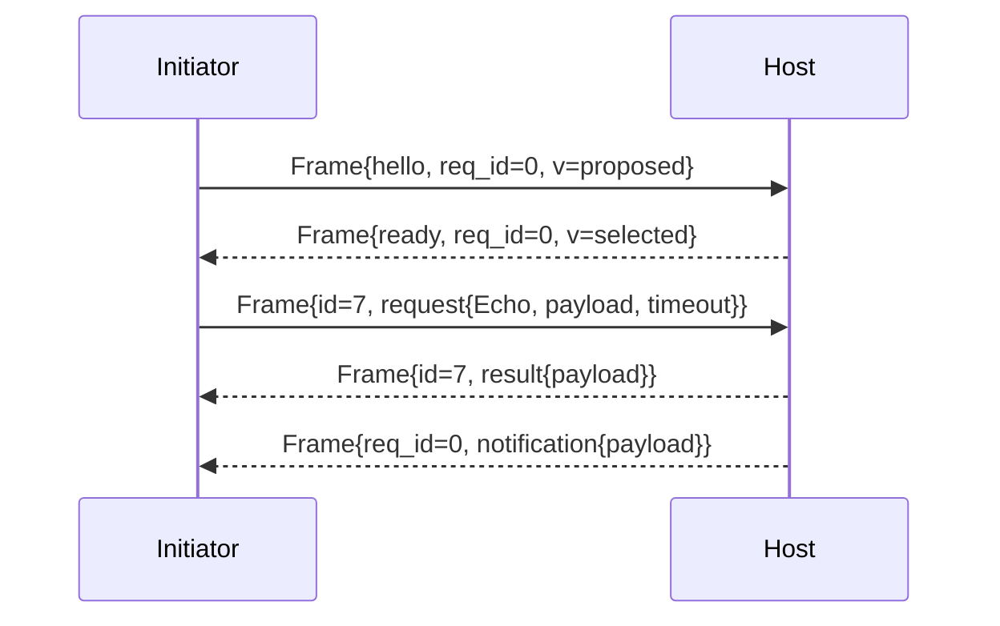

# Syntra v1 Core — Wire Envelope and Framing

- Identifier: `specifications/core/framing.md`
- Title: Transport-Independent Wire Envelope and Framing
- Status: Draft (pending maintainer approval via RFC)
- Version: 1.0.0-draft.1 (2026-10-19)
- Normative references: BCP 14; `proto/syntra/v1/envelope.proto` (`Frame`), `proto/syntra/v1/errors.proto`; `protocol.md`; `serialization.md`; `errors.md`; `handshake.md`; transport profile specs (forthcoming, own length-prefix/HTTP/WS bindings)
- Scope: The transport-independent `Frame` envelope: allowed variants, invalid combinations, unknown variants, validation, size, empty-payload rules. Byte-on-transport framing (how a serialized `Frame` is delimited per TCP/TLS/HTTP/WS) belongs to transport specs and is referenced, not defined, here.
- Terminology: Per `protocol.md`. **Envelope** = `Frame{version, request_id, body}`. **Variant** = one `oneof body` member. **Framing** = transport-specific delimiting of serialized envelopes.

The key words "MUST", "MUST NOT", etc. are per BCP 14.

## 1. Protocol requirements (envelope)

**SNTR-WIRE-001** — Every Syntra unit on every transport MUST be exactly one serialized `Frame`. Implementations MUST NOT send bare `RpcRequest`/`RpcResult`/`Notification` without the envelope, and MUST NOT batch multiple `Frame`s inside one Protobuf message. Batching at the transport layer (e.g., multiple length-prefixed frames in one TCP segment) is framing, not envelope batching, and is governed by transport specs.

**SNTR-WIRE-002** — Allowed variants: `hello`, `ready`, `request`, `result`, `cancel`, `notification` — exactly one per `Frame`. Producers MUST set exactly one; the `oneof` MUST NOT be empty and MUST NOT contain more than one member (Protobuf enforces the latter; validators MUST enforce the former).

**SNTR-WIRE-003** — Invalid combinations (MUST be rejected before any application effect):
- empty `body` (no variant);
- `request_id != 0` with `hello`, `ready`, or `notification` (these use `request_id == 0`; `hello`/`ready` are handshake-scoped, `notification` is uncorrelated);
- `request_id == 0` with `request`, `result`, or `cancel` (these are correlated);
- `result` without exactly one `outcome` (`payload` XOR `error`);
- `hello`/`ready` outside handshake states (see `handshake.md`);
- `request`/`cancel`/`notification` before ACTIVE.

**SNTR-WIRE-004** — Unknown variants: a `Frame` whose `body` decodes to an unrecognized variant (future `oneof` member, or unknown field masquerading as body) MUST be rejected with `ERROR_CODE_UNIMPLEMENTED` if an RPC/connection context can carry the error, or with connection closure during handshake. It MUST NOT be silently dropped or treated as success (SYN-ARCH-021).

**SNTR-WIRE-005** — Validation rules (in order): (1) Protobuf well-formedness + size/depth per `serialization.md`; (2) `version` equals negotiated version (post-handshake) or within `min/max` range (handshake); (3) `request_id` discipline per SNTR-WIRE-003; (4) variant-state legality per `handshake.md`; (5) per-variant semantic checks per `rpc.md`/`events.md`/`errors.md`. First failure determines the error; validation MUST complete before dispatch.

**SNTR-WIRE-006** — Maximum envelope size: DEFAULT_MAX_FRAME_BYTES = 1 MiB (1,048,576 bytes) of serialized `Frame`, unless a transport profile or negotiated capability states a different bound. Envelopes exceeding the bound MUST be rejected with `RESOURCE_EXHAUSTED` (or connection closure if unbounded pre-handshake). Bounds MUST be documented per deployment; insecure/offline profiles MUST NOT silently raise them.

**SNTR-WIRE-007** — Empty payload handling: `payload` fields are `bytes`; empty (zero-length) is valid and meaningful. `RpcRequest.payload == ""` invokes the method with empty input; `RpcResult.payload == ""` (with `outcome=payload` set) explicitly means success with empty output — it MUST NOT be confused with unset `outcome`. `Notification.payload == ""` is a valid empty event. Presence is determined by `oneof`/field presence, never by length.

**SNTR-WIRE-008** — Reserved values: field numbers 16, 17 and names `event`, `resume`, `ack` MUST NOT be emitted or accepted; receipt of a reserved number MUST be treated as malformed per SNTR-SER-008.

## 2. Client behavior

- **SNTR-WIRE-010** — The client MUST set `version` to the negotiated version after handshake (proposed range before), use nonzero unique `request_id` per concurrent RPC (MAY reuse after terminal `result`), `request_id == 0` only for handshake/uncorrelated frames, and MUST enforce SNTR-WIRE-006 on receive before parsing fully.
- **SNTR-WIRE-011** — The client MUST reject variant/state violations locally (e.g., `result` for unknown `request_id`, `notification` before ACTIVE) per §1 without invoking application callbacks except to report the error.

## 3. Server behavior

- **SNTR-WIRE-020** — The server MUST apply identical validation, MUST enforce max concurrent envelopes/RPCs (see `reliability.md`), and MUST NOT dispatch handlers for envelopes failing §1.
- **SNTR-WIRE-021** — The server MUST set `version` to the selected version in every post-handshake envelope and MUST NOT change it mid-connection.

## 4. Failure handling

Framing-layer failures (oversize, empty body, correlation misuse, unknown variant, version mismatch) are terminal for the affected RPC; handshake-phase failures are terminal for the connection (see `handshake.md`). Errors use `errors.md` codes: `INVALID_ARGUMENT` (shape), `FAILED_PRECONDITION` (state), `UNIMPLEMENTED` (unknown variant), `RESOURCE_EXHAUSTED` (size/concurrency), `UNAUTHENTICATED` (pre-ready access).

## 5. Security considerations

Size caps and ordered validation are DoS boundaries. Validators MUST bound before allocating; MUST NOT echo raw envelope bytes in errors; MUST NOT treat `connection_id` or `request_id` as authenticators.

## 6. Compatibility considerations

Envelope shape evolves only via minor additive variants (new OPTIONAL `oneof` member + capability) or major version (any incompatible change). Field order on the wire is insignificant; implementations MUST NOT depend on it (non-canonical serialization).

## 7. Conformance requirements

- **SNTR-WIRE-900** — Fixtures: one valid frame per variant; empty-body rejection; zero/nonzero `request_id` misuse matrix; unknown-variant rejection; oversize rejection at exactly MAX+1; empty-payload round-trip (request/result/notification); reserved-number rejection; version-mismatch handling.
- **SNTR-WIRE-901** — Transport-independence proof: the same logical `Frame` sequence MUST interoperate over at least two transport profiles with only adapter changes.

