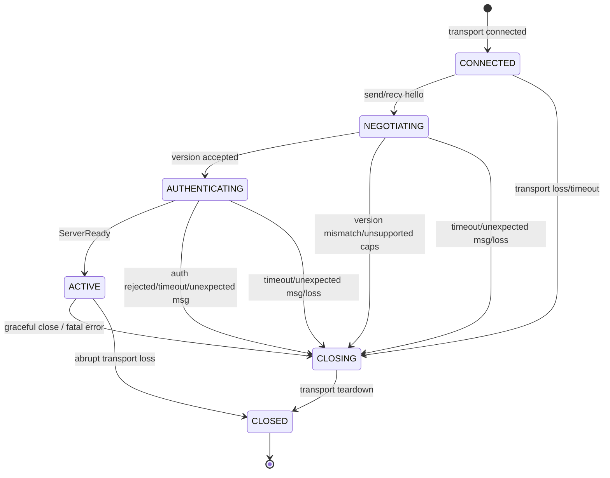
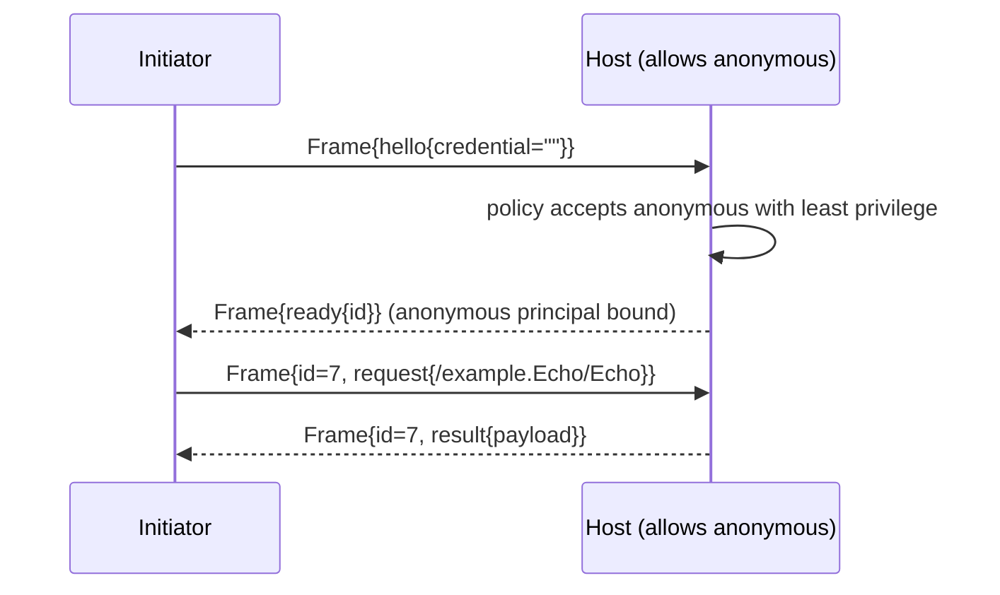
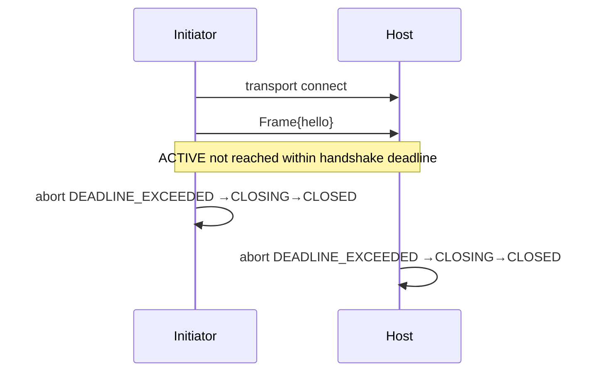

# Syntra v1 Core — Handshake and Connection Establishment

- Identifier: `specifications/core/handshake.md`
- Title: Handshake, Version Negotiation, and Connection State Machine
- Status: Draft (pending maintainer approval via RFC)
- Version: 1.0.0-draft.1 (2026-10-19)
- Normative references: BCP 14; `proto/syntra/v1/envelope.proto` (`Frame`), `proto/syntra/v1/handshake.proto` (`ClientHello`, `ServerReady`); `protocol.md`; `framing.md` (SNTR-WIRE-*); `authentication.md`; `errors.md`; `capabilities.md`; transport specs (connection binding, timeouts)
- Scope: The transport-independent handshake: version negotiation, authentication initiation, state machine CONNECTED→NEGOTIATING→AUTHENTICATING→ACTIVE→CLOSING→CLOSED, success/failure transitions, timeouts, and close semantics. Credential validation policy belongs to `authentication.md`; byte-on-transport binding belongs to transport specs.
- Terminology: Per `protocol.md`. **Handshake** = exchange of `hello`→`ready`/error establishing version + authentication before ACTIVE.

The key words "MUST", "MUST NOT", etc. are per BCP 14.

## Accepted SC1 channel-establishment boundary

[RFC 0007](../../rfcs/0007-secure-channel-device-authorization.md) adds the
accepted SC1 channel phase before Syntra `CONNECTED`, with its own absolute
establishment and total-attempt budgets. Both Noise payloads are empty. The
client verifies the second message before sending an encrypted `hello`; the
host verifies fresh client transport traffic and current enrollment policy
before `ready` or protected effects. The first authenticated envelope is
exactly one complete framed `ClientHello`. No early RPCs or new core
state/variant are implied. The existing state machine below is unchanged.
Numeric channel budgets and the trusted authentication-context API are
implementation and release work, not acceptance blockers; RFC 0007 has accepted
the SC1 contract.

## 1. State machine



**SNTR-HS-001** — Implementations MUST implement exactly these six states with the transitions above. No other state and no shortcut (e.g., CONNECTED→ACTIVE) is permitted.

**SNTR-HS-002** — `CONNECTED`: transport is up, no Syntra bytes exchanged. Peers MUST start the core handshake timer (default 5 s unless a transport profile states otherwise) when its transport's establishment completes: established TCP for TCP; successfully completed and verified TLS for TLS/TCP; a validated Upgrade for WS; verified TLS plus a validated Upgrade for WSS (accepted [RFC 0003](../../rfcs/0003-handshake-failure-signaling.md) D4). The timer runs continuously through negotiation and authentication until ACTIVE or failure and MUST NOT reset on partial input or state changes; slow trickles do not extend the absolute deadline. Each endpoint measures its own boundary; synchronized clocks are unnecessary. Transport/Upgrade setup has its own separate bounded, documented establishment budget owned by the transport/SC1 specs — a setup timeout is a setup failure reporting its phase, never a Syntra handshake that never began.

**SNTR-HS-003** — `NEGOTIATING`: initiator has sent `Frame{hello{min_version,max_version,credential}, request_id=0, version=max_version}`. Host MUST validate version range first, before credential semantics: if no overlap with host-supported versions → handshake failure with detecting-side cause `UNIMPLEMENTED` + close (accepted RFC 0003 D3; no wire error Frame is sent — see §5). Capabilities are never negotiated through `ClientHello` extensions: optional capability finalization happens only post-`ACTIVE` through each profile's accepted contract (accepted RFC 0005 D1), and `ClientHello` carries no capability semantics.

**SNTR-HS-004** — `AUTHENTICATING`: version agreed; host evaluates credential per `authentication.md`. Success → `Frame{ready{connection_id}, request_id=0, version=selected}` and →ACTIVE. Failure → terminal handshake failure (detecting side records the §5 cause; the peer sees only the native signal per accepted RFC 0003 D1) + →CLOSING. `connection_id` MUST be opaque, single-connection scoped, and MUST NOT be an auth session ID (ADR-005).

**SNTR-HS-005** — `ACTIVE`: application RPCs, cancellation, and (if negotiated) notifications permitted. Version is fixed to selected version for the connection lifetime.

**SNTR-HS-006** — `CLOSING`: graceful close in progress (close frame/error + transport teardown per profile). No new RPCs; in-flight RPCs receive `UNAVAILABLE` or `CANCELLED`. `CLOSED`: transport released; all per-connection state discarded except diagnostics.

## 1A. Suggested-name mapping (informative; not new states)

The task glossary suggests `DISCONNECTED`, `TRANSPORT_ESTABLISHED`, and `ERROR`. Under the approved six-state machine (SNTR-HS-001) they map as follows and MUST NOT be treated as additional wire states:

- `DISCONNECTED` (suggested) = no transport yet. This is outside Syntra: no Syntra messages are legal, nothing is validated, and no session exists. The entry point to the protocol is `CONNECTED` once transport is up (SNTR-HS-002).
- `TRANSPORT_ESTABLISHED` (suggested) = `CONNECTED`. Transport is up, no Syntra bytes exchanged, handshake timer runs per SNTR-HS-002.
- `ERROR` (suggested) is NOT an externally observable Syntra state. A failure is reported locally to the detecting side with the typed cause from §5, while the peer observes only the transport-native signal (SNTR-ERR-004, accepted RFC 0003 D1); the connection moves to `CLOSING` then `CLOSED` (SNTR-HS-006). There is no transition out of an error back to `ACTIVE` on the same connection, and no wire-visible `ERROR` state peers can negotiate. Implementations MAY retain internal diagnostics after `CLOSED` but MUST NOT expose them as a resumable protocol state.

Introducing a wire-visible `ERROR` state or splitting `CONNECTED` would alter the state machine and is therefore major per SNTR-VER-003. It is proposed for discussion in `rfcs/0002-auth-session-lifecycle.md`, not decided here.

## 1B. Complete transition table (clarifies SNTR-HS-001…006/012/040)

`ProtocolError` below means the detecting side's locally recorded typed handshake causes per the §5 table (SNTR-ERR-004). Per accepted [RFC 0003](../../rfcs/0003-handshake-failure-signaling.md) D1, there is no pre-`ACTIVE` error `Frame` carrier: implementations MUST deliver the cause locally, close the connection, and MUST NOT invent a zero-`request_id` `result`, an error-bearing `ready`, or a second `hello` to carry it; the peer learns only via the transport-native signal. `Resumable` is `No` by default (SNTR-SESS-003); `Yes` only where a negotiated resumption capability both exists and is confirmed per SNTR-SESS-006 (no such capability exists in default v1).

| Current state | Received | Expected behavior | Initiated by | Timeout | ProtocolError first? | Transport open? | Session resumable? |
|---|---|---|---|---|---|---|---|
| (none) | transport down | No Syntra processing; nothing legal | — | — | No | No | No |
| CONNECTED | transport loss / handshake timer expiry | →CLOSING→CLOSED; `UNAVAILABLE`/`DEADLINE_EXCEEDED` to waiters (SNTR-HS-002/011/014) | either (loss) / local timer | handshake deadline | No (no peer context) | Closes | No |
| CONNECTED | first `hello` (well-formed) | →NEGOTIATING (SNTR-HS-003) | initiator | timer continues | No | Yes | No |
| CONNECTED | `ready` / `request` / `result` / `cancel` / `notification` / unknown variant | Protocol violation; detecting side records `FAILED_PRECONDITION` (`UNIMPLEMENTED` for unknown variant), discards without delivery, and enters CLOSING/CLOSED; no dispatch, queueing, or subscription state (SNTR-HS-012, SNTR-WIRE-004; RFC 0003 D2) | either peer detects | — | Yes | Closes | No |
| NEGOTIATING | version overlap found | →AUTHENTICATING; evaluate credential next (SNTR-HS-003/004) | host | timer continues | No | Yes | No |
| NEGOTIATING | version mismatch / required capability unsupported | Handshake failure with detecting-side `UNIMPLEMENTED` + →CLOSING (SNTR-HS-003; RFC 0003 D3) | host | — | Yes | Closes | No |
| NEGOTIATING | second `hello` / `ready` / `request` / `result` / `cancel` / `notification` / unknown variant | Protocol violation; detecting side records `FAILED_PRECONDITION` (`UNIMPLEMENTED` for unknown variant) and proceeds to CLOSING/CLOSED without delivery (SNTR-HS-012; RFC 0003 D2) | either peer detects | — | Yes | Closes | No |
| NEGOTIATING | transport loss / timer expiry | →CLOSING→CLOSED; `UNAVAILABLE`/`DEADLINE_EXCEEDED` (SNTR-HS-011/014) | either / local | handshake deadline | No | Closes | No |
| AUTHENTICATING | credential accepted | Emit one `ready{connection_id}` (`request_id=0`, `version=selected`) →ACTIVE (SNTR-HS-004) | host | timer stops at ACTIVE | No | Yes | No (session=connection) |
| AUTHENTICATING | credential rejected / timeout / unexpected message / oversize hello | Handshake failure per §5 table + →CLOSING (SNTR-HS-004/011/012) | host detects (timeout either) | handshake deadline | Yes | Closes | No |
| AUTHENTICATING | transport loss | →CLOSING→CLOSED; `UNAVAILABLE` to waiters (SNTR-HS-014) | either | — | No | Closes | No |
| ACTIVE | `request` (valid, authorized) | Dispatch; exactly one terminal `result` (SNTR-RPC-002/006/030) | initiator | per-RPC deadline | No (terminal result, not a handshake-phase failure) | Yes | No |
| ACTIVE | `cancel` (outstanding ID) | Best-effort cancel; terminal `result` still follows (SNTR-RPC-005) | initiator | per-RPC deadline | No | Yes | No |
| ACTIVE | `notification` (host→initiator) | Deliver as event; never completes an RPC (SNTR-EVENT-005) | host | — | No | Yes | No |
| ACTIVE | `hello` / `ready` (either direction) | Protocol violation `FAILED_PRECONDITION` + →CLOSING (SNTR-HS-012) | either peer detects | — | Yes | Closes | No |
| ACTIVE | `result` for unknown ID | Locally ignore + diagnostic; no error storm (SNTR-RPC-§4) | local | — | No | Yes | No |
| ACTIVE | unknown variant / oversize / malformed | `UNIMPLEMENTED` / `RESOURCE_EXHAUSTED` / `INVALID_ARGUMENT`; connection closes only if exhausted/misbehaving per SNTR-ASEC-020/SNTR-REL-007 (SNTR-WIRE-004/006) | either peer detects | — | Where RPC context exists | Per policy | No |
| ACTIVE | graceful close initiated | Stop new RPCs; grace period per transport profile; →CLOSING→CLOSED; in-flight get `UNAVAILABLE`/`CANCELLED` (SNTR-HS-006/013) | either | close grace | No | Closes after grace | No |
| ACTIVE | abrupt transport loss | →CLOSED; `UNAVAILABLE` to all in-flight RPCs, outcome unknown (SNTR-HS-014, SNTR-REL-009) | either (loss) | — | No | No | No |
| CLOSING | any further `request` / new work | Rejected; no new RPCs (SNTR-HS-006/013) | local | close grace | No | Closing | No |
| CLOSING | transport teardown complete | →CLOSED; discard per-connection state except diagnostics (SNTR-HS-006) | either | — | No | No | No |

Re-handshake on the same transport instance is forbidden in every failure row (SNTR-HS-040); a new transport connection is REQUIRED.

## 2. Protocol requirements

**SNTR-HS-010** — When version agreement exists, the selected version MUST be the highest version in the intersection of initiator range and host support. `Frame.version` pre-handshake is the initiator's max; post-handshake it MUST equal the selected version.

**SNTR-HS-011** — Handshake timeout: if ACTIVE is not reached within the handshake deadline, the waiting peer MUST abort with `DEADLINE_EXCEEDED` and →CLOSING. The deadline MUST be bounded and documented.

**SNTR-HS-012** — Unexpected messages: any `request`/`result`/`cancel`/`notification` received in CONNECTED/NEGOTIATING/AUTHENTICATING, or a second `hello`, or `ready` received by the host, is a protocol violation → handshake failure with the detecting-side cause from §5 (`FAILED_PRECONDITION` for wrong-state frames; `UNIMPLEMENTED` for unknown variants) →CLOSING→CLOSED. The detecting endpoint discards the offending frame without application delivery or subscription state; the peer observes only the transport-native signal per §5 (accepted RFC 0003 D1/D2 — no error Frame, zero-ID result, error-bearing `ready`, or second `hello` is ever sent).

**SNTR-HS-013** — Graceful close from ACTIVE: either peer MAY initiate close; the initiator MUST stop new RPCs, allow a close grace period per transport profile, then teardown →CLOSING→CLOSED.

**SNTR-HS-014** — Unexpected transport loss at any state MUST be surfaced as `UNAVAILABLE` to affected RPCs and as connection closure; it MUST NOT be reported as application success (SNTR-CORE-005).

## 2A. Handshake ordering (clarifies SNTR-HS-003/004/010/020, SNTR-AUTH-003, SNTR-CAP-002, SNTR-SESS-001/002)

1. **Who sends `ClientHello`**: the initiator only, exactly once, as the first Syntra envelope (SNTR-CORE-010, SNTR-HS-020). The host MUST NOT send `hello` and MUST NOT accept a second `hello` (SNTR-HS-012).
2. **`ServerHello` does not exist in v1.** The host emits exactly one terminal outcome per connection (SNTR-CORE-020, SNTR-HS-004/030): `ServerReady` on success, or a native transport rejection (detecting side records the §5 cause; no error Frame) on failure. A wire `ServerHello` would be an unknown variant and MUST be rejected per SNTR-WIRE-004.
3. **Version final**: at host selection of the highest overlap (SNTR-HS-010). Every post-handshake `Frame.version` MUST equal the selected version (SNTR-WIRE-021, SNTR-HS-005).
4. **Capability final**: there is no v1 capability-negotiation binding, so mandatory-only operation is the interoperable outcome by default (SNTR-CAP-002/003). An optional capability is final only where its RFC defines an explicit binding and both peers confirm it; unconfirmed use MUST fail per SNTR-CAP-011. Accepted RFC 0005 D1 binds post-ACTIVE profile negotiation to each profile's accepted contract; there is no generic core enumeration in v1.
5. **Authentication starts**: with the `hello` credential presentation (SNTR-AUTH-003); the host evaluates it after version acceptance (SNTR-HS-004). Follow-up rounds, if any mechanism needs them, use application RPCs after `ACTIVE`, never new pre-`ACTIVE` frames (SNTR-AUTH-004).
6. **Anonymous operations**: empty credential is a valid anonymous attempt on the wire (SNTR-AUTH-003); acceptance is host policy. An accepted anonymous attempt binds an anonymous principal with least privilege — it does not bypass authorization for protected operations (SNTR-AUTH-005/007, SNTR-ASEC-022).
7. **Session identifier assigned**: never in v1. There is no session identifier; `connection_id` in `ServerReady` is a per-connection diagnostic that MUST NOT be used as a session handle (SNTR-SESS-002).
8. **Application RPC legal**: only in `ACTIVE` (SNTR-HS-005, SNTR-WIRE-003, SNTR-RPC-030).
9. **Events legal**: host→initiator `notification` only in `ACTIVE` (SNTR-HS-005, SNTR-EVENT-005). Pre-`ACTIVE` notification is fail-close on both ends (accepted RFC 0003 D2): the sender sending it before `ACTIVE` is a host violation, and a receiver detecting `notification` in CONNECTED/NEGOTIATING/AUTHENTICATING MUST record a local `FAILED_PRECONDITION`, discard it without application delivery, and proceed to CLOSING→CLOSED; it MUST NOT queue the event for later delivery nor treat it as establishing a subscription (SNTR-HS-012, `events.md` SNTR-EVENT-005).
10. **Failed negotiation terminator**: the detecting endpoint records the typed §5 cause and closes; the peer learns only via the transport-native signal (accepted RFC 0003 D1). Implementations MUST NOT emit a zero-`request_id` `result`, an error-bearing `ready`, a second `hello`, or any invented error record to carry a handshake failure (SNTR-HS-040, SNTR-ERR-004).

```mermaid
sequenceDiagram
  participant C as Initiator
  participant H as Host
  C->>H: transport connect (CONNECTED)
  C->>H: Frame{v=max, req=0, hello{range, cred}} (NEGOTIATING)
  H->>H: select highest overlap → AUTHENTICATING
  H->>H: validate credential, bind principal
  H-->>C: Frame{v=selected, req=0, ready{id}} (ACTIVE)
  Note over C,H: No ServerHello exists; version is Frame.version
```



```mermaid
sequenceDiagram
  participant C as Initiator[1..2]
  participant H as Host[1]
  C->>H: Frame{hello{min=1,max=2}}
  H->>H: no overlap
  H-->>C: native transport close/status (no error Frame)
  Note over C,H: H records local UNIMPLEMENTED; →CLOSING→CLOSED; new transport required (RFC 0003)
```

```mermaid
sequenceDiagram
  participant C as Initiator
  participant H as Host
  C->>H: Frame{hello} (requires capability resume/1)
  H-->>C: native close/status (no error Frame; local UNIMPLEMENTED at detect)
  Note over C,H: Required-but-unsupported → failure; unknown optional advertisement alone MUST NOT fail (SNTR-CAP-004)
```

```mermaid
sequenceDiagram
  participant C as Initiator
  participant H as Host
  C->>H: Frame{hello{credential=bad}}
  H->>H: shape ok → policy denies
  H-->>C: native close/status, no authentication sub-reason (detecting side records UNAUTHENTICATED/PERMISSION_DENIED)
  Note over C,H: No reason oracle; no credential in message (SNTR-ASEC-011)
```



```mermaid
sequenceDiagram
  participant C as Initiator
  participant H as Host
  C->>H: transport connect
  C--xH: transport disconnects during NEGOTIATING/AUTHENTICATING
  C->>C: report UNAVAILABLE to waiters; discard state
  H->>H: report UNAVAILABLE to waiters; discard state
  Note over C,H: Reconnect means a new handshake; no resumption by default
```

## 2B. Reliable-session attachment (OPTIONAL, no state-machine change)

**SNTR-HS-015** — Reliable-session attachment is post-`ACTIVE` generic-RPC control under `syntra.reliable-session/1` and changes no state, transition, or timer in §1/§1B/§2A. The six-state machine, version negotiation, and handshake deadlines are untouched. Attachment (new or resumed with a resume handle, plus lease proposal/confirmation per SNTR-SESS-031/033) runs only in `ACTIVE` after the capability is confirmed; pre-`ACTIVE` session control MUST fail per §1B (handshake failure, no resumption). Fencing, revocation, idle expiry, and drain signals (SNTR-SESS-031/032/034) close or fence the attachment's connection but never add, remove, or reorder handshake states. Transport profiles MUST NOT bind session attachment to transport establishment; only a completed `hello`→`ready` establishes the principal binding that attachment then references.

## 3. Client behavior

- **SNTR-HS-020** — The client MUST send exactly one `hello` with `min_version ≤ max_version`, both nonzero, and MUST NOT send application frames before receiving `ready`. On handshake error the detecting side MUST record the locally typed cause per §5; the peer learns only via the transport-native signal (per the §5 native-signal table, accepted RFC 0003 D1): no error Frame, no zero-ID result, no error-bearing `ready`, no second `hello` is ever sent. The client MUST NOT retry with downgraded versions automatically unless the application explicitly re-negotiates, and MUST close the transport.
- **SNTR-HS-021** — The client MUST enforce the handshake timer and MUST treat timeout as failure, not as implicit success.

## 4. Server behavior

- **SNTR-HS-030** — The server MUST validate `hello` shape (range, size bounds per SNTR-SER-006) before policy evaluation, MUST select or reject deterministically, and MUST emit exactly one terminal handshake outcome.
- **SNTR-HS-031** — The server MUST enforce concurrent-handshake caps and handshake rate limits; excess MUST be rejected with `RESOURCE_EXHAUSTED` + close (see `reliability.md`).

## 5. Failure handling

**SNTR-HS-040** — Handshake failures are terminal for the connection. Re-handshake on the same transport instance is forbidden; a new transport connection is REQUIRED.

Per accepted [RFC 0003](../../rfcs/0003-handshake-failure-signaling.md) D1, failures are reported on two axes only: the detecting side records the locally typed cause below; the peer observes only the transport-native signal and may conclude only what that signal supports (a generic close does NOT reveal the host's precise rejection cause). The table mirrors the RFC 0003 §4 native-signal mapping; the transport profiles own their concrete close/status bindings.

| Detecting-side condition | Local mechanism/cause | Transition | Peer-native signal | What the peer may conclude |
|---|---|---|---|---|
| TCP/TLS handshake rejection (version mismatch, unsupported capability, state violation, auth rejection, oversize/malformed hello) | Applicable typed cause from this table at the detecting side | →CLOSING | TCP close; TLS shutdown where possible | Attempt ended; `UNAVAILABLE` absent better local evidence; not the precise rejection cause |
| HTTP/HTTPS no version overlap | `UNIMPLEMENTED` | →CLOSING | `400`, no Syntra envelope | Local binding failure `INVALID_ARGUMENT` per SNTR-HTTP-041; not proof of a particular host cause |
| HTTP/HTTPS malformed binding | `INVALID_ARGUMENT` | →CLOSING | `400`, no Syntra envelope | Local binding failure `INVALID_ARGUMENT`; not proof of a particular host cause |
| HTTP/HTTPS authentication rejection | `UNAUTHENTICATED` / `PERMISSION_DENIED` | →CLOSING | `401` or `403`, no Syntra envelope | Generic adapter report, without an authentication sub-reason |
| WS/WSS version/state/unknown-variant failure after Upgrade | `UNIMPLEMENTED` / `FAILED_PRECONDITION` | →CLOSING | Close `1002` | Generic protocol rejection, not which cause/code occurred |
| WS/WSS authentication rejection | `UNAUTHENTICATED` / `PERMISSION_DENIED` | →CLOSING | Close `1008` | Generic policy rejection, not credential validity or denial sub-reason |
| WS/WSS oversized message | `RESOURCE_EXHAUSTED` | →CLOSING | Close `1009` | Message-size rejection, no echoed input |
| WS/WSS core handshake deadline | `DEADLINE_EXCEEDED` (locally expired timer only) | →CLOSING | Close `1001` | Going away/attempt ended; only the locally expired timer establishes deadline cause |
| Unexpected transport loss at any phase | `UNAVAILABLE` (to affected local waiters) | →CLOSED | None if transport is gone | Failure with no inferred remote verdict |

## 6. Security considerations

`hello` arrives unauthenticated: parsers MUST bound and validate before any policy lookup to avoid oracle/DoS. Credentials MUST follow `authentication.md` transport rules (secure transports in production). `connection_id` MUST be unguessable (≥128-bit entropy) and MUST NOT encode principal or session information.

## 7. Compatibility considerations

Version negotiation is the only wire-version mechanism. Adding handshake fields is minor-additive; changing state semantics is major. Transport profiles MUST NOT alter this state machine, only bind timers and close bytes.

## 8. Conformance requirements

- **SNTR-HS-900** — Fixtures: success; version mismatch (low/high/disjoint); unsupported required capability; auth reject; timeout; unexpected `request` during NEGOTIATING; second `hello`; pre-ACTIVE `notification`; graceful close; abrupt loss in each state. Each MUST yield the tabled detecting-side cause/transition, and the failure fixtures MUST additionally assert that no error `Frame` (zero-ID `result`, error-bearing `ready`, second `hello`) crosses the wire — the peer's report is the native signal only (accepted RFC 0003).
- **SNTR-HS-902** — Reliable-session attachment fixture (OPTIONAL, gated): pre-`ACTIVE` session control fails per §1B; post-`ACTIVE` attach/resume advances epoch without state-machine change. `CONF-RS-001`.
- **SNTR-HS-901** — Sequence proof:

```mermaid
sequenceDiagram
  participant C as Initiator
  participant H as Host
  C->>H: transport connect (CONNECTED)
  C->>H: Frame{hello} (NEGOTIATING)
  H->>H: version check (AUTHENTICATING)
  alt accept
    H-->>C: Frame{ready} (ACTIVE)
  else reject/timeout/mismatch
    H-->>C: native close/status (CLOSING; no error Frame)
  end
```
