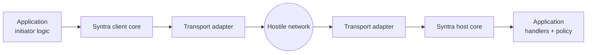

# Syntra v1 Core Protocol — General Model

- Identifier: `specifications/core/protocol.md`
- Title: General Protocol Model
- Status: Draft (pending maintainer approval via RFC)
- Version: 1.0.0-draft.1 (2026-10-19)
- Normative references:
  - BCP 14 / RFC 2119 / RFC 8174 (requirement keywords)
  - `proto/syntra/v1/envelope.proto`, `proto/syntra/v1/handshake.proto`,
    `proto/syntra/v1/rpc.proto`, `proto/syntra/v1/errors.proto`
  - `specifications/architecture.md` (charter, authority map SYN-ARCH-040–045)
  - ADRs 001–010 (`specifications/decisions/`)
  - Protocol Buffers proto3 language + wire-format encoding documentation
- Scope: Transport-independent definitions of Syntra roles, abstractions, and lifecycle. This document defines each term once; all other core documents normatively reference these definitions and MUST NOT redefine them.
- Audience: A new implementer without access to Rust code or private repositories.

The key words "MUST", "MUST NOT", "REQUIRED", "SHALL", "SHALL NOT", "SHOULD", "SHOULD NOT", "RECOMMENDED", "MAY", and "OPTIONAL" are to be interpreted as described in BCP 14 (RFC 2119, RFC 8174) when in all capitals.

## 1. Terminology

The following are the only protocol-level abstractions. No application-specific data type is defined.

- **Client endpoint (initiator):** The peer that opens a transport connection, proposes versions, presents credentials, invokes RPCs, and receives results and events.
- **Server endpoint (host):** The peer that accepts transport connections, validates versions and credentials per application policy, dispatches RPCs to application handlers, and optionally emits events.
- **Transport connection:** A single instance of an underlying transport (TCP, TLS 1.3/TCP, HTTP/1.1, HTTPS/H1/H2, WS/WSS over H1) carrying a Syntra handshake followed by envelopes. Disposable; see `sessions.md` for distinction from sessions.
- **Logical protocol session:** Application-scoped association of an authenticated principal with connection(s), established per `sessions.md`. A session MAY span sequential connections only if a future session specification explicitly defines resumption; otherwise it is bound to one connection.
- **Authenticated principal:** An opaque identity established by successful authentication (see `authentication.md`). Syntra treats it as opaque bytes/handle; it MUST NOT assume user accounts — principals MAY be devices, services, keys, or any application-defined identity.
- **Request:** An initiator-to-host invocation `RpcRequest{method, payload, timeout_ms}` correlated by `request_id`.
- **Response:** Exactly one terminal `RpcResult{payload | error}` per request, correlated by the same `request_id`.
- **Application payload:** Opaque `bytes` whose schema and meaning belong to the application. Syntra MUST NOT parse, validate semantically, or decrypt it.
- **Server-originated event:** An opaque `Notification{payload}` sent host→initiator after readiness, uncorrelated (`request_id == 0`).
- **Optional subscription:** A negotiated interest in a class of events, established via generic RPC and delivered as events. Subscription mechanics are generic; topic semantics belong to the application.
- **Capability:** A named optional behavior (e.g., event streams, resumption, extension) that MUST be explicitly negotiated per `capabilities.md`. Mandatory interop never depends on an unnegotiated capability.
- **Protocol extension:** A versioned optional addition (new envelope variant, capability, or transport) accepted via RFC. Extensions MUST NOT alter mandatory behavior.
- **Protocol error:** A typed `RpcError{code, message}` with a known nonzero `ErrorCode`, carried as an RPC outcome or handshake/transport failure mapping per `errors.md`.

## 2. Protocol requirements

**SNTR-CORE-001** — Implementations MUST implement exactly the abstractions in §1 and MUST NOT introduce application-specific types (chat messages, conversations, contacts, profiles, receipts, payment objects) at the protocol layer.

**SNTR-CORE-002** — The core MUST treat credentials, method names except for syntactic validation, payloads, notification bytes, principal handles, and session tokens as opaque. It MUST NOT parse application ciphertext or interpret payload semantics.

**SNTR-CORE-003** — Every transport-independent rule MUST be defined once in `specifications/core/*.md` and referenced elsewhere. Transport specifications MUST NOT restate core state machines; core specifications MUST NOT embed socket/TLS details (SYN-ARCH-042).

**SNTR-CORE-004** — Mandatory capabilities for interop are: handshake, authentication interface, generic RPC, cancellation, typed errors, version negotiation. Event streams, subscriptions, session resumption, and extensions are OPTIONAL and MUST be negotiated per `capabilities.md`.

**SNTR-CORE-005** — Transport receipt, framing acknowledgment, or TLS success MUST NOT be exposed as application processing. Only an application-level `RpcResult` proves application outcome (SYN-ARCH-035).

**SNTR-CORE-006** — Public production deployments MUST use secure transports per charter SYN-ARCH-030; insecure transports are restricted-development only.

## 3. Client behavior

- **SNTR-CORE-010** — The client MUST open the transport connection, send exactly one `ClientHello` as the first envelope, then await `ServerReady` or a terminal error before sending any `request`, `cancel` (except handshake abort via transport close), or application payload.
- **SNTR-CORE-011** — The client MUST NOT send application requests before the handshake reaches ACTIVE (see `handshake.md`). It MAY pipeline transport-level negotiation bytes as defined by the transport profile, but MUST NOT pipeline Syntra RPCs.
- **SNTR-CORE-012** — The client MUST correlate each `result` to its outstanding `request` by `request_id` and MUST handle interleaved uncorrelated `notification` frames without treating them as completion.

## 4. Server behavior

- **SNTR-CORE-020** — The server MUST validate version range and credential per application policy, then emit exactly one of `ServerReady` (→ACTIVE) or a terminal handshake error (→CLOSING), never both.
- **SNTR-CORE-021** — The server MUST NOT dispatch application handlers or emit `notification` before reaching ACTIVE, and MUST NOT authorize protected operations before successful authentication (SYN-ARCH-033).
- **SNTR-CORE-022** — The server MUST enforce explicit bounds (max envelope size, max concurrent RPCs, handshake timeout) and map violations to typed errors per `errors.md` / `reliability.md`.

## 5. Failure handling

- **SNTR-CORE-030** — Any violation of §2–§4 (e.g., pre-ACTIVE RPC, opaque-field inspection as a protocol decision, redefinition of a core term) MUST be treated as a protocol violation: the detecting peer MUST emit `ERROR_CODE_FAILED_PRECONDITION` or `ERROR_CODE_INVALID_ARGUMENT` where an RPC context exists, or close with a handshake error otherwise, per `handshake.md` and `errors.md`.
- **SNTR-CORE-031** — Failures MUST be deterministic and bounded: no panics on untrusted input, no unbounded allocation, no silent drops of unknown `Frame.body` variants (see `framing.md` SNTR-WIRE requirements).

## 6. Security considerations

The hostile-network assumption (charter §7) applies. Opaque bytes may be attacker-controlled; parsing is limited to Protobuf framing + syntactic validation (method path shape, size limits). Credential handling rules live in `authentication.md`; transport policy in charter SYN-ARCH-030/031. Error messages MUST NOT leak credentials or private diagnostics (SYN-ARCH-033).

## 7. Compatibility considerations

This document introduces no wire fields. It constrains evolution: new abstractions REQUIRE an RFC and MUST arrive as OPTIONAL capabilities or major-version changes per `versioning.md` and ADR-009. Transport additions MUST reuse this model unchanged.

## 8. Conformance requirements

- **SNTR-CORE-900** — A conformant implementation MUST demonstrate: (a) neutral echo/key-value RPC over at least one secure transport, (b) rejection of pre-ACTIVE RPC, (c) opaque carriage (bit-preserving payload round-trip including empty and arbitrary bytes), (d) no application-specific wire types.
- **SNTR-CORE-901** — Conformance evidence MUST cite requirement IDs in this document plus the ownership map (`SYN-ARCH-041`); implementation behavior alone is not normative (ADR-010).

## Appendix: References

- `framing.md` (SNTR-WIRE-*), `serialization.md` (SNTR-SER-*), `handshake.md` (SNTR-HS-*), `rpc.md` (SNTR-RPC-*), `events.md` (SNTR-EVENT-*), `capabilities.md` (SNTR-CAP-*), `errors.md` (SNTR-ERR-*), `versioning.md` (SNTR-VER-*).
