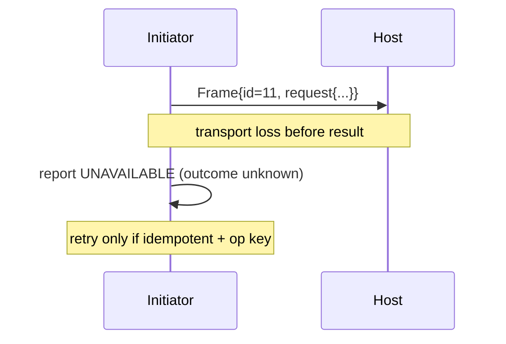

# Syntra v1 Core — Reliability, Timeouts, and Resource Bounds

- Identifier: `specifications/core/reliability.md`
- Title: Delivery Semantics, Retries, Backpressure, and Exhaustion
- Status: Draft (pending maintainer approval via RFC)
- Version: 1.0.0-draft.1 (2026-10-19)
- Normative references: BCP 14; `protocol.md`; `framing.md` (SNTR-WIRE-006); `rpc.md`; `events.md`; `errors.md`; `handshake.md`; charter SYN-ARCH-034/035; ADR-006/007
- Scope: What Syntra guarantees and does not guarantee about delivery, duplication, retries, backpressure, and resource exhaustion. Transport-specific queue sizes and TCP/HTTP retry details belong to transport specs; application-level exactly-once logic belongs to the application.
- Terminology: Per `protocol.md`. **Transport delivery** = bytes reached the peer's adapter. **Application processing** = handler executed and produced `RpcResult`. **At-most-once** = an RPC's effects happen zero or one times. **At-least-once** = retries may cause duplicates unless deduplicated.

The key words "MUST", "MUST NOT", etc. are per BCP 14.

## 1. Protocol requirements

**SNTR-REL-001** — Transport delivery vs application processing: transport/framing/TLS success MUST NOT be treated as application success. Only `RpcResult{payload}` proves success; `RpcResult{error}` or `UNAVAILABLE` on loss proves nothing about handler execution (SYN-ARCH-035, SNTR-CORE-005).

**SNTR-REL-002** — Default RPC semantics are at-most-once per connection. The core MUST NOT automatically retry. Any retry is initiated by the initiator application per SNTR-REL-003 and may cause duplicate handler execution unless the application deduplicates.

**SNTR-REL-003** — Retry conditions: initiators MAY retry ONLY when (a) no terminal `result` was received (timeout, `UNAVAILABLE`, connection loss) AND (b) the operation is known-idempotent or carries an application-level idempotency key in the payload. Retries after a terminal `result` (including errors other than `UNAVAILABLE`/`DEADLINE_EXCEEDED`) MUST NOT be automatic; they REQUIRE explicit application decision. `CANCELLED` MUST NOT be retried without re-evaluation.

## 1A. Retry categories and transport failure (informative labels; rules stay in SNTR-REL-003/009 and `rpc.md` §1I)

The labels `SAFE_TO_RETRY`, `CONDITIONALLY_RETRYABLE`, `NOT_SAFE_TO_RETRY`, and `UNKNOWN_OUTCOME` are guidance only — never wire values and never a license for automatic retry. `SAFE_TO_RETRY` applies narrowly: read-only or inherently idempotent operations (e.g., `/example.Echo/Echo`, `/example.KV/Get`) retried with fresh `request_id`s. Everything else is `CONDITIONALLY_RETRYABLE` (idempotent or operation-keyed, with backoff), `NOT_SAFE_TO_RETRY` (terminal results, `CANCELLED`, credential/authorization failures retried identically), or `UNKNOWN_OUTCOME` (loss, deadline expiry, `INTERNAL`/`UNKNOWN` terminal results where the handler may have executed). The per-failure table lives in `rpc.md` §1I; this document adds no second table so the two cannot diverge.

Transport disappearance with requests outstanding MUST be reported per RPC as exactly one of: definitely not executed (only where the core can prove non-dispatch, e.g., the request never passed validation), definitely executed (only via a received terminal success `result`), or outcome unknown (all other loss/timeout cases, the common case). The default is outcome unknown. Documented application idempotency (same operation key, fresh `request_id`, within the retention window) is what makes retry of unknown-outcome operations safe — never transport behavior alone.

**SNTR-REL-004** — Deduplication and idempotency: the core provides NO deduplication. Applications needing at-least-once with safety MUST embed operation IDs in payloads and deduplicate host-side. `request_id` MUST NOT be used for cross-connection dedup (SNTR-RPC-010).

**SNTR-REL-005** — Duplicate events: initiators MUST tolerate duplicate `notification`s (replay, at-least-once streams, post-cancel races, live+replay overlap windows). Hosts SHOULD minimize duplicates but MAY emit them under replay/reconnect; duplicates MUST NOT be treated as protocol violations.

## 1B. Event streams under loss and replay (pointer; owned by `events.md`)

Replay responses are subject to the same queue bounds as live events (SNTR-REL-007/008); oversized replays MUST be paged per `events.md` §1I, never burst beyond documented queues. The live+replay coordination strategy (overlap-with-dedup vs hold-live) is owned by the negotiated stream specification per `events.md` §1J; this document adds no second rule so the two cannot diverge.

**SNTR-REL-006** — Timeouts: every RPC MUST have an effective deadline (`timeout_ms` or host default, both bounded). Handshakes MUST have a bounded deadline (see `handshake.md`). Implementations MUST surface expiry as `DEADLINE_EXCEEDED` and MUST NOT leave RPCs pending indefinitely.

**SNTR-REL-007** — Backpressure: hosts MUST bound inbound queues (pending RPCs, event buffers). On saturation they MUST apply a documented policy: reject new work with `RESOURCE_EXHAUSTED` and/or drop events per stream policy — never unbounded queueing, never silent deadlock.

**SNTR-REL-008** — Resource exhaustion: `RESOURCE_EXHAUSTED` signals a capacity budget (frame size, concurrency, rate, queue). Clients MUST back off (bounded retries with jitter, not tight loops). Hosts MUST recover without restart where possible and MUST NOT collapse existing RPCs to admit new ones except per documented priority.

**SNTR-REL-009** — Connection interruption: abrupt loss MUST be reported as `UNAVAILABLE` to all in-flight RPCs on that connection. Initiators MUST assume unknown handler outcome (may have executed) and MUST follow SNTR-REL-003 before retrying. Hosts MUST NOT assume the initiator observed any `result` sent near the loss.

**SNTR-REL-010** — No automatic exactly-once: Syntra MUST NOT claim exactly-once delivery or processing. Any claim of effectively-once behavior MUST be documented as application-level idempotency above Syntra, with explicit operation keys, retention, and duplicate windows.

## 1C. Reliable delivery (OPTIONAL, gated on `syntra.reliable-session/1`)

Default at-most-once (SNTR-REL-002) is unchanged. When the reliable-session capability is confirmed, the following bounded reconciliation contract applies. No envelope change; reserved values preserved; app payloads opaque (equality only); no exactly-once business effects claimed.

**SNTR-REL-011** — ACK/resend with stable delivery IDs: initiators participating in reliable delivery assign one stable 16-byte delivery identifier per logical operation, distinct from the connection-scoped `request_id` (SNTR-RPC-011). The delivery ID is stable across resends on the same session; each resend uses a fresh `request_id` with the same delivery ID. Hosts retain terminal outcomes keyed by delivery ID for a bounded window (default 5 min, deployment-documented) and return the retained outcome instead of re-executing. Initiators MUST resend unacknowledged reliable operations only with the same delivery ID and MUST NOT reuse a delivery ID for a different logical operation.

**SNTR-REL-012** — Duplicate-content validation: the same delivery ID MUST carry byte-identical `(method, payload)` on every presentation. Hosts MUST compare opaque bytes for equality only (never parse) and MUST reject mismatched resends with `FAILED_PRECONDITION` (never merged, never reinterpreted). Validation precedes dispatch; the connection stays usable.

**SNTR-REL-013** — RPC outcome reconciliation with retained results and forgotten state: hosts MUST support explicit reconciliation per delivery ID returning exactly one of `Retained` (terminal outcome returned, no re-execution), `Forgotten` (retention expired or explicitly forgotten after initiator ACK + durable handling; the initiator MUST treat this as a new application decision, never as dedup proof), or `Unknown` (never seen; safe to dispatch as new). Retention is bounded in count (default 128/session) and bytes (default 1 MiB aggregate); beyond caps hosts fail with `RESOURCE_EXHAUSTED` and MUST NOT evict retained outcomes to admit new ones except per documented priority. Initiators MUST NOT treat `Forgotten`/`Unknown` as execution proof.

**SNTR-REL-014** — Deadline/cancel tombstones: after `DEADLINE_EXCEEDED`/`CANCELLED`/`UNAVAILABLE` for a delivery ID, hosts MUST retain a bounded tombstone (default 128/session, 5 min) so late duplicates resolve deterministically to the same terminal code instead of re-executing or reporting unknown twice. Only deadline/cancel/unavailable codes may tombstone; tombstones expire per retention and are then `Forgotten`. Tombstone storage is bounded and reapable; exhaustion yields `RESOURCE_EXHAUSTED`.

**SNTR-REL-015** — Bounded control-plane progress: all reliable-session control state (sessions, retained outcomes + bytes, tombstones, resume handles, revocation set, control queue + bytes) is bounded with documented defaults (see `syntra-core::reliable::ControlBounds`: 1024 sessions, 128 retained/session, 1 MiB retained bytes, 128 tombstones, 1024 resume handles, 64 queued signals, 64 KiB signal bytes). Admission beyond caps MUST fail with `RESOURCE_EXHAUSTED` (caller backs off with jitter, never tight loops). Control operations MUST be O(1) except bounded `reap`/`poll_idle` (at most `max_sessions` entries, at most `max_control_queue` signals). Implementations MUST NOT hold blocking locks across `await`, MUST NOT spawn unbounded per-message work, MUST propagate cancellation, MUST join owned tasks with a bounded grace, and MUST drain explicitly during shutdown (stop new, close active with `going-away`, retain outcomes/tombstones per retention, clear the control queue). No silent drops except per documented stream policy; no unbounded queueing; no silent deadlock.

## 2. Client behavior

- **SNTR-REL-020** — The client MUST implement per-RPC timers, bounded retry budgets (max attempts + backoff), and MUST NOT retry non-idempotent operations without an application decision.
- **SNTR-REL-021** — The client MUST handle `RESOURCE_EXHAUSTED` with backoff and MUST surface `UNAVAILABLE` distinctly from application errors.

## 3. Server behavior

- **SNTR-REL-030** — The server MUST enforce all bounds (frame size, concurrency, handshake/queue limits, per-principal rate limits), MUST isolate misbehaving principals, and MUST emit `RESOURCE_EXHAUSTED` before degrading conformant traffic.
- **SNTR-REL-031** — The server MUST document every bound and default deadline; undocumented unbounded behavior is non-conformant.

## 4. Failure handling

Timeout → `DEADLINE_EXCEEDED`; overload → `RESOURCE_EXHAUSTED`; loss → `UNAVAILABLE`; duplicate-suspect retry → application decides (core reports only). All bounds violations are terminal for the affected RPC, not the connection, unless the connection itself is exhausted/misbehaving.

## 5. Security considerations

Unbounded queues/timers are DoS vectors. Pre-allocation bounds, rate limits, and backoff are security controls. Retry storms after outages MUST be damped (jitter + caps).

## 6. Compatibility considerations

Bounds may tighten (minor, if documented) but MUST NOT silently loosen security-relevant limits without an RFC. Changing default at-most-once to anything stronger is a major version.

## 7. Conformance requirements

- **SNTR-REL-900** — Fixtures: loss-before-result → `UNAVAILABLE` + safe-retry proof (idempotent succeeds, non-idempotent not auto-retried); deadline → `DEADLINE_EXCEEDED`; flood → `RESOURCE_EXHAUSTED` with recovery; duplicate-event tolerance; no-exactly-once attestation (implementation documents operation-key approach or states at-most-once only).
- **SNTR-REL-901** — Distinction proof: transport-ack without `RpcResult` MUST NOT be reported as success in any fixture.
- **SNTR-REL-902** — Reliable-delivery fixtures (OPTIONAL, gated): stable delivery-ID resend returns retained outcome without re-execution; mismatched content rejected; forgotten/unknown handled as new decisions; tombstones deterministic; control-plane bounds enforced with `RESOURCE_EXHAUSTED` and explicit drain. `CONF-RS-005`.

