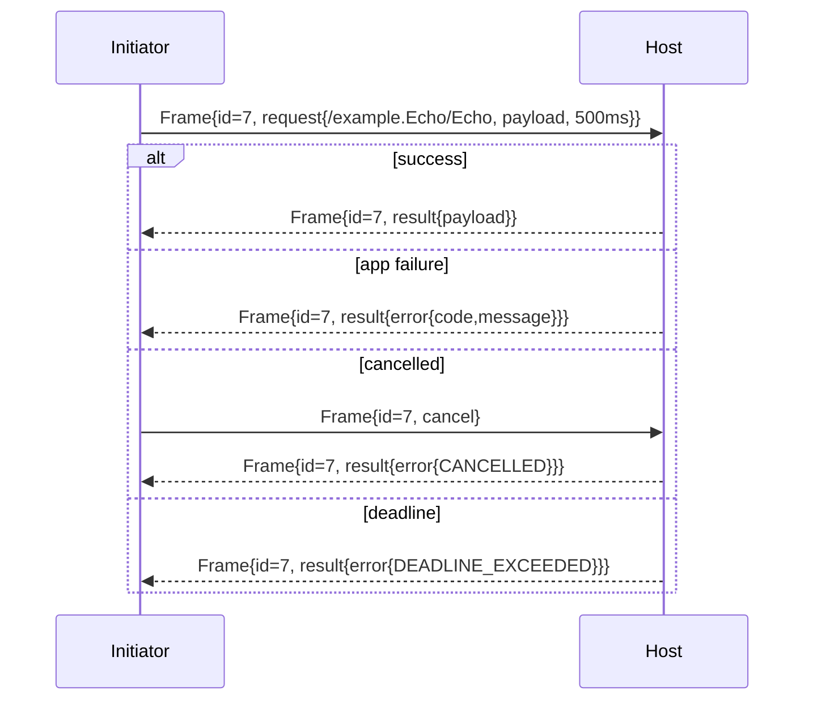

# Syntra v1 Core — Generic RPC

- Identifier: `specifications/core/rpc.md`
- Title: Generic Request/Response Correlation and Cancellation
- Status: Partially accepted (2026-10-30) — protocol-contract owner file for accepted [RFC 0004](../../rfcs/0004-correlation-identity-carriage.md) D1–D4 with accepted RFC 0005 D3 and the RFC 0008 D2 timing reconciliation per [Decision 0002](../../docs/decisions/0002-sdd-acceptance-wave.md); §§1J–1L (`SNTR-RPC-011..013`) remain proposal-only as marked inline
- Version: 1.0.0-draft.1 (2026-10-19, accepted-clause corrections 2026-10-30)
- Normative references: BCP 14; `proto/syntra/v1/envelope.proto` (`Frame`), `proto/syntra/v1/rpc.proto` (`RpcRequest`, `RpcResult`, `Cancel`); `protocol.md`; `framing.md`; `errors.md`; `reliability.md`; `capabilities.md`
- Scope: Transport-independent RPC: method identifiers, correlation IDs, opaque payloads, deadlines, cancellation, error propagation, idempotency metadata. Payload schemas and handler semantics belong to the application.
- Terminology: Per `protocol.md`. **Request ID** = `Frame.request_id` (transport correlation nonce). **Operation ID** = optional application-level idempotency key carried inside opaque payload (never interpreted by Syntra). The two MUST NOT be conflated.

The key words "MUST", "MUST NOT", etc. are per BCP 14.

## 1. Protocol requirements

**SNTR-RPC-001** — Method identifier: `RpcRequest.method` MUST be a canonical `/package.Service/Method` path (leading slash, exactly two slashes, non-empty segments, ASCII printable excluding spaces/control). Producers MUST validate shape before sending; consumers MUST reject malformed paths with `INVALID_ARGUMENT` without dispatch. Method semantics belong to the application.

**SNTR-RPC-002** — Correlation: each RPC MUST carry a nonzero, connection-scoped `request_id`, and request identifiers MUST be strictly monotonically increasing in request-frame emission order per connection. An identifier MUST NOT be reused within a connection for any reason, including after a terminal outcome (accepted [RFC 0004](../../rfcs/0004-correlation-identity-carriage.md) D1). Exactly one terminal `RpcResult` with the same `request_id` completes the RPC. `request_id == 0` MUST NOT be used for RPC. Responders MUST echo the identical ID.

**SNTR-RPC-003** — Payloads are opaque bytes. Arbitrary bytes (including empty and non-UTF-8) are valid. The core MUST route and bound them without semantic validation. Empty `RpcRequest.payload` and empty success `RpcResult.payload` are meaningful (see SNTR-WIRE-007).

**SNTR-RPC-004** — Deadlines: `timeout_ms == 0` selects the host default (MUST be bounded and documented); nonzero selects the call budget in milliseconds. The responder MUST enforce the effective deadline and return `DEADLINE_EXCEEDED` on expiry. The initiator MUST enforce its own timer anchored at call admission — before readiness waiting or writer queueing (see §1F; accepted RFC 0004 §4 / RFC 0008 D2) — and MAY abandon locally, but abandonment does not cancel the host without an explicit `cancel`.

**SNTR-RPC-005** — Cancellation: `Cancel{}` in a `Frame` whose `request_id` targets an outstanding RPC requests best-effort cancellation. It MUST NOT be interpreted as rollback of a committed mutation. Cancellation is advisory; the RPC still ends with exactly one terminal `result` (`payload` if it completed first, `CANCELLED` error otherwise). `cancel` for unknown/completed IDs MUST be ignored (no error) to tolerate races.

**SNTR-RPC-006** — Error propagation: failures MUST use `RpcResult{error{RpcError{code, message}}}` with a known nonzero code per `errors.md`. The `outcome` oneof MUST always be set, including for empty success. No other failure channel (transport close alone, empty frame) substitutes for the terminal result except connection-level failures per `handshake.md`/`reliability.md`.

**SNTR-RPC-007** — Optional idempotency metadata: Syntra defines no core idempotency field. Applications needing safe retry MUST embed their own operation key inside the opaque payload. Implementations MUST NOT treat `request_id` as an idempotency key across connections — `request_id` is connection-scoped correlation only (see SNTR-RPC-010).

**SNTR-RPC-008** — Concurrency: peers MUST support at least 16 concurrent RPCs per connection unless a lower bound was negotiated; they MUST enforce a documented max and reject excess with `RESOURCE_EXHAUSTED`.

**SNTR-RPC-010** — Request ID vs operation ID: `request_id` (transport, connection-scoped, initiator-chosen, never reused within the connection — RFC 0004 D1) and application operation IDs (durable, cross-connection, application-scoped) are distinct namespaces. The core MUST NOT map one to the other; deduplication on operation IDs belongs to the application (see `reliability.md`).

## 1A. RPC stages (clarifies SNTR-RPC-002/006, SNTR-REL-001, SNTR-CORE-005)

| Stage | Owner | Wire-visible? | Meaning |
|---|---|---|---|
| Received | transport adapter + core | The `request` `Frame` decoded and within bounds | Bytes arrived; nothing proven about execution |
| Accepted | core | Validation passed (SNTR-WIRE-005): version, `request_id` discipline, `ACTIVE`, method shape, size | Eligible for dispatch; still no handler effect |
| Handler started | application | No new wire signal | Handler running; caller-visible state unchanged |
| Handler completed | application | No new wire signal yet | Terminal outcome determined internally |
| Response transmitted | core | One `result` `Frame` with the same `request_id` sent | Exactly one terminal response per accepted request (SNTR-RPC-002/006/030); a second `result` for the same ID MUST NOT be sent |
| Peer received | peer core | `result` decoded and correlated | Caller learns the outcome; receipt of the `result` still proves nothing beyond what the outcome states |

Transport delivery, framing acknowledgment, or TLS success at any earlier stage MUST NOT be treated as application processing or success. Only `RpcResult{payload}` proves success; `RpcResult{error}` or connection-loss mapping to `UNAVAILABLE` proves nothing about handler effects (SNTR-REL-001). Rejected requests (validation, authentication, authorization failures) never reach handler-started and still end with exactly one terminal outcome where an RPC context exists, or with connection closure for handshake-phase failures (SNTR-ERR-004).

## 1B. Request identifiers — the one normative model (clarifies SNTR-RPC-002/010, SNTR-WIRE-003/010)

`request_id` is the `uint64` correlation field of the enclosing `Frame` (`envelope.proto`), not a field of `RpcRequest`. The accepted RFC 0004 D1/D2 model:

- **Type and generator:** unsigned 64-bit integer, chosen by the initiator of the RPC. All IDs are nonzero.
- **Ordering scope:** per connection, strictly increasing in the actual serialized request-frame emission order (not API-call order, scheduling order, or ticket order). Gaps are allowed; consecutive numbering and a start at 1 are not required. No wrap at `2^64 − 1`: before exhaustion the initiator stops admitting new requests and drains/closes or opens a fresh connection; zero is never a fallback, and a skipped reservation can exhaust the space too. Results and cancels reference the original ID and never consume a new ID or advance the high-water mark; a late cancel for ID 7 after request 10 is not a violation (RFC 0004 D1).
- **Uniqueness scope:** a correlation label on that connection only. It is NOT unique per session, per principal, or globally, and MUST NOT be used for cross-connection deduplication (SNTR-RPC-007/010, SNTR-RPL-012, SNTR-RPL-020); the same numeric value on another connection is harmless and identifies nothing.
- **Zero:** never valid for RPC. `request_id == 0` with `request`/`result`/`cancel` MUST be rejected; zero belongs to `hello`/`ready`/`notification` (SNTR-WIRE-003).
- **Lifetime:** from request-frame emission until the call's single terminal outcome is committed, or the connection is lost (in-flight RPCs map to `UNAVAILABLE` per SNTR-REL-009). Retired terminal IDs leave the active-entry map but are never resurrected.
- **Never reuse:** allocated, skipped, and retired identifiers are never reused on that connection, including after timeout, cancellation, overload rejection, successful completion, or an arbitrarily long idle; no aging window makes an old ID fresh (accepted RFC 0004 D1 — this replaces the former reuse-after-completion permission and aligns SNTR-RPL-012, owned by `replay-protection.md`).
- **Host high-water rule:** the host holds a `uint64` high-water mark H (initially zero) and, after bounded decode, version/nonzero-ID/state checks and before method authorization or handler dispatch, admits requests serialized in received-frame order. If a received request ID N ≤ H — whether N names an active, completed, skipped-below-H, or otherwise retired ID — that is an ordering violation detected by the host high-water rule: the host records a local `FAILED_PRECONDITION`, dispatches nothing for the offending frame, sends no `RpcResult` under N and no zero-ID error, and terminates the connection through the native profile signal; the connection fails (accepted RFC 0004 D2). This applies equally so that same-connection replay of a completed identifier is an ordering violation detected by the host high-water rule; the connection fails. Otherwise H = N is set atomically with admission: the number is consumed even if later method validation, authorization, or concurrency checks reject the request, and such ordinary rejections may still return one lawful result for N.
- **After reconnect:** the ID space dies with the connection. New attempts on the new connection MUST use fresh IDs; logical continuity across connections uses the application operation key in the payload, never the old `request_id` (SNTR-RPL-020).
- **After session resume (future RFC only):** same as reconnect — fresh connection, fresh ID space (SNTR-SESS-008).
- **`result` for an unknown ID:** locally ignore with a diagnostic; no error storm. Unknown/late results and unknown/completed cancels are ignored with bounded diagnostics and never change H nor dispatch work; a result with no active local call cannot resurrect one (SNTR-RPC-§4; RFC 0004 D2).

## 1C. Method identifiers (clarifies SNTR-RPC-001)

The dotted forms in task examples (`example.echo`, `example.add`) are informal shorthand only. The wire syntax is unchanged: `RpcRequest.method` MUST be a canonical `/package.Service/Method` path — leading slash, exactly two slashes, non-empty segments, ASCII printable excluding spaces and control characters (SNTR-RPC-001). Neutral wire examples: `/example.Echo/Echo`, `/example.KV/Get`.

- **Character set:** ASCII printable except spaces/control; byte-exact, case-sensitive matching with no normalization (`/example.Echo/Echo` and `/example.echo/echo` are different methods).
- **Length:** no separate v1 bound; the method string MUST fit within the serialized-envelope bound (SNTR-WIRE-006). Deployments MUST document any additional method-length cap; exceeding a documented cap maps to `INVALID_ARGUMENT` or `RESOURCE_EXHAUSTED` per the documented policy.
- **Case sensitivity:** sensitive. No case folding is performed.
- **Versioning:** application-defined. Recommended: a new method name or a versioned payload schema (the core never parses either). Method-name versioning and payload versioning are equally conformant; deployments MUST document their choice.
- **Reserved namespaces:** none in v1. Illustrative prefixes such as `/syntra.auth/*` are NOT reserved; hosts MUST NOT treat any method prefix specially at the core layer.
- **Invalid identifier:** reject with `INVALID_ARGUMENT` before dispatch (SNTR-RPC-001/030); the connection remains usable.

## 1D. Opaque application payloads (clarifies SNTR-RPC-003, SNTR-WIRE-007, SNTR-CORE-002, SNTR-OPQ-001/002)

- **Representation:** arbitrary `bytes`, including empty and non-UTF-8 (SNTR-RPC-003). Presence is determined by `oneof` field presence, never by length.
- **Maximum vs envelope:** payload bytes plus all envelope overhead (tags, lengths, `version`, `request_id`, method, `timeout_ms`, outcome wrapper) MUST fit within `DEFAULT_MAX_FRAME_BYTES` (1 MiB serialized `Frame`) unless a transport profile or an explicitly accepted profile contract states another bound (SNTR-WIRE-006); there is no generic negotiated-capability override (accepted RFC 0005 D1). The bound applies to the TOTAL serialized `Frame`: a frame whose payload makes the serialized total `MAX+1` is rejected pre-dispatch, while a MAX-sized total frame (serialized `Frame` of exactly `DEFAULT_MAX_FRAME_BYTES`) is within the bound — so a fixture's "1 MiB" expectation is about the total frame, not the payload alone, and payloads MUST be sized smaller so the frame fits (settled by accepted [RFC 0005](../../rfcs/0005-negotiation-bounds-identifiers.md) D3; the framing document owns SNTR-WIRE-006/011 notes). Implementations MUST enforce the envelope bound on serialized bytes and MUST NOT silently raise it for large payloads.
- **Empty behavior:** empty `RpcRequest.payload` invokes the method with empty input; selected empty `RpcResult.payload` means success with empty output; unset `outcome` is never success (SNTR-WIRE-007, SNTR-RPC-006/020).
- **Interpretation ownership:** the application alone. The core MUST route, correlate, bound, and time-limit payloads without semantic validation, transformation, compression, or decryption.
- **Content-type negotiation:** none exists at the core layer. There is no content-type field; peers that need format agreement do so out of band or inside opaque payload bytes under application versioning.
- **Encoding decision:** applications MAY use any payload encoding (Protobuf, JSON, CBOR, raw bytes, ciphertext, or proprietary formats). Syntra's own use of Protobuf constrains only the core wire schema, never application payloads (SYN-ARCH-013, SNTR-CORE-002).

## 1E. Concurrent requests (clarifies SNTR-RPC-002/008)

Multiple in-flight RPCs on one connection are permitted and expected. Responses MAY complete and arrive out of request order; correlation is solely by `request_id`, and initiators MUST NOT assume FIFO completion. Peers MUST support at least 16 concurrent RPCs per connection unless a lower bound was negotiated, MUST enforce a documented maximum, and MUST reject excess with `RESOURCE_EXHAUSTED` (SNTR-RPC-008). Independent RPCs MUST progress independently (no head-of-line blocking imposed by the core); backpressure and isolation follow SNTR-REL-007/008 and SNTR-ASEC-020.

## 1F. Request deadlines (clarifies SNTR-RPC-004, SNTR-REL-006, SNTR-ASEC-021)

- **Optional?** No: every RPC has an effective deadline. `timeout_ms == 0` selects the host default, which MUST be bounded and documented; nonzero selects the call budget in milliseconds; an unset budget uses the documented bounded initiator default (RFC 0008 D2; a host may apply a stricter default/cap, and profile negotiation cannot silently extend an existing local deadline).
- **Representation:** relative millisecond budget (`uint32 timeout_ms` in `RpcRequest`). No absolute timestamps cross the wire.
- **Clocks (accepted RFC 0004 §4, synchronized with RFC 0008 D2):** no synchronized clocks are assumed, and neither endpoint subtracts network transit using peer wall clocks. The initiator's local operation deadline starts when the call is admitted, before readiness waiting or writer queueing; admission rejection is local and creates no pending wire RPC. If fewer than one millisecond remains at encoding time the call expires locally; zero is never encoded as an accidental host-default reset. The host timestamps complete bounded-frame receipt of the request before worker-queue waiting; once validation establishes a legal request with an effective timeout_ms, its deadline is calculated from that receipt timestamp; validation and host queue time consume the budget; network transit is not measurable by the host and is not subtracted using peer wall clocks. Expired work is not dispatched; the writer's queued-to-emitting handoff is atomic with checking the call's terminal/deadline gate; no already-terminal queued call starts emission. The full queue/suspend contract (capacities, elapsed/suspension clocks, write-stall budgets) is owned by accepted RFC 0008 D2; suspension counts toward elapsed budgets.
- **Maximum duration:** deployments MUST document a maximum call budget. A requested budget above the documented maximum MUST be handled per documented policy (clamp to the maximum or reject with `OUT_OF_RANGE`/`INVALID_ARGUMENT`); the chosen policy MUST be documented and MUST NOT be silent unbounded acceptance.
- **Server after deadline:** stop or disregard remaining work on a best-effort basis and return `DEADLINE_EXCEEDED`, unless a completion candidate was already committed at the host's terminal gate (§1G; accepted RFC 0004 D4). The server MAY continue execution after the caller's timeout (e.g., a non-interruptible handler) but MUST still report `DEADLINE_EXCEEDED` for that RPC; any effects are unknown to the caller (SNTR-REL-001).
- **Client after deadline:** surface `DEADLINE_EXCEEDED`; local abandonment does not cancel the host without an explicit `cancel` (SNTR-RPC-004). Retry only per §1I.
- **Error:** `DEADLINE_EXCEEDED` in all deadline-expiry reports.

## 1G. Cancellation — supported, best-effort (clarifies SNTR-RPC-005/021/031)

Syntra v1 supports explicit cancellation; it is NOT deferred.

- **Cancel message:** `Frame{request_id=N, cancel{}}`. `Cancel` carries no fields; the target is the enclosing `request_id` (SNTR-RPC-005).
- **Target:** an outstanding RPC `N` on the same connection. Cancellation of a subscription's originating RPC cancels only that RPC unless the stream specification binds them (SNTR-EVENT-010).
- **Race with completion (accepted RFC 0004 D4):** exactly one terminal outcome is committed per attempt by a serialized gate checked across deadline, cancel, and result arrival; completion wins only if already committed before a newer candidate is checked.
- **Gate semantics:** (a) Pending + `now >= deadline` commits `DEADLINE_EXCEEDED` before any candidate being considered now, even if the timer callback has not run; (b) a cancel/deadline tie while Pending selects `DEADLINE_EXCEEDED`; (c) the host's gate runs after handler terminal computation, before enqueueing terminal output (not at socket-write completion); (d) the initiator's gate runs after validation/correlation of received results, before application callback delivery; (e) endpoints may therefore legitimately observe different outcomes — the host may have selected success while the initiator's deadline/loss won before receipt; (f) neither property promises exactly-once execution or rollback, and closure is not rollback.
- **Completion vs application-effect:** handler effects, wire-result emission, and local application notification are distinct. A host-selected success may never reach the caller (deadline/loss won first); a caller that never receives the result treats the outcome as `UNAVAILABLE`/timeout without implication about handler effects (SNTR-REL-001), and an already-committed result survives a delayed callback or executor suspension (never a second outcome).
- **Unknown or already-completed target:** ignore with no error, to tolerate races (SNTR-RPC-005).
- **Duplicate cancellation:** the second arrives as unknown/completed and is likewise ignored.
- **Semantics:** best-effort interruption only; cancellation MUST NOT be interpreted as rollback of a committed mutation (SNTR-RPC-005/031).
- **Server obligation:** SHOULD attempt to stop the work and MUST still end the RPC with exactly one terminal `result`: the success result if it won, otherwise `CANCELLED`.
- **Response semantics:** the terminal `result` carries `error{code=CANCELLED}` with the same `request_id`, unless completion won at the gate.
- **Cancel-vs-deadline tie:** resolved by (b) — a tie selects `DEADLINE_EXCEEDED`; simultaneous pre-deadline candidates are ordered by gate acquisition, not callback delivery or wall-clock guesses (settled by accepted RFC 0004 D4; the gate's full contract is RFC 0004 D4, with RFC 0008 owning queue/suspend timing).

## 1H. Idempotency — `request_id` vs operation key (clarifies SNTR-RPC-007/010, SNTR-RPL-002/013/020, SNTR-REL-002/004/010)

```text
Attempt 1:  request_id = 100,  payload contains operation_id = ABC
Connection fails before the result arrives. Outcome unknown.
Attempt 2:  request_id = 201,  payload contains operation_id = ABC
Two transport/RPC attempts; one logical operation ABC.
```

- `request_id` is transport correlation: connection-scoped, initiator-chosen, fresh per attempt, never reused across connections (SNTR-RPL-020). It MUST NOT be used for deduplication.
- The operation key (`operation_id`/`idempotency_key`) is an application-level identifier carried **inside the opaque payload** (SNTR-RPC-007). There is deliberately no core operation-ID field; adding one would REQUIRE an RFC plus capability (SNTR-RPC-§6).
- **Optional:** operation keys are OPTIONAL in the core. Which operations should use them is an application decision: any non-idempotent operation the initiator may retry SHOULD carry one.
- **Server behavior if supported:** entirely application-defined and MUST be documented where claimed: deduplication scope (per method? per principal? global?), retention window, duplicate handling (return the original result vs a conflict error), and expiry behavior. The core contributes only bit-exact carriage of the key bytes.
- **Deduplication scope:** never the core. Retention windows and key stores belong to the application above Syntra.
- **Duplicate result behavior:** application-defined and documented (same-result replay or explicit conflict error); the core reports whatever single terminal `result` the handler produces.
- **Expired deduplication state:** after the documented window lapses, a repeated key MUST be treated as a new operation (with unknown duplication risk documented); implementations MUST NOT claim indefinite dedup.
- **Interaction with sessions:** keys MUST NOT cross connection state implicitly. After reconnect or resume, attempt 2 carries a fresh `request_id` and repeats the same operation key; the server deduplicates only within its documented window.
- **No exactly-once:** Syntra MUST NOT promise exactly-once execution (SNTR-REL-010). At-most-once is the default (SNTR-REL-002); effectively-once is achievable only through documented application idempotency, never from `request_id` handling or TLS delivery alone (SNTR-RPL-002).

## 1I. Retry guidance (clarifies SNTR-REL-003/006, SNTR-ERR-006)

The core never automatically retries (SNTR-REL-002). The initiator decides, using this non-binding classification (labels are guidance, not wire values). `UNKNOWN_OUTCOME` always means the handler may have executed.

| Failure | Category | Protocol rule |
|---|---|---|
| Connection loss before any `result` | UNKNOWN_OUTCOME | Report `UNAVAILABLE` locally; retry ONLY if idempotent or carrying the same operation key (SNTR-REL-003/009) |
| `DEADLINE_EXCEEDED` (no `result`) | UNKNOWN_OUTCOME | Same as loss: outcome unknown; retry only idempotent/with-key; never blindly retry a completed terminal error |
| `RESOURCE_EXHAUSTED` (rate/quota/concurrency) | CONDITIONALLY_RETRYABLE | Back off with jitter and bounded attempts (SNTR-REL-008/020); retry the same logical operation with a fresh `request_id` (same operation key) |
| `UNAVAILABLE` (transient) | CONDITIONALLY_RETRYABLE | Retry idempotent/with-key operations with backoff; do not treat as proof of non-execution |
| `UNAUTHENTICATED` (expired credential, revocation) | NOT_SAFE_TO_RETRY identically | Present a different/fresh credential on a new handshake first (SNTR-AUTH-009/021); retrying the identical bytes in a tight loop is forbidden |
| `PERMISSION_DENIED` | NOT_SAFE_TO_RETRY | Do not retry identically; seek authorization change (SNTR-AUTH-021) |
| `INVALID_ARGUMENT`, `NOT_FOUND` (definitive), `ALREADY_EXISTS`, `FAILED_PRECONDITION`, `ABORTED`, `OUT_OF_RANGE`, `UNIMPLEMENTED`, `DATA_LOSS` terminal results | NOT_SAFE_TO_RETRY (as stated) | A received terminal `result` is definitive for that attempt; re-issuing is a new application decision, never an automatic retry (SNTR-REL-003) |
| `CANCELLED` | NOT_SAFE_TO_RETRY without re-evaluation | Caller abandoned; re-issue only as a new decision (SNTR-REL-003) |
| `INTERNAL` / `UNKNOWN` terminal results | UNKNOWN_OUTCOME | Handler may or may not have executed; retry only as a new idempotent decision with an operation key |

Syntra MUST NOT classify every failed mutation as safe to retry: any automatic retry of a non-idempotent operation without an operation key is non-conformant.

## 1J. Stable delivery IDs vs `request_id` (OPTIONAL, gated on `syntra.reliable-session/1`)

> Draft-proposal notice: §§1J–1L (SNTR-RPC-011..013) are proposal-only and carry no normative force until the authorizing RFC is accepted. Until acceptance, implementations MUST NOT ship behavior from them, and no test, claim, or release MAY cite them as authority.

**SNTR-RPC-011** — Delivery IDs are session-scoped stable keys distinct from `request_id`: a delivery ID is 16 opaque bytes (non-zero, initiator-chosen, stable across resends on the same session); a `request_id` is a `u64` connection-scoped correlation nonce (initiator-chosen, nonzero, strictly increasing per connection, never reused — accepted RFC 0004 D1). The two namespaces MUST NOT be conflated: correlation uses `request_id`; reconciliation uses the delivery ID. Resends MUST reuse the delivery ID with a fresh (never previously used, i.e., newly increasing) `request_id`; a delivery ID MUST NOT be reused for a different logical operation within one session (byte-mismatched reuse → `FAILED_PRECONDITION` per SNTR-REL-012). Delivery IDs are per-session keys: the same bytes presented in different sessions are distinct keys and MUST NOT be correlated across sessions; hosts MUST NOT retain unbounded cross-session key state.

## 1K. Outcome reconciliation (OPTIONAL, gated)

**SNTR-RPC-012** — Hosts confirming the capability MUST retain terminal outcomes keyed by delivery ID per SNTR-REL-013 and MUST answer explicit reconciliation with `Retained` (return the retained outcome, no re-execution), `Forgotten` (retention expired or explicitly forgotten; caller treats as a new application decision), `Unknown` (never seen), or `Pending` (dispatched, no terminal yet; caller MUST resend the same delivery ID, MUST NOT dispatch as new). Initiators MUST query reconciliation after loss/timeout before blindly re-executing non-idempotent operations and MUST NOT treat `Forgotten`/`Unknown`/`Pending` as execution proof. Retained success payloads are bit-identical returns, not new executions; business effects remain application-owned (no exactly-once claim).

## 1L. Deadline/cancel tombstones (OPTIONAL, gated)

**SNTR-RPC-013** — Hosts MUST retain deadline/cancel tombstones per delivery ID per SNTR-REL-014 so late duplicates (resends racing completion, retries after `DEADLINE_EXCEEDED`/`CANCELLED`) resolve to the same terminal code deterministically. Only `DEADLINE_EXCEEDED` and `CANCELLED` may tombstone; `UNAVAILABLE` follows the resend/`Pending` path, never tombstones. Tombstones MUST NOT be used for other codes, MUST expire per retention (then `Forgotten`), and MUST be bounded (exhaustion → `RESOURCE_EXHAUSTED`). Completion committed at the serialized gate still wins races at the RPC layer (SNTR-RPC-005/§1G, accepted RFC 0004 D4); tombstones only decide late-duplicate answers after the terminal outcome is already fixed.

## 2. Client behavior

- **SNTR-RPC-020** — The client MUST emit strictly increasing, nonzero, connection-scoped request IDs and MUST NOT reuse an identifier within the connection (accepted RFC 0004 D1), MUST time out per SNTR-RPC-004, MUST handle interleaved `notification`s before `result` without completing the RPC, and MUST treat missing `outcome` as `INVALID_ARGUMENT` (protocol violation), not success.
- **SNTR-RPC-021** — The client SHOULD send `cancel` when abandoning an RPC it no longer needs, but MUST still await (or explicitly discard with a local timeout) the terminal `result`, because identifiers are never reused and a lost original result cannot be correlated to a re-sent ID (accepted RFC 0004 D1).

## 3. Server behavior

- **SNTR-RPC-030** — The server MUST validate method shape, size bounds, and ACTIVE state before dispatch; MUST dispatch only to the application handler for the method; MUST return exactly one terminal `result`; MUST NOT send a second `result` for the same ID.
- **SNTR-RPC-031** — On `cancel`, the server SHOULD attempt to stop work and MUST return `CANCELLED` unless the RPC already completed (then the success result wins). It MUST NOT roll back committed application effects.
- **SNTR-RPC-032** — The server MUST enforce per-method authorization (application policy) with `UNAUTHENTICATED`/`PERMISSION_DENIED` per `authentication.md`.

## 4. Failure handling

Duplicate or out-of-order `request_id` (any request whose ID is at or below the host's committed high-water mark) → local `FAILED_PRECONDITION`, no dispatch for the offending frame, no same-ID rejection result, and the connection terminates through the native profile signal (accepted RFC 0004 D2). Same-connection replay of a completed identifier is an ordering violation detected by the host high-water rule; the connection fails — the former core reuse-after-completion permission is gone (accepted RFC 0004 D1; `replay-protection.md` owns the aligned SNTR-RPL-012 wording). `result` for unknown ID → locally ignored + diagnostic (no error storm). Malformed method → `INVALID_ARGUMENT`. Deadline → `DEADLINE_EXCEEDED`. Overloaded → `RESOURCE_EXHAUSTED`. Transport loss → `UNAVAILABLE` to all in-flight RPCs.

## 5. Security considerations

Method paths and payloads are attacker-controlled. Shape validation + bounds precede dispatch. Authorization precedes handler execution. Error messages MUST NOT leak handler internals. Cancellation abuse (storm) is rate-limited per `reliability.md`.

## 6. Compatibility considerations

New RPC semantics arrive via new methods (application) or new capabilities (protocol), never by redefining `request_id` scope or `outcome` presence. `timeout_ms` semantics are frozen; adding a core idempotency field would REQUIRE an RFC + capability.

## 7. Conformance requirements

- **SNTR-RPC-900** — Neutral fixtures: `/example.Echo/Echo` round-trip (empty, small, payload sized to keep the TOTAL serialized `Frame` within `DEFAULT_MAX_FRAME_BYTES` — a MAX-sized total frame is within the bound and `MAX+1` is rejected pre-dispatch per RFC 0005 D3, arbitrary bytes); `/example.KV/Get` NOT_FOUND; malformed method; missing outcome; duplicate/out-of-order ID closing the connection with no same-ID rejection result (accepted RFC 0004 D2); cancel-before-completion vs cancel-after-completion; deadline expiry (exact-deadline tie selects `DEADLINE_EXCEEDED`, RFC 0004 D4); interleaved notification; 16-concurrent RPCs; operation-ID vs request-ID independence proof.
- **SNTR-RPC-901** — Exactly-once-terminal proof: no fixture yields zero or two terminal results for one `request_id` except connection-loss mapping to `UNAVAILABLE`.
- **SNTR-RPC-902** — Reliable-delivery fixtures (OPTIONAL, gated): delivery-ID vs `request_id` independence; resend with same delivery ID returns retained outcome; mismatched content rejected; forgotten/unknown as new decisions; tombstone determinism. `CONF-RS-005`.



## 8. Sequence diagrams (views of §1; no new behavior)

Concurrent requests complete out of order; correlation is by `request_id` alone:

```mermaid
sequenceDiagram
  participant C as Initiator
  participant H as Host
  C->>H: Frame{id=7, request{/example.Echo/Echo, A}}
  C->>H: Frame{id=8, request{/example.KV/Get, B}}
  H-->>C: Frame{id=8, result{B-result}}
  H-->>C: Frame{id=7, result{A-result}}
  Note over C: Out-of-order completion is legal; FIFO MUST NOT be assumed
```

Timeout: the responder reports expiry; effects stay unknown:

```mermaid
sequenceDiagram
  participant C as Initiator
  participant H as Host
  C->>H: Frame{id=9, request{/example.Echo/Echo, timeout_ms=100}}
  Note over H: handler still running at 100ms
  H-->>C: Frame{id=9, result{error{DEADLINE_EXCEEDED}}}
  Note over C,H: Handler effects unknown; retry only idempotent/with-key
```

Connection loss with idempotent retry uses a fresh `request_id` and the same operation key:

```mermaid
sequenceDiagram
  participant C as Initiator
  participant H as Host
  C->>H: Frame{id=100, request{op ABC}}
  Note over C,H: transport lost; C reports UNAVAILABLE (outcome unknown)
  C->>H: new connection + handshake
  C->>H: Frame{id=201, request{op ABC}}
  H-->>C: Frame{id=201, result{payload or prior result}}
  Note over H: Dedup on ABC is application-defined; core only carried the bytes
```

Protocol error (connection-level) versus RPC error (call-level):

```mermaid
sequenceDiagram
  participant C as Initiator
  participant H as Host
  C->>H: Frame{req_id=0, request{...}} (zero ID with request)
  H-->>C: connection close (INVALID_ARGUMENT context; no dispatch)
  Note over C,H: Malformed envelope → protocol error, connection unusable
  C->>H: Frame{id=11, request{/example.Unknown/Call}}
  H-->>C: Frame{id=11, result{error{UNIMPLEMENTED}}}
  Note over C,H: Valid envelope, unknown method → RPC error, connection usable
```
