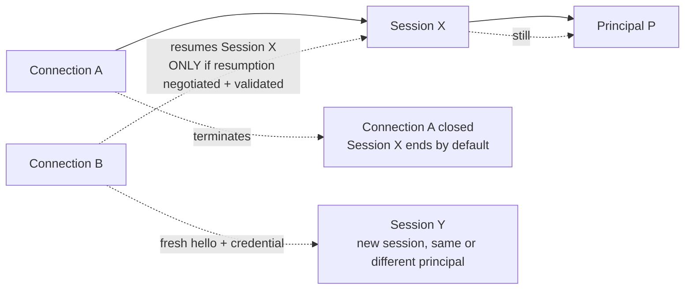
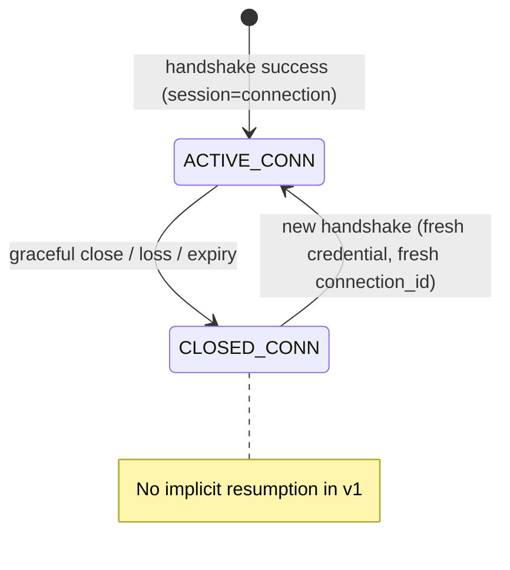

# Syntra v1 Core — Logical Sessions

- Identifier: `specifications/core/sessions.md`
- Title: Logical Sessions and Connection Binding
- Status: Draft (pending maintainer approval via RFC)
- Version: 1.0.0-draft.1 (2026-10-19)
- Normative references: BCP 14; `proto/syntra/v1/handshake.proto` (`ServerReady.connection_id`); `protocol.md`; `handshake.md`; `authentication.md`; ADR-005; charter SYN-ARCH-013
- Scope: What a logical session is, how it relates to transport connections, establishment/closure/expiration, resumption eligibility, auth binding, and reconnect behavior. Cross-transport resumption with security/state guarantees is explicitly NOT promised in v1 unless a future RFC fully defines it.
- Terminology: Per `protocol.md` + ADR-005. **Connection** = disposable transport instance with `connection_id`. **Session** = application-scoped association of a principal with one or more sequential connections (only if resumption is defined and negotiated).

The key words "MUST", "MUST NOT", etc. are per BCP 14.

## Persistent device authorization is not session resumption

[RFC 0007](../../rfcs/0007-secure-channel-device-authorization.md)
establishes persistent shared device authorization with fresh Noise keys for
each new channel. Reusing a valid enrollment can avoid another interactive
login, but does not attach a previous session, restore pending RPCs or
subscriptions, or transfer cipher/counter state between carriers. The host
re-evaluates scope, expiry and revocation before a new binding. The existing
session rules below and separately proposed recovery mechanisms retain their
own authority and acceptance status.

## 1. Protocol requirements

**SNTR-SESS-001** — Session establishment: a session is established implicitly when a connection reaches ACTIVE (principal bound). No separate session handshake exists in v1. Applications MAY layer session tokens above ACTIVE via generic RPC; the core MUST NOT interpret them.

**SNTR-SESS-002** — Session identifier semantics: `ServerReady.connection_id` is a connection diagnostic, NOT a session identifier. It MUST be opaque, unguessable (≥128-bit entropy), single-connection scoped, and MUST NOT be accepted as an authentication credential, resumption token, or session handle. Session identifiers, if any, belong to the application above Syntra.

**SNTR-SESS-003** — Connection vs session lifetime: by default (no resumption capability negotiated) the session lifetime EQUALS the connection lifetime. Connection close (graceful or abrupt) terminates the session; no state survives except application-defined durable state outside Syntra.

**SNTR-SESS-004** — Session closure: graceful transport close (see `handshake.md` CLOSING) terminates the session normally. Abrupt loss terminates it abnormally; in-flight RPCs receive `UNAVAILABLE`. Peers MUST discard per-connection state on CLOSED.

**SNTR-SESS-005** — Expiration: hosts MAY impose session/connection max lifetimes. Expiry MUST be signaled as `UNAUTHENTICATED` (auth binding withdrawn) or `UNAVAILABLE` (host shutdown), and MUST NOT be silent.

**SNTR-SESS-006** — Resumption eligibility: resumption across connections (same or different transport) MUST NOT be attempted unless BOTH (a) an RFC-defined resumption capability was negotiated for the original session AND (b) the resumption token/lifetime/replay rules of that RFC are satisfied. Otherwise the client MUST start a fresh handshake with a fresh credential; the host MUST reject any `connection_id` or stale token presented as resumption with `FAILED_PRECONDITION` or `UNAUTHENTICATED`.

**SNTR-SESS-007** — Authentication binding: a session is bound to exactly the principal authenticated at `ServerReady`. Principal change REQUIRES a new connection + handshake. Mid-connection principal revocation terminates the session per SNTR-AUTH-008.

**SNTR-SESS-008** — Behavior after reconnecting: after any close/loss, the client MUST assume no session continuity (no in-flight RPC survives, no subscription survives, no cursor valid) unless resumption per SNTR-SESS-006 was negotiated AND confirmed. Subscriptions/notifications MUST be re-established explicitly after reconnect.

## 1A. Three distinct concepts (see `protocol.md` §1, ADR-005)

A **transport connection** is one disposable transport instance (TCP, TLS 1.3/TCP, HTTP request or persistent HTTP connection, WebSocket, Secure WebSocket) carrying a Syntra handshake followed by envelopes. A **Syntra session** is the logical protocol context that, by default, equals exactly one connection's lifetime (SNTR-SESS-003) and MAY span sequential connections only where a resumption capability is negotiated and validated (SNTR-SESS-006). An **authenticated principal** is the opaque identity bound at `ServerReady` for that session (SNTR-AUTH-007). The three MUST NOT be treated as interchangeable: closing a connection ends the default session but does not by itself revoke the principal's long-term credential; re-authenticating creates a new binding; and presenting a `connection_id` never resumes anything (SNTR-SESS-002/020).



Only the last arrow (resumption) requires the capability in §1C. In default v1 every new connection starts a new session even when the credential authenticates the same principal.

## 1B. Session identifier semantics (v1: none exists)

v1 defines **no session identifier**. `ServerReady.connection_id` is a per-connection diagnostic and MUST NOT be used as one (SNTR-SESS-002). Any session handle belongs to the application above `ACTIVE` via generic RPC and the core MUST NOT interpret it (SNTR-SESS-001).

| Question | v1 answer |
|---|---|
| Who generates it? | Nobody at the protocol layer. The host generates a fresh `connection_id` per connection (SNTR-SESS-020), which is not a session identifier. |
| Uniqueness scope? | `connection_id`: single connection. No session scope exists. |
| Secret? | `connection_id` is unguessable (≥128-bit entropy) but is a diagnostic, not key material; it MUST NOT grant authority (SNTR-SESS-002, SNTR-ASEC-010). |
| In logs? | `connection_id` MAY appear in diagnostics; it MUST NOT encode principal or session information (SNTR-HS-004). Principal handles MUST be redacted/pseudonymized (SNTR-ASEC-004). |
| Persists across reconnects? | No. Peers MUST discard per-connection state on `CLOSED` (SNTR-HS-006) and MUST re-authenticate per connection (SNTR-SESS-010). |
| Client-controlled? | No. Hosts MUST NOT accept client-chosen session state (SNTR-ASEC-010, SNTR-SESS-020). |
| Reusable? | No. Fresh `connection_id` per connection; reuse as credential or token MUST be rejected (SNTR-SESS-006/020). |
| Expires? | With the connection. Hosts MAY also impose session/connection max lifetimes, signaled per SNTR-SESS-005. |
| Exposed over HTTP profiles? | `connection_id` travels only inside `ServerReady` like any envelope field; it gains no extra meaning on HTTP profiles and MUST NOT be placed in URLs (SNTR-ASEC-003). |

A public session identifier MUST NOT automatically grant authorization. This holds vacuously in v1 (none exists) and constrains any future design: resumption tokens are reference handles whose privileges MUST be re-evaluated at resumption (SNTR-ASEC-007).

## 1C. Session resumption (Deferred/Optional — not mandatory)

**Decision: resumption is an OPTIONAL negotiated capability and is deferred.** Default v1 has no resumption: session lifetime equals connection lifetime (SNTR-SESS-003), and any resumption attempt without a negotiated RFC capability MUST be rejected (SNTR-SESS-006/020). This matches `capabilities.md` (resumption is optional), ADR-005, and core `open-questions.md` blocker 2. Resumption MUST NOT be treated as mandatory for interop (SNTR-CAP-003).

If a future RFC defines resumption, it MUST specify at least the following at the protocol-abstraction level (mechanism details owned by that RFC; no proprietary token cryptography may be invented — implementations MUST use an appropriate cryptographically secure construction without Syntra defining one, per SYN-ARCH-031 and SNTR-TMOD-051):

- **Resume credential format (abstraction only):** opaque, single-purpose resumption handle; never a bare `connection_id` (SNTR-SESS-002). Token syntax, issuance RPC, and presentation point are defined by the RFC, not guessed by peers.
- **Opacity:** the core treats the token as bytes and MUST NOT interpret privilege content (SNTR-ASEC-007).
- **Expiration:** bounded lifetime with explicit not-before/not-after; expired tokens rejected per §4.
- **Rotation:** single-use-or-rotated (SNTR-ASEC-008); reuse of a rotated/consumed token is suspected replay (SNTR-RPL-011/031).
- **Single-use vs reusable:** defined by the RFC; default expectation is single-use-or-rotated. Reusable bearer tokens MUST NOT be introduced without replay-window analysis.
- **Replay resistance:** freshness/validity re-checked on every presentation (SNTR-RPL-011/030); TLS alone is insufficient (SNTR-RPL-002).
- **Principal binding:** tokens are audience- and principal-bound; resumption MUST NOT change principals or weaken authentication relative to the original (SNTR-SESS-007, §4).
- **Capability binding:** a token is valid only under the resumption capability version negotiated for the original session; capability withdrawal ends resumption eligibility.
- **Protocol-version binding:** tokens are bound to the negotiated wire version; cross-version resumption is forbidden unless the RFC explicitly defines migration.
- **State restored on resume:** only what the RFC explicitly lists — at minimum the principal binding re-established after re-validation. In-flight RPCs, subscriptions, event cursors, and `request_id` spaces are NEVER implicitly restored (SNTR-SESS-008); the new connection uses fresh correlation IDs.
- **State that MUST NOT be restored:** completed or in-flight RPC outcomes, subscription registrations, event stream positions, and any revoked/expired authorization.
- **Failure behavior:** unknown, expired, forged, audience-mismatched, or rotated-reuse tokens → `UNAUTHENTICATED` or `FAILED_PRECONDITION` + close (see §4).
- **Revocation:** issuers MUST be able to revoke tokens promptly; revocation invalidates the token and, per policy, the session (SNTR-ASEC-006).

```mermaid
sequenceDiagram
  participant C as Initiator
  participant H as Host
  C->>H: new transport + hello{fresh credential}
  H->>H: no resumption capability → evaluate as fresh auth
  alt resumption capability negotiated + valid token presented per RFC
    H->>H: validate token, principal, capability, version bindings
    H-->>C: ready (principal re-bound; subscriptions/RPCs NOT restored)
  else no capability or invalid token
    H-->>C: handshake error UNAUTHENTICATED/FAILED_PRECONDITION + close
  end
```

## 1D. Cross-transport resumption (Not allowed in v1)

**Decision: not allowed in v1 (option 3 of the task).** A session established over TLS/TCP MUST NOT resume over Secure WebSocket (or any different profile) in default v1. Cross-transport resumption is permitted ONLY when ALL of the following hold: (a) a resumption RFC explicitly allows the named profile pair and defines the token's cross-transport binding; (b) both profiles were negotiated and both endpoints document support; (c) endpoint identity (certificate, hostname, SNI/ALPN consistency per SNTR-TSEC-004/008/010) is re-validated on the new profile; (d) secure-channel requirements are not weakened (no downgrade to plaintext, SNTR-TSEC-007/009). Until such an RFC exists, hosts MUST reject cross-transport presentations exactly like any unnegotiated resumption attempt. Security consequence of getting this wrong: channel-confusion attacks that transplant a session onto a weaker or misidentified channel.

## 1E. HTTP/HTTPS session semantics (transport details owned by future profiles)

Transport specifications own byte bindings; the following principles constrain them and MUST NOT be weakened there:

- Authentication MUST NOT be inferred from the lifetime of an underlying TCP connection or an HTTP/2 connection. Only a completed Syntra `hello`→`ready` on that logical connection establishes a principal binding.
- Each logical Syntra connection carried over HTTP profiles performs its own handshake; HTTP keep-alive, pooling, or multiplexing MUST NOT merge Syntra state across logical connections.
- A logical session MAY span multiple HTTP requests ONLY via an RFC-defined resumption token. Otherwise each HTTP-carried Syntra connection is an independent session that ends when its transport binding ends.
- Sessions are identified ONLY by the resumption token where one exists — never by source IP/port, TLS session ID, HTTP cookies, or `connection_id`, unless a resumption RFC explicitly defines the binding.
- HTTP/2 connection or stream identity does not imply Syntra authentication. Connection reuse across origins or principals MUST NOT share principal state.
- Credentials travel only in `ClientHello.credential` (and RFC-defined follow-up RPC payloads after `ACTIVE`), never in URLs, regardless of profile (SNTR-ASEC-003, SNTR-TSEC-021).

## 1F. Termination distinctions

There is no `CloseSession` message in v1. Graceful close is: stop new RPCs, observe the transport profile's close grace period, then teardown `CLOSING`→`CLOSED` (SNTR-HS-006/013). A `ProtocolError` is the typed error where an RPC or handshake context exists (SNTR-ERR-004); otherwise termination is connection closure with local reporting.

| Condition | Invalidates session? | Leaves resumable? | Invalidates resume credentials? | Cancels outstanding RPC? | Cancels subscriptions? | CloseSession message? | ProtocolError? |
|---|---|---|---|---|---|---|---|
| Graceful session close (either peer, from ACTIVE) | Yes (default) | Only if resumption RFC + token still valid | No (token lifetime unchanged) | Yes — in-flight get `UNAVAILABLE`/`CANCELLED` | Yes — MUST re-subscribe after reconnect | No (no such message; transport teardown per profile) | No (clean close); errors only for failing RPCs |
| Transport disconnect (abrupt loss) | Yes (default) | Only if resumption RFC + token valid | No | Yes — `UNAVAILABLE`, outcome unknown | Yes | No | No new message; `UNAVAILABLE` to in-flight RPCs |
| Session expiration (max lifetime) | Yes | No (expired tokens rejected) | Yes (expired) | Yes — `UNAUTHENTICATED`/`UNAVAILABLE` | Yes | No | Yes (`UNAUTHENTICATED`, or `UNAVAILABLE` for shutdown) |
| Authentication revocation (credential/principal withdrawn) | Yes | No | Yes | Yes — `UNAUTHENTICATED` + close by default | Yes (terminated with typed signal where possible) | No | Yes (`UNAUTHENTICATED`) |
| Protocol violation | Yes (connection) | No | No (unrelated tokens unchanged) | Yes — affected RPC fails; handshake-phase fails connection | Yes (connection state discarded) | No | Yes (typed code per tables) |
| Administrative revocation (operator action) | Yes | No | Yes | Yes — `UNAUTHENTICATED` + close by default | Yes | No | Yes (`UNAUTHENTICATED`) |
| Idle timeout (no activity) | Yes, per documented policy | Only if resumption RFC + token valid | Only on expiry/revocation | Yes — `DEADLINE_EXCEEDED`/`UNAVAILABLE` | Yes | No | Yes (timeout code) |
| Server shutdown | Yes | Only if resumption RFC + token valid | No | Yes — `UNAVAILABLE` | Yes | No | `UNAVAILABLE` to in-flight RPCs |

```mermaid
stateDiagram-v2
  [*] --> ACTIVE_CONN: handshake success (session = connection)
  ACTIVE_CONN --> CLOSING: graceful close / expiry / revocation / violation / idle / shutdown
  CLOSING --> CLOSED_CONN: teardown; RPCs get terminal errors; state discarded
  CLOSED_CONN --> ACTIVE_CONN: new handshake (fresh credential, fresh connection_id)
  note right of CLOSED_CONN: Resumption path exists ONLY under an RFC capability
```



## 1G. Timeouts (concepts; numeric defaults owned where stated)

| Timeout | Normative concept? | Default / configurability |
|---|---|---|
| Transport connection timeout | Transport concern, not Syntra. Profiles MAY bound TCP/TLS/WS establishment; Syntra MUST NOT depend on its value. | Per transport implementation; documented per deployment. |
| Handshake timeout | Yes (SNTR-HS-002/011). Bounded; expiry aborts with `DEADLINE_EXCEEDED`. | Default 5 s unless transport profile states otherwise. |
| Authentication timeout | No separate timer. Authentication runs inside the handshake deadline. | Same as handshake timeout. |
| Session idle timeout | Deployment-defined; meaningful with resumption. Hosts MAY close idle sessions; MUST signal per SNTR-SESS-005, MUST document the value. | No v1 default; bounded and documented where enforced. |
| Session absolute lifetime | Deployment-defined (SNTR-SESS-005). Expiry MUST be signaled, never silent. | No v1 default; bounded and documented where enforced. |
| Graceful close timeout (grace period) | Yes, profile-bound (SNTR-HS-006/013). Peers stop new RPCs, allow the grace window, then teardown. | Per transport profile; documented per deployment. |

Per-RPC deadlines (`timeout_ms` or bounded host default) and slow-client/inter-frame bounds are governed by SNTR-RPC-004, SNTR-REL-006, and SNTR-ASEC-021.

## 1H. Reliable sessions (OPTIONAL capability `syntra.reliable-session/1`)

> Draft-proposal notice: this §1H (SNTR-SESS-030..034, SNTR-SESS-902) is proposal-only and carries no normative force until its authorizing RFC is accepted. Until acceptance, implementations MUST NOT ship behavior from it, and no test, claim, or release MAY cite it as authority. Where this section and another core specification diverge, the owning core document prevails.

The default v1 contract above (connection-bound sessions, no resumption) is unchanged and remains the mandatory interop baseline. This section defines an OPTIONAL, capability-gated reliable-session contract. No envelope change, no new `Frame` variant, no new field number, and no reuse of reserved numbers 16/17 or reserved names `event`/`resume`/`ack` (envelope.proto `reserved 16, 17; reserved "event", "resume", "ack"`). All reliable-session control travels as versioned binary payloads inside existing `RpcRequest`/`RpcResult`/`Notification` envelopes. App payloads stay opaque. The capability MUST be negotiated per `capabilities.md` SNTR-CAP-008 after ACTIVE; use without confirmation MUST fail per SNTR-CAP-011. Interop without the capability is mandatory-only (SNTR-CAP-003). Externally reachable production traffic MUST use TLS (SNTR-TSEC-007/009, SYN-ARCH-030). No custom cryptography is designed or required: session IDs and resume handles are OS-CSPRNG bytes used as lookup keys, never self-contained tokens.

Canonical control methods for §1H (e.g. `/syntra.v1.ReliableSession/Attach` and peers) are TBD: no canonical method names or payload schemas are normatively defined by this section. Control payloads, when defined by a future RFC, will be versioned binary bytes carried in `RpcRequest` envelopes; the IDL (e.g. a future `session_control.proto`) is TBD. Until the RFC is accepted this section is proposal-only with no normative force.

Shipping-authority blocker: no accepted reliable-session RFC or canonical
negotiation/control/delivery payload contract is recorded in `rfcs/`.
RFC 0002 defers resumption; RFC 0006 proposes a separate update/recovery
profile and does not authorize reliable sessions. Existing local APIs and
unit tests cannot establish wire interoperability or override that process.
Maintainers need to resolve the implementation's shipping posture through
the RFC process; this draft does not approve it. Draft test plans are in §7.1.

**SNTR-SESS-030** — Session identity distinct from `connection_id`: when the capability is confirmed, the host issues one opaque 16-byte session identifier per reliable session (≥128-bit entropy, CSPRNG, non-zero, never all-zero). The session ID MUST be distinct from every `connection_id` (which stays per-connection diagnostic, SNTR-SESS-002), MUST NOT be accepted as an authentication credential, MUST NOT appear in URLs, MUST NOT be logged verbatim (redact/pseudonymize per SNTR-ASEC-004), and MUST be bound to exactly one principal + wire version + capability at issuance. Clients MUST treat it as opaque bytes and MUST NOT parse authority from it.

**SNTR-SESS-031** — Attachment epoch and fencing: each reliable session carries a monotonic `u64` attachment epoch. The initial attachment uses epoch 1; each subsequent attachment (including resume) advances it (`current + 1`; `u64::MAX` is terminal — the session MUST be retired rather than wrap). At most one ACTIVE attachment per session exists; a new attachment with a higher epoch fences the old one. The fenced attachment's in-flight RPCs receive `UNAVAILABLE` (outcome unknown, SNTR-REL-009) and its connection closes; the fenced connection MUST NOT complete further work. Presenting a stale epoch (≤ current) MUST be rejected with `FAILED_PRECONDITION` and MUST NOT fence. Epoch 0 is never valid.

**SNTR-SESS-032** — Resumption with resume credentials and revocation: resumption across connections is permitted ONLY under this capability with an opaque resume handle (32-byte v1 handle, CSPRNG lookup key; implementations MUST accept 16..256 bytes for forward compatibility and MUST reject empty/oversize/all-zero before lookup). Handles are single-purpose (resumption only, never auth, never `connection_id`), bound to exactly one session + principal + wire version + capability, with a bounded lifetime (default 24 h, deployment-documented) and single-use-or-rotated semantics (successful resume consumes the presented handle, issues a fresh one, and revokes the old; replay of a rotated handle is suspected replay, SNTR-RPL-011/031). Hosts MUST validate expiry, revocation, audience, principal, version, and capability bindings on every presentation; failure yields `UNAUTHENTICATED` or `FAILED_PRECONDITION` + close per §4. Issuers MUST be able to revoke promptly: revocation invalidates the handle immediately (and per policy the session), is bounded in memory, and propagates within the documented bound (security open-questions item 1; SNTR-ASEC-006). Rotation and revocation MUST NOT use custom cryptography.

**SNTR-SESS-033** — Client-negotiated idle/keepalive lease: the initiator proposes `idle_timeout_ms` and `keepalive_interval_ms` (zero means host default) in the attach payload; the host confirms clamped values within 2 s..300 s idle and 1 s..60 s keepalive with `keepalive < idle` (at most half of idle), both bounded and documented. Over-maximum proposals are clamped per documented policy; under-minimum non-zero proposals are rejected with `OUT_OF_RANGE`. Keepalive is Syntra-owned control-plane progress (not app payload) and counts as activity; it MUST be bounded in rate and bytes and MUST NOT be used as a data channel. Idle expiry yields the `idle-timeout` signal (`UNAVAILABLE` to affected in-flight RPCs, SNTR-SESS-034) and clears the active attachment; the session survives for resume until credential expiry.

**SNTR-SESS-034** — Typed lifecycle, drain, and overload feedback: hosts MUST surface session lifecycle with typed signals using existing `ErrorCode`s only (no new codes): `draining`/`going-away`/`idle-timeout` → `UNAVAILABLE`, `overloaded` → `RESOURCE_EXHAUSTED`, `fenced` → `FAILED_PRECONDITION`, `expired`/`revoked` → `UNAUTHENTICATED`. Signals travel as versioned control payloads (machine-readable names, exact match, case-sensitive) plus the mapped terminal RPC error where an RPC context exists. Drain is orderly: stop new work, observe the close grace, then teardown with `going-away`; in-flight RPCs receive terminal errors; shutdown retains outcomes/tombstones per retention for reconciliation and drains the control queue explicitly. Overload MUST apply backpressure (`RESOURCE_EXHAUSTED` with bounded jittered backoff, never unbounded queueing, never silent deadlock) and MUST isolate misbehaving principals (SNTR-REL-007/008, SNTR-ASEC-020).

```mermaid
sequenceDiagram
  participant C as Initiator
  participant H as Host
  C->>H: handshake + ACTIVE (mandatory-only)
  C->>H: attach{new session, lease proposal} (capability confirmed)
  H-->>C: attached{session_id, epoch=1, resume handle, lease}
  C->>H: invoke{delivery_id, method, payload} (stable ID)
  H-->>C: result{delivery_id, outcome} (retained)
  Note over C,H: transport loss; outcome unknown
  C->>H: new transport + handshake + attach{resume handle}
  H-->>C: attached{epoch=2, fresh handle} (old fenced)
  C->>H: reconcile{delivery_id}
  H-->>C: retained result (no re-execution)
```

## 2. Client behavior

- **SNTR-SESS-010** — The client MUST NOT send `connection_id` as a credential or resumption token, MUST NOT cache it beyond diagnostics for the connection lifetime, and MUST re-authenticate on every new connection.
- **SNTR-SESS-011** — After reconnect, the client MUST re-issue unacknowledged RPCs only per `reliability.md` retry rules (idempotent or explicitly marked), and MUST re-subscribe explicitly.

## 3. Server behavior

- **SNTR-SESS-020** — The server MUST generate fresh `connection_id` per connection, MUST NOT accept it back as auth, and MUST treat any resumption attempt without a negotiated capability as a protocol violation.
- **SNTR-SESS-021** — The server MUST document whether it supports any resumption capability; default deployments MUST document "no resumption — sessions are connection-bound".

## 4. Failure handling

Stale/unknown/forged resumption attempts → `UNAUTHENTICATED` or `FAILED_PRECONDITION` + close. Expired sessions → `UNAUTHENTICATED`. Hosts MUST NOT resume with weaker authentication than the original.

## 5. Security considerations

Confusing `connection_id` with a session/auth token enables fixation and replay. Unguessability, single-use scope, and refusal to honor it as auth are security boundaries. Any future resumption RFC MUST define token confidentiality, lifetime, replay windows, and cross-transport binding; until then, prohibition (SNTR-SESS-006) is the safe default.

## 6. Compatibility considerations

Adding resumption is a minor-additive capability (new RPCs + tokens), never a silent behavior change. Clients that do not implement it remain conformant; hosts MUST NOT require it.

## 7. Conformance requirements

- **SNTR-SESS-900** — Fixtures: fresh `connection_id` per connection; `connection_id`-as-credential rejected; reconnect loses subscriptions/RPCs; resumption attempt without capability rejected; expiry signaled correctly.
- **SNTR-SESS-901** — No-promise proof: an implementation claiming v1 MUST document that cross-transport resumption is unsupported unless an RFC-defined capability is negotiated and tested.
- **SNTR-SESS-902** — Proposed reliable-session coverage (OPTIONAL, gated on `syntra.reliable-session/1` after acceptance): session ID distinct from `connection_id` (16-byte, non-zero, never auth); epoch fencing (stale rejected, old fenced with `UNAVAILABLE`); resume with rotation (replay of rotated handle rejected) and revocation (prompt invalidation); lease negotiation (clamp/reject rules, keepalive < idle); typed drain/overload signals with existing codes only; mandatory-only peer interoperates without the capability. `CONF-RS-001…005` are non-executable draft test plans (§7.1), not conformance evidence. This requirement has the same proposal-only status as §1H.

### 7.1 Reliable-session draft test plans — not executable

These IDs are retained for traceability and are not reused. Their former
rows have been removed from `conformance/manifest/session.yaml` because no
accepted canonical wire contract exists. `requirements.yaml` records
`not_testable` with empty executable `test_ids` and these planned IDs in
notes. A claimed capability alone cannot make these plans executable or
turn implementation unit-test results into conformance passes.

| Reserved test ID | Proposed coverage after acceptance | Draft requirement trace |
|---|---|---|
| `CONF-RS-001` | Explicit post-ACTIVE negotiation: confirmation, partial acceptance/fallback, unconfirmed-use rejection, connection isolation; initial attachment at epoch 1 with a nonzero 16-byte session ID distinct from `connection_id`; stale epoch rejection, fencing with unknown outcomes, pre-ACTIVE rejection, mandatory-only interop. Attach alone does not test negotiation. | SNTR-SESS-030/031/902, SNTR-CAP-008/902, SNTR-HS-015/902 |
| `CONF-RS-002` | Deterministic setup with initial epoch 1, then resume expecting epoch **2**, fresh handle and rejection of rotated-handle replay; expiry/revocation/principal/version/capability binding; epoch 0 rejection and maximum-epoch retirement. Resume credentials are distinct from handshake authentication. | SNTR-SESS-032/902 |
| `CONF-RS-003` | Lease defaults, clamp/reject bounds, keepalive activity and injected-clock idle expiry; idle-timeout maps to `UNAVAILABLE`, clears the attachment, and preserves reconciliation state. | SNTR-SESS-033/034/902 |
| `CONF-RS-004` | Typed lifecycle/drain/overload feedback, bounded admission and jittered backoff, isolation, terminal errors for in-flight work, retained outcomes/tombstones, explicit control-queue drain. | SNTR-SESS-034/902, SNTR-REL-015 |
| `CONF-RS-005` | Stable 16-byte delivery ID with fresh request IDs; same-content resend returns retained result without re-execution, mismatched content rejected; Retained/Forgotten/Unknown/Pending; Pending remains protected while execution is live even beyond the result-retention interval; deterministic `DEADLINE_EXCEEDED`/`CANCELLED` tombstones (never `UNAVAILABLE`), count/byte bounds and drain. | SNTR-REL-011/012/013/014/015/902, SNTR-RPC-011/012/013/902, SNTR-SESS-902 |

Acceptance prerequisites include canonical `/package.Service/Method` paths,
versioned binary payload schemas, explicit negotiation and confirmation,
delivery-ID carriage within those payloads, and deterministic setup and
expected outcomes. `Frame`, `RpcRequest`, and `RpcResult` have no
`delivery_id` field; a manifest-only `delivery_id_b64` does not create one.
The removed base64-encoded JSON examples are not a payload specification.
The manifest schema defines `expected.retry` as a string; queue bounds and
retry schedules need separate accepted fixture semantics rather than maps
in that field. Meaningful implementation unit tests remain useful evidence
about local behavior, independently of this blocked wire test plan.


