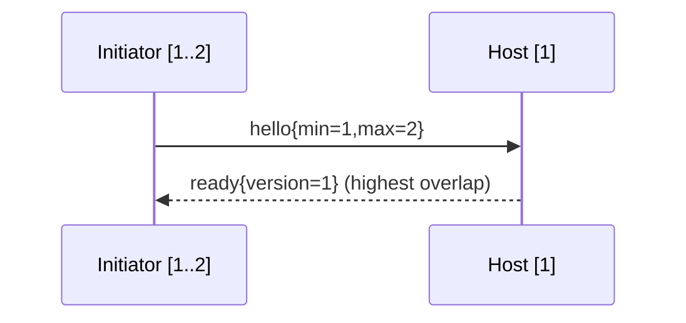

# Syntra v1 Core — Versioning and Compatibility

- Identifier: `specifications/core/versioning.md`
- Title: Wire, Schema, Transport, Extension, and Implementation Versions
- Status: Draft (pending maintainer approval via RFC)
- Version: 1.0.0-draft.1 (2026-10-19)
- Normative references: BCP 14; `protocol.md`; `serialization.md`; `framing.md`; `handshake.md`; `capabilities.md`; `errors.md`; ADR-009; `GOVERNANCE.md`; charter SYN-ARCH-020/021/040–045/050/051
- Scope: The five version dimensions, negotiation, compatibility/deprecation rules, and what constitutes breaking vs additive change. Transport revision details belong to transport specs; implementation release notes belong to implementations.
- Terminology: Per `protocol.md`. Five dimensions: (1) Protobuf schema package version (`syntra.v1`), (2) core wire protocol version (`Frame.version`), (3) transport profile revision, (4) optional extension/capability revision, (5) implementation release version.

The key words "MUST", "MUST NOT", etc. are per BCP 14.

## 1. Protocol requirements

**SNTR-VER-001** — Dimensions are independent and MUST NOT be conflated:
- Schema package (`syntra.v1`) versions representation; Buf governs field compatibility.
- Wire version (`Frame.version`, currently `1`) versions behavior/state machines; negotiated via `ClientHello{min,max}` → selected (highest overlap) per `handshake.md`.
- Transport profile revision versions framing/TLS/HTTP bindings; negotiated per transport spec, never changes `Frame` semantics.
- Extension revision versions an OPTIONAL capability (`capabilities.md`); negotiated per capability.
- Implementation release versions code; it NEVER versions the protocol (ADR-010).

**SNTR-VER-002** — Wire negotiation: initiator proposes `[min_version, max_version]` (both nonzero, `min ≤ max`); host selects highest overlap or fails with `UNIMPLEMENTED`/`FAILED_PRECONDITION` + close. Post-handshake, `Frame.version` MUST equal the selected version for the connection lifetime.

**SNTR-VER-003** — Compatibility classes:
- *Additive/minor*: new OPTIONAL `oneof` member + capability, new OPTIONAL field, new error-code value (with SNTR-ERR-005 tolerance), new transport/extension, relaxed validation that accepts strictly more peers. MUST remain backward compatible; old peers MUST interoperate (ignoring unknowns / `UNIMPLEMENTED` for optionals).
- *Breaking/major*: repurposed field number/name, changed field type, new REQUIRED field or behavior, altered state machine, weakened security, changed failure semantics, `reserved` reuse. REQUIRES a new wire major version, major RFC, migration notes, and `CHANGELOG.md` entry per `GOVERNANCE.md` §4.

**SNTR-VER-004** — Unknown tolerance (frozen): unknown Protobuf fields MUST be ignored; unknown `Frame.body` variants MUST be rejected with `UNIMPLEMENTED` (SYN-ARCH-021). Changing either rule is major.

**SNTR-VER-005** — Reserved preservation: `reserved 16,17` + `reserved "event","resume","ack"` MUST be preserved across all v1 minors; reuse REQUIRES a major version + RFC.

**SNTR-VER-006** — Deprecation: marking a field/capability/transport deprecated REQUIRES an RFC with notice period, alternative path, and removal version. Deprecated features MUST remain functional until removal; removal of a mandatory feature is major, of an optional feature is minor-with-notice per `capabilities.md` SNTR-CAP-007.

**SNTR-VER-007** — No silent downgrade: peers MUST NOT negotiate below the highest mutual version without explicit application consent; security-relevant downgrades (e.g., to insecure transport) MUST be refused.

## 2. Client behavior

- **SNTR-VER-010** — The client MUST propose the full range it supports, MUST handle `UNIMPLEMENTED` version rejection by reporting (not silently retrying weaker), and MUST record negotiated versions for diagnostics.
- **SNTR-VER-011** — The client MUST tolerate minor-additive responses (unknown fields/codes) per SNTR-SER-003/SNTR-ERR-005.

## 3. Server behavior

- **SNTR-VER-020** — The server MUST publish supported wire versions, transports (with secure/insecure labeling per SYN-ARCH-050), and capabilities; MUST select deterministically; MUST NOT accept a version it does not implement.
- **SNTR-VER-021** — The server MUST gate breaking changes behind the new major version and MUST maintain the documented dual-support window if promised.

## 4. Failure handling

Version mismatch → handshake failure (table in `handshake.md`). Mid-connection version change attempt → `FAILED_PRECONDITION` + close. Unknown-variant from a newer minor → `UNIMPLEMENTED` (not downgrade).

## 5. Security considerations

Version/capability downgrade attacks are in scope: negotiation MUST run over integrity-protected transports in production; hosts MUST prefer highest secure overlap and MUST log negotiation anomalies.

## 6. Compatibility considerations

This document is the compatibility authority for process; `capabilities.md` is the mechanism; Buf + conformance suite are the enforcement. Transport-only revisions MUST NOT change wire behavior; wire majors MUST NOT be smuggled as transport revisions.

## 7. Conformance requirements

- **SNTR-VER-900** — Fixtures: disjoint/overlapping ranges (low/high/exact); unknown-field tolerance across minors; unknown-variant `UNIMPLEMENTED`; reserved-reuse rejection (negative test with synthetic bytes); downgrade-refusal; deprecation-notice presence.
- **SNTR-VER-901** — Dimension-independence proof: same wire version over two transport revisions interops; same transport with two implementation releases interops with identical wire traces.

