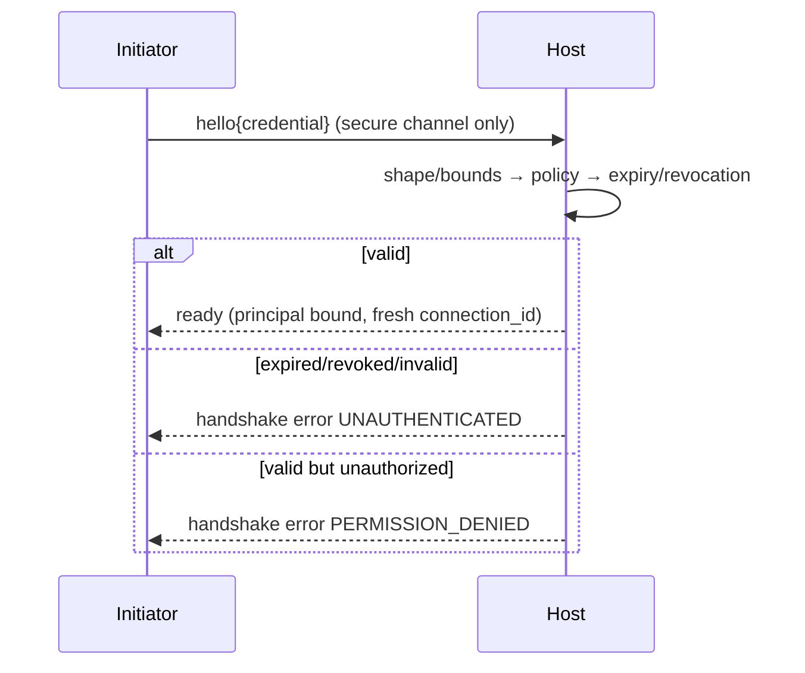

# Syntra v1 Security — Authentication Security

- Identifier: `specifications/security/authentication-security.md`
- Title: Credential, Session, and Token Security
- Status: Draft (pending maintainer approval via RFC)
- Version: 1.0.0-draft.1 (2026-10-26)
- Normative references:
  - BCP 14; `threat-model.md` (T1, T3, T5, T8, T9); `transport-security.md`; `replay-protection.md`; `opaque-payloads.md`
  - `specifications/core/authentication.md` (SNTR-AUTH-*, framework/principal/authorization in §1A–§1D), `sessions.md` (three concepts, resumption, cross-transport, HTTP, termination, timeouts in §1A–§1G), `handshake.md` (lifecycle table, ordering, diagrams in §1A–§1B/§2A), `errors.md`, `reliability.md`
  - `proto/syntra/v1/session.proto` (`ClientHello`, `ServerReady`)
- Scope: Security rules for credential carriage, principal handling, expiry/revocation, resume-token design, rotation, fixation defenses, and error disclosure. Credential formats and identity stores belong to the application; this document defines only channel, lifetime, and disclosure rules and is generic across user, service, device, or key-based principals.
- Terminology: Per `core/protocol.md`. **Principal** = opaque authenticated identity (never assumed to be a user account). **Resume token** = optional opaque token enabling resumption ONLY if a capability RFC defines it (default: no resumption in v1).

The key words "MUST", "MUST NOT", etc. are per BCP 14.

## 1. Protocol requirements

**SNTR-ASEC-001** — Credential confidentiality: credentials MUST be treated as sensitive key material. The core and adapters MUST NOT log, persist, cache beyond the handshake, echo in errors, or expose them in diagnostics, metrics labels, or traces. Memory handling SHOULD minimize retention (overwrite or release promptly where the language permits).

**SNTR-ASEC-002** — Channel binding: credentials MUST traverse only secure profiles in public deployments (see `transport-security.md` SNTR-TSEC-009) or loopback-restricted plaintext for development. If a negotiated channel-binding mechanism is defined by a future RFC (e.g., TLS exporter binding), its use MUST be explicit and versioned; absent such an RFC, implementations MUST NOT claim channel binding and MUST NOT improvise binding by mixing transport bytes into credential comparison.

**SNTR-ASEC-003** — Carriage: credentials MUST appear only in `ClientHello.credential` (initial) and, for multi-round mechanisms, in explicitly documented follow-up RPC payloads after ACTIVE. Credentials MUST NOT appear in URLs (no query-string, path, or fragment carriage), in `connection_id`, `request_id`, method strings, error messages, or event payloads as protocol metadata. This rule holds even if the application encodes its own references inside opaque payloads — the Syntra layer MUST NOT require URL carriage.

**SNTR-ASEC-004** — Principal identity handling: principals MUST be opaque handles bound at `ServerReady` for exactly one connection (see `core/authentication.md` SNTR-AUTH-007). Implementations MUST NOT assume user accounts; authorization policy MUST treat service/device/key/anonymous principals uniformly through the same hooks. Principal identifiers in logs MUST be redacted or pseudonymized unless the deployment documents otherwise.

**SNTR-ASEC-005** — Credential expiration: every credential type MUST have a bounded lifetime documented by the application. Hosts MUST enforce expiry (handshake denial with `UNAUTHENTICATED` or per-RPC `UNAUTHENTICATED` after ACTIVE) and MUST NOT accept indefinitely valid credentials in public deployments except for explicitly documented long-lived service credentials with rotation procedures.

**SNTR-ASEC-006** — Session revocation: hosts MUST be able to revoke a principal binding and any issued resume/session tokens promptly. On revocation, in-flight RPCs for the binding MUST fail with `UNAUTHENTICATED` and the connection MUST close unless the deployment documents per-RPC survival (default: close). Maximum revocation-propagation delay MUST be documented (see residual risk in `threat-model.md`).

**SNTR-ASEC-007** — Resume token design requirements (only applicable if a resumption capability RFC exists; otherwise resumption MUST be refused per `core/sessions.md` SNTR-SESS-006): tokens MUST be unguessable (≥128-bit entropy), single-purpose (resumption only, never authentication-by-itself unless the RFC explicitly defines the derivation), audience- and principal-bound, time-boxed, revocable, and integrity-protected by the issuer. Tokens MUST NOT encode privileges beyond a reference; privilege state MUST be re-evaluated at resumption.

**SNTR-ASEC-008** — Token rotation policy: on every successful resumption (if defined), hosts SHOULD rotate the token (issue a fresh token, invalidate the presented one) to bound replay windows. Reuse of a rotated token MUST be treated as suspected replay per `replay-protection.md`.

**SNTR-ASEC-009** — Replay protection for authentication: credentials and resume tokens MUST be replay-resistant per `replay-protection.md` (per-class defenses; TLS alone is insufficient). In particular, capture-and-retransmit of a `hello` or token MUST NOT yield a new authenticated session without freshness/validity checks defined by the mechanism.

**SNTR-ASEC-010** — Session fixation defenses: `connection_id` MUST be freshly generated per connection (≥128-bit entropy), MUST NOT be accepted as input, MUST NOT be predictable from prior connections, and MUST NOT grant any privilege. Hosts MUST NOT allow a peer to select or fixate session state (no client-chosen session IDs in v1 core).

**SNTR-ASEC-011** — Authentication error disclosure: handshake denials MUST use `UNAUTHENTICATED` (credential invalid/expired/revoked) or `PERMISSION_DENIED` (valid credential, insufficient access) without distinguishing sub-reasons (unknown principal vs wrong secret vs expired vs revoked) unless the deployment documents the oracle as intentional. `RpcError.message` MUST be generic and MUST NOT contain credential material, token values, principal enumerations, or backend diagnostics. Timing behavior SHOULD minimize user-enumeration oracles (constant-time credential comparison where applicable).

## 2. Request-security hooks (per-connection/session limits)

**SNTR-ASEC-020** — Hosts MUST enforce, per connection AND per session/principal: maximum envelope size (default 1 MiB per `framing.md`), maximum concurrent RPCs, maximum handshake attempts per unit time, maximum subscriptions/events per principal, and call deadlines. Limits MUST be documented; exceeding them MUST yield `RESOURCE_EXHAUSTED` (RPC context) or handshake/connection closure, and MUST trigger rate-limiting or temporary blocking of the offending source before affecting conformant principals (see `reliability.md`).

**SNTR-ASEC-021** — Slow-client protection: hosts MUST bound time-to-first-`hello`, inter-frame gaps during handshake, and per-RPC payload delivery windows; stalled peers MUST be closed with `DEADLINE_EXCEEDED`/`UNAVAILABLE`, not retained indefinitely.

**SNTR-ASEC-022** — Rate-limiting and authorization hooks: the core MUST expose (or document as application-implemented) hooks for per-principal rate limiting and per-method/subscription authorization evaluated AFTER authentication and BEFORE handler dispatch. Bypassing either hook MUST be treated as a security failure, not a functional bug.

**SNTR-ASEC-023** — Malformed input handling: shape/size/depth failures MUST map to `INVALID_ARGUMENT`/`RESOURCE_EXHAUSTED`/`FAILED_PRECONDITION` per `errors.md` without handler invocation and without sensitive disclosure.

**SNTR-ASEC-024** — Safe error messages: all authentication/session/token failures MUST use the disclosure rules in SNTR-ASEC-011; operational detail (attempt counts, backend identifiers) MUST go to privileged server-side diagnostics only, never to the peer.

## 3. Client behavior

- **SNTR-ASEC-030** — Initiators MUST store credentials securely (per application guidance), MUST NOT place them in URLs, logs, or error reports, MUST discard handshake state on rejection, and MUST NOT retry identical credentials in a tight loop (bounded backoff REQUIRED).
- **SNTR-ASEC-031** — Initiators MUST treat `UNAUTHENTICATED` as “present different/fresh credential” and `PERMISSION_DENIED` as “do not retry identically; seek authorization change”.

## 4. Server behavior

- **SNTR-ASEC-040** — Hosts MUST validate shape/bounds before policy lookup, compare secrets in constant time where applicable, rate-limit authentication attempts per source AND per principal, and isolate principals (no cross-principal credential/state use).
- **SNTR-ASEC-041** — Hosts MUST re-check expiry/revocation on each RPC and subscription action where staleness would grant unauthorized access, within the documented propagation window.

## 5. Failure handling

Expired → `UNAUTHENTICATED`; revoked → `UNAUTHENTICATED` + close (default); unauthorized → `PERMISSION_DENIED`; fixation/resumption abuse → `FAILED_PRECONDITION` or `UNAUTHENTICATED` + close; overload → `RESOURCE_EXHAUSTED`. Repeated failures trigger backoff/blocks.

## 6. Security considerations

This document's rules are the application-independence guarantee: no user-account assumption, no private identity service, no URL credentials. Channel binding is explicitly unclaimed until an RFC defines it — claiming it without a specified mechanism is non-conformant.

## 7. Compatibility considerations

New credential types are application deployments (no protocol change). New token, rotation, or binding mechanisms REQUIRE capability RFCs. Tightening disclosure or lifetime rules is a minor clarification; relaxing them is major.

## 8. Conformance requirements

- **SNTR-ASEC-900** — Fixtures: expired/revoked/invalid credentials; unauthorized-but-authenticated; fixation (`connection_id` replay/client-chosen); URL-carriage absence (negative grep of implementation + wire traces); error-message hygiene; revocation mid-connection; rate-limit behavior; slow-client closure.
- **SNTR-ASEC-901** — Generic-principal proof: same rules demonstrated with non-user principals (e.g., service key + device token fixtures using neutral opaque bytes).

