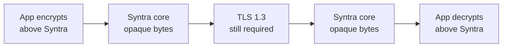

# Syntra v1 Security — Opaque Payloads

- Identifier: `specifications/security/opaque-payloads.md`
- Title: Opaque Application Bytes and Encryption Scope
- Status: Draft (pending maintainer approval via RFC)
- Version: 1.0.0-draft.1 (2026-10-26)
- Normative references:
  - BCP 14; `threat-model.md` (assets 4/7, out-of-scope 1/2); `transport-security.md`; `authentication-security.md`
  - `specifications/architecture.md` SYN-ARCH-013/031; `specifications/core/protocol.md` (SNTR-CORE-002), `serialization.md`, `framing.md`, `rpc.md`, `events.md`
  - `proto/syntra/v1/session.proto` (`bytes payload` fields)
- Scope: Security rules for Syntra's carriage of application-defined binary bytes. End-to-end encryption is outside Syntra's scope and MUST NOT be implemented here. Application cryptographic formats are never negotiated by the core.
- Terminology: Per `core/protocol.md`. **Opaque payload** = `RpcRequest.payload`, `RpcResult.payload`, `Notification.payload`, authentication follow-up bytes, and subscription filter bytes whose syntax and meaning belong to the application.

The key words "MUST", "MUST NOT", etc. are per BCP 14.

## 1. Protocol requirements

**SNTR-OPQ-001** — Syntra carries application-defined binary bytes. Producers MAY send arbitrary bytes (including empty and non-UTF-8); carriers MUST preserve them bit-exact and MUST NOT interpret, validate semantically, transform, compress, or decrypt them.

**SNTR-OPQ-002** — Syntra does not inspect encrypted payload semantics. Whether payload bytes are plaintext, serialized structures, or ciphertext is invisible to and irrelevant to the core; routing, correlation, bounds, and error mapping MUST behave identically regardless of content format.

**SNTR-OPQ-003** — End-to-end encryption is outside Syntra's scope. Syntra MUST NOT define, negotiate, or implement application-level E2EE, key exchange, ratchets, or custom ciphers. Applications that need E2EE MUST implement it above Syntra with established libraries; no E2EE handshake, algorithm identifier, or key material SHALL appear in Syntra envelope fields.

**SNTR-OPQ-004** — Application cryptographic formats are not negotiated by the Syntra core. Capability negotiation (`capabilities.md`) MUST NOT advertise application cryptosystems; version negotiation MUST NOT select them. Any format agreement is an application deployment concern carried opaquely.

**SNTR-OPQ-005** — Transport-level integrity and authentication remain necessary even for opaque encrypted payloads. Encrypted content MUST still traverse secure profiles in public deployments (see `transport-security.md`); use of application encryption MUST NOT justify plaintext transport, skipped certificate validation, or missing authentication. Rationale: transport protects endpoints, metadata, handshake, errors, and availability — none of which application encryption covers.

**SNTR-OPQ-006** — Payload limits apply regardless of content format. Maximum envelope/payload sizes, concurrency, deadlines, and queue bounds (see `framing.md` SNTR-WIRE-006, `reliability.md`, `authentication-security.md` SNTR-ASEC-020) MUST be enforced on byte length before any application processing, whether the bytes are plaintext or ciphertext. Encrypted payloads MUST NOT receive larger allowances.

## 2. Client behavior

- **SNTR-OPQ-010** — Initiators MUST size-check payloads before sending, MUST NOT assume the network or host interprets their format, and MUST NOT place credentials or key material in Syntra metadata fields (method strings, IDs, error text) even when payloads are encrypted.

## 3. Server behavior

- **SNTR-OPQ-020** — Hosts MUST dispatch on method + principal authorization without inspecting payload format, MUST enforce byte-length bounds before handler invocation, and MUST return handler failures as typed `RpcError`s without leaking payload plaintext/ciphertext in messages.

## 4. Failure handling

Oversize payloads → `RESOURCE_EXHAUSTED` regardless of format. undecryptable or invalid application content (detected by the application, not Syntra) → application-mapped `RpcError` (e.g., `INVALID_ARGUMENT`, `FAILED_PRECONDITION`) with generic text; Syntra MUST NOT add a distinct “decryption-failed” core code.

## 5. Security considerations

Opacity is a safety property (the core cannot be confused by content) but not a confidentiality property — the current secure profiles obtain wire confidentiality from TLS. Application payload encryption alone does not hide method names or subscription metadata; TLS protects envelope contents on its secured leg, while timing, sizes and endpoints remain observable. Applications with sensitive flows SHOULD document padding/quantization above Syntra.

### Accepted channel boundary (informative)

The carrier-independent [secure channel](secure-channel.md) accepted under
[RFC 0007](../../rfcs/0007-secure-channel-device-authorization.md)
authenticates/decrypts channel records before bounded envelope reconstruction
and core decoding. That operation is distinct from interpreting or decrypting
`payload` bytes: applications retain ownership of any inner ciphertext and
its keys. Accepted record framing may split a serialized envelope without
changing its opaque bytes or the default serialized-envelope limit. The
accepted contract adds no application E2EE algorithm, capability or schema
field. SNTR-OPQ-005's secure-profile and certificate requirements remain in
force: the accepted channel is additive to transport security, not a
replacement for it, and opaque application encryption supplies no policy
exception.

## 6. Compatibility considerations

Payload formats are application-versioned, never Syntra-versioned. Core evolution MUST NOT depend on payload syntax; adding a core field to “support E2EE” is FORBIDDEN — such proposals MUST be rejected without an application-layer design.

## 7. Conformance requirements

- **SNTR-OPQ-900** — Fixtures: arbitrary-byte round-trip (empty, binary, a maximum-payload fixture sized so the TOTAL serialized `Frame` stays within `DEFAULT_MAX_FRAME_BYTES` per accepted [RFC 0005](../../rfcs/0005-negotiation-bounds-identifiers.md) D3 — a MAX-sized total frame is within the bound and `MAX+1` is rejected pre-dispatch, so a 1 MiB payload alone does NOT fit — simulated-ciphertext random bytes) bit-preserved across a secure profile; oversize-ciphertext rejected identically to oversize-plaintext; no E2EE fields present in envelope traces (negative check).
- **SNTR-OPQ-901** — Scope proof: implementation documentation states E2EE (if any) lives above Syntra and transport security remains enforced.

