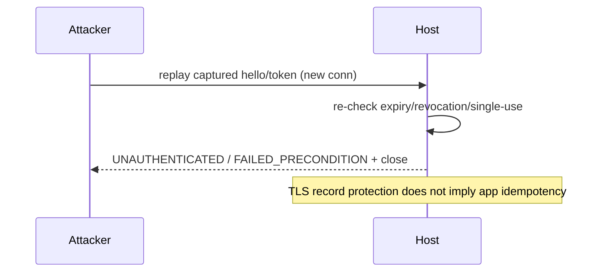

# Syntra v1 Security — Replay Protection

- Identifier: `specifications/security/replay-protection.md`
- Title: Replay Classes and Application-Level Defenses
- Status: Draft (pending maintainer approval via RFC)
- Version: 1.0.0-draft.1 (2026-10-26)
- Normative references:
  - BCP 14; `threat-model.md` (T4); `authentication-security.md`; `transport-security.md`
  - `specifications/core/authentication.md` (§1A framework), `sessions.md` (§1C–§1D resumption/cross-transport), `rpc.md`, `events.md`, `reliability.md`, `errors.md`
  - TLS 1.3 (RFC 8446) — for scope clarification only (TLS replay protections do not imply application idempotency)
- Scope: The five distinguished replay classes, required per-class defenses, and the explicit rule that TLS MUST NOT be assumed to provide application-level idempotency. Mechanism details (nonces, windows, operation keys) belong to application deployments or resumption/stream RFCs; this document defines only class separation and minimum guarantees.
- Terminology: Per `core/protocol.md`. **Replay** = retransmission of a previously valid byte sequence or token in a new context. **Idempotency key** = application-level operation identifier inside opaque payload (never `request_id`).

The key words "MUST", "MUST NOT", etc. are per BCP 14.

## 1. Protocol requirements — class separation

**SNTR-RPL-001** — Implementations MUST treat the following as distinct classes with distinct defenses; a defense for one class MUST NOT be claimed as covering another:

1. Replay of authentication credentials (captured `hello`/follow-up payloads).
2. Replay of resume tokens (captured resumption presentations).
3. Repeated RPC `request_id`s (retransmitted or colliding correlation IDs).
4. Repeated idempotency keys (application operation identifiers inside payloads).
5. Duplicate application events (replayed or redelivered `Notification`s).

**SNTR-RPL-002** — TLS scope rule: TLS 1.3 protections against record replay MUST NOT be assumed to provide application-level idempotency, deduplication, or exactly-once execution. An RPC, token use, or event that is delivered exactly once by TLS MAY still be duplicated by retries, reconnections, replay attackers, or stream recovery. Applications needing effectively-once behavior MUST implement operation-level defenses above Syntra.

## 2. Per-class rules

**SNTR-RPL-010** — Class 1 (credential replay): captured credentials MUST NOT yield extended access beyond the credential's own validity. Defenses: short lifetimes (SNTR-ASEC-005), revocation (SNTR-ASEC-006), and mechanism-level freshness where the application defines it (e.g., single-use or challenge-bound credentials). Retransmission of a `hello` on a new connection MUST be evaluated as a fresh authentication (expiry/revocation re-checked), never as implicit success.

**SNTR-RPL-011** — Class 2 (resume-token replay): if resumption is defined, tokens MUST be single-use-or-rotated (SNTR-ASEC-008), audience/principal/time-bound (SNTR-ASEC-007), and reuse of a rotated/consumed token MUST be rejected as suspected replay (`UNAUTHENTICATED` or `FAILED_PRECONDITION` + close). Absent a resumption RFC, any presented “resume” data MUST be rejected per `sessions.md` SNTR-SESS-006.

**SNTR-RPL-012** — Class 3 (repeated `request_id`): `request_id` is connection-scoped correlation only (SNTR-RPC-010). A duplicate `request_id` for an outstanding RPC MUST be rejected (`FAILED_PRECONDITION`); a `request_id` arriving after its terminal `result` MUST be treated as a new-RPC attempt with a stale ID and rejected (not executed), because the initiator MUST NOT reuse IDs before completion. `request_id` MUST NOT be used for cross-connection dedup.

**SNTR-RPL-013** — Class 4 (repeated idempotency keys): the core provides NO interpretation. Applications requiring safe retry MUST embed operation keys in opaque payloads and MUST implement server-side dedup windows (key retention, duplicate response, conflict handling). Syntra conformance for this class means (a) preserving key bytes bit-exact through the core and (b) documenting whether the application implements dedup — the core MUST NOT claim it.

**SNTR-RPL-014** — Class 5 (duplicate events): initiators MUST tolerate duplicates (see `events.md` SNTR-EVENT-007/008, `reliability.md` SNTR-REL-005); hosts SHOULD minimize them but MAY emit them under replay/recovery/reconnect. Duplicates MUST NOT be treated as protocol violations and MUST NOT trigger error storms.

### Proposed channel replay defenses (informative)

[Draft RFC 0007](../../rfcs/0007-secure-channel-device-authorization.md)
adds a [channel-record and handshake replay review](secure-channel.md),
separate from the five application replay classes above. Returning NKpsk0
uses a persistent shared AK, but each attempt has fresh ephemeral keys,
directional traffic keys, counters and channel state. The scoped eight-byte
`auth_id` only selects a candidate enrollment; neither it nor a valid first
flight proves fresh client participation. The host would wait for an
authenticated client transport record under the new keys (potentially the
encrypted `hello`) and current principal checks before protected effects.

Both proposed handshake payloads are empty: no 0-RTT RPC, enrollment or other
application effects are permitted by the proposal. Ordered carriers fail on
record authentication errors; a future UDP binding needs explicit counters,
a bounded replay window and authenticate-before-state-update rules, plus
independent path/DoS controls. UDP remains deferred pending that frozen,
reviewed and accepted binding.

[Persistent device authorization](device-authorization.md) is fresh
authentication on reconnect, not a resume token, restored subscription or
permission to replay an RPC. Record anti-replay cannot deduplicate application
operation keys or events; unknown outcomes and the five current RPL classes
remain separate. These proposed cases supplement, rather than replace,
SNTR-RPL-900/901 and the existing TLS-based tests after acceptance.

## 3. Client behavior

- **SNTR-RPL-020** — Initiators MUST NOT retry with the same `request_id` across connections, MUST generate fresh correlation IDs per attempt, MUST carry the same application operation key across retries when safe-retry is intended, and MUST deduplicate received events where the application defines identity.
- **SNTR-RPL-021** — Initiators MUST NOT interpret TLS success as “handler executed exactly once” (see `reliability.md` SNTR-REL-001).

## 4. Server behavior

- **SNTR-RPL-030** — Hosts MUST re-validate freshness/expiry/revocation on every credential/token presentation (no caching of “previously valid”), MUST enforce `request_id` rules in §2, MUST preserve operation-key bytes untouched, and MUST document dedup windows if the application implements them.
- **SNTR-RPL-031** — Hosts MUST rate-limit suspected-replay bursts (rotated-token reuse, `request_id` collisions) as potential attacks, not merely functional errors.

## 5. Failure handling

Credential/token replay → `UNAUTHENTICATED` (+ close for handshake/resumption). Stale `request_id` → `FAILED_PRECONDITION`. Duplicate operation keys → application-defined (success-with-same-result or conflict error, documented). Duplicate events → tolerated, no error.

## 6. Security considerations

Cross-class confusion is the principal risk (e.g., treating `request_id` uniqueness as replay protection for credentials). Class separation (§1) is a security boundary. Windows (token lifetimes, dedup retention, revocation delay) MUST be documented as they bound attacker opportunity.

## 7. Compatibility considerations

Adding per-class mechanisms (nonces, windows, new token types) is minor-additive via capability RFCs. Changing class semantics (e.g., giving `request_id` cross-connection meaning) is major and FORBIDDEN in v1.

## 8. Conformance requirements

- **SNTR-RPL-900** — Fixtures: captured-`hello` retransmit re-evaluated (expired → denied); rotated-token reuse denied; duplicate outstanding `request_id` rejected; stale-ID-after-completion rejected; operation-key bytes preserved with documented dedup behavior; duplicate-event tolerance; TLS-delivered-but-retried RPC does not double-apply without application dedup (negative proof).
- **SNTR-RPL-901** — Distinction proof: test log shows all five classes exercised independently with different defenses; no single “replay test” claimed as covering multiple classes.

