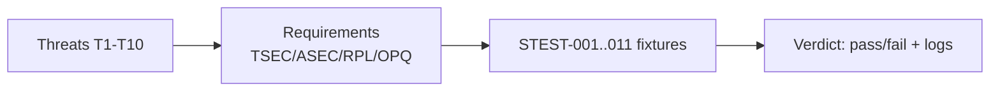

# Syntra v1 Security — Test Plan

- Identifier: `specifications/security/test-plan.md`
- Title: Security Test Requirements and Traceability
- Status: Draft (pending conformance-suite RFC; informative until suite accepts it)
- Version: 1.0.0-draft.1 (2026-10-26)
- Normative references: `threat-model.md` (T1–T10); all security documents; `core/conformance.md`; `requirements.md`
- Scope: REQUIRED security test groups, fixtures, and pass criteria. Each group maps threats → requirements → fixtures. “Pass” MUST NOT be reported unless executed with logs. Neutral fixtures only (echo, generic key/value, generic subscription).
- Terminology: Per `core/protocol.md`. **Negative test** = attack/misuse input that MUST be rejected without compromise.

## 1. Test groups (G — eleven required)

**SNTR-STEST-001 — Invalid certificates.** Present self-signed-untrusted, wrong-chain, and malformed certificates on a secure profile. Expect: handshake fails before any `hello`/credential is sent; no fallback; `UNAVAILABLE` to waiters. Maps T1. (Refs SNTR-TSEC-003/020/030.)

**SNTR-STEST-002 — Wrong hostname.** Present a chain-valid certificate for a different name (SAN mismatch, CN-only mismatch, IP mismatch). Expect: rejection before credential presentation, even though the chain validates. Maps T1/T10. (Refs SNTR-TSEC-004.)

**SNTR-STEST-003 — Expired credentials.** Present a well-formed but expired credential (and, if defined, an expired resume token). Expect: `UNAUTHENTICATED` (handshake or per-RPC per phase); no state established. Maps T3. (Refs SNTR-ASEC-005, SNTR-RPL-010.)

**SNTR-STEST-004 — Revoked credentials.** Revoke a previously valid credential/principal, then present it (handshake and mid-connection RPC). Expect: `UNAUTHENTICATED` + binding termination within documented propagation window. Maps T3. (Refs SNTR-ASEC-006/041.)

**SNTR-STEST-005 — Unauthorized requests.** Authenticate with a valid-but-insufficient principal; invoke a protected method and a protected subscription. Expect: `PERMISSION_DENIED`, no handler effect, no existence oracle beyond documented behavior. Maps T3/T9. (Refs SNTR-ASEC-011, SNTR-AUTH-009.)

**SNTR-STEST-006 — Invalid resume tokens.** Present unknown, expired, wrong-audience, and (if rotation defined) already-rotated tokens; also present `connection_id` as a token. Expect: `UNAUTHENTICATED` or `FAILED_PRECONDITION` + close; no session established. Where no resumption RFC exists, any resumption attempt MUST fail. Maps T5/T4. (Refs SNTR-ASEC-007/008/010, SNTR-RPL-011, SNTR-SESS-006.)

**SNTR-STEST-007 — Oversized envelopes.** Test the serialized-envelope bound
with a valid serialized `Frame` of exactly MAX bytes (default 1,048,576),
then otherwise-valid envelopes of MAX+1 and 2×MAX bytes. Count all tags,
length varints, nested-message wrappers, and enclosing fields; adjust opaque
payload lengths to reach the intended total. A MAX-byte payload alone is
not a MAX-byte envelope. Exactly MAX is accepted only when decode, state,
authentication, and all independent field limits also pass; MAX+1 and
2×MAX take the profile's oversize path (`RESOURCE_EXHAUSTED` context,
HTTP `413`, WS Close 1009, or connection closure as applicable), with no
allocation failure or panic. Separately test documented method, payload,
credential, and notification field limits at their own boundaries, using
valid shapes/states and supported variants; no field is entitled to MAX
bytes merely because the envelope cap is MAX. In particular, preserve
HTTP's decoded-credential ceiling (default 64 KiB, SNTR-HTTP-113) and
independent header limits; do not enlarge them to construct an envelope
boundary case. HTTP/HTTPS never carries a notification envelope or an
envelope credential; test its credential in `Authorization` and its body
bound separately. Apply the same budgets to simulated-ciphertext payload
bytes. Maps T6. (Refs SNTR-WIRE-006, SNTR-SER-006, SNTR-OPQ-006.)

**SNTR-STEST-008 — Truncated frames.** Send truncated varints, cut length-prefixes, half-delivered handshakes, and slow-drip payloads exceeding inter-frame windows. Expect: deterministic `INVALID_ARGUMENT`/`DEADLINE_EXCEEDED`/`UNAVAILABLE` per layer; slow clients closed, not retained. Maps T6/T7. (Refs SNTR-SER-007, SNTR-ASEC-021.)

**SNTR-STEST-009 — Resource exhaustion.** Flood handshake attempts, concurrent RPCs beyond max, subscription/event bursts, and oversized queues from one principal while a conformant principal operates. Expect: `RESOURCE_EXHAUSTED` + rate-limit/block of offender; conformant traffic unaffected per documented priority; recovery without restart. Maps T7. (Refs SNTR-ASEC-020, SNTR-REL-007/008.)

**SNTR-STEST-010 — Protocol downgrade attempts.** Offer TLS <1.3, plaintext retry after TLS failure, weaker wire version, weaker capability set, and stripped ALPN/SNI. Expect: refusal, no credential disclosure, no silent fallback; highest secure overlap selected when legitimate. Maps T2. (Refs SNTR-TSEC-002/007, SNTR-VER-007.)

**SNTR-STEST-011 — Cross-session credential misuse.** Replay a credential/token/`connection_id` across connections, principals, and (where transports differ) profiles. Expect: each use re-evaluated; cross-principal use denied; `connection_id` never accepted as auth; fixation attempts fail. Maps T5/T4. (Refs SNTR-ASEC-004/010, SNTR-RPL-010/011, SNTR-SESS-006.)

## 2. Cross-cutting requirements

**SNTR-STEST-900** — Every group MUST include: (a) wire trace showing no credential/token in URLs, logs, errors, or metrics labels; (b) error-message hygiene check (negative grep for secret/diagnostic patterns); (c) timing-agnostic pass criteria (no flaky deadlines); (d) secure-profile AND (where permitted) loopback-plaintext scoping labels.

## 3. Traceability matrix

| Test | Threats | Requirements sampled |
|------|---------|----------------------|
| STEST-001/002 | T1, T10 | SNTR-TSEC-001–004, SNTR-TMOD-030 |
| STEST-003/004/005 | T3, T9 | SNTR-ASEC-004–006/011, SNTR-AUTH-* |
| STEST-006 | T4, T5 | SNTR-ASEC-007/008/010, SNTR-RPL-011 |
| STEST-007/008 | T6 | SNTR-SER-006/007, SNTR-WIRE-006, SNTR-OPQ-006 |
| STEST-009 | T7 | SNTR-ASEC-020–022, SNTR-REL-007/008 |
| STEST-010 | T2 | SNTR-TSEC-002/007/010, SNTR-VER-007 |
| STEST-011 | T4, T5 | SNTR-ASEC-004/009/010, SNTR-RPL-010–012 |

