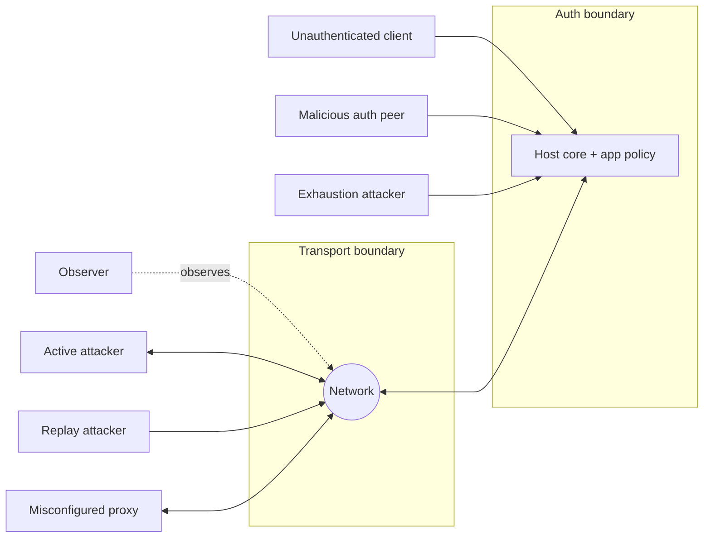

# Syntra v1 Security — Threat Model

- Identifier: `specifications/security/threat-model.md`
- Title: Normative Threat Model
- Status: Draft (pending maintainer approval via RFC)
- Version: 1.0.0-draft.1 (2026-10-26)
- Normative references:
  - BCP 14 / RFC 2119 / RFC 8174
  - `specifications/architecture.md` (SYN-ARCH-030–035, ownership SYN-ARCH-043)
  - `specifications/core/protocol.md` (SNTR-CORE-*), `handshake.md`, `authentication.md`, `sessions.md`, `rpc.md`, `events.md`, `reliability.md`, `errors.md`, `capabilities.md`, `versioning.md`
  - `proto/syntra/v1/session.proto`, `proto/syntra/v1/error.proto`
- Scope: The authoritative threat model for Syntra v1 public deployments. It identifies assets, attackers, trust boundaries, assumptions, in-scope vs out-of-scope threats, mitigations, and residual risks. Companion documents (`transport-security.md`, `authentication-security.md`, `replay-protection.md`, `opaque-payloads.md`) own the corresponding normative mitigations and MUST NOT weaken this model.
- Terminology: Per `core/protocol.md`. **Asset** = anything whose compromise violates a security requirement. **Trust boundary** = a point where data or control passes between mutually distrusting parties. **Mitigation** = a REQUIRED mechanism; **residual risk** = accepted remaining risk that deployments MUST document.

The key words "MUST", "MUST NOT", etc. are per BCP 14.

## 1. Assets

**SNTR-TMOD-001** — Implementations MUST protect the following assets as sensitive, regardless of application semantics:

1. Protocol credentials (`ClientHello.credential`, any follow-up authentication payloads, resume tokens).
2. Authenticated session state (principal binding, expiry, revocation status).
3. Resume tokens (if a resumption capability is negotiated; otherwise their absence MUST be treated as an asset — see `sessions.md` SNTR-SESS-006).
4. Request and response payloads (opaque bytes; confidentiality and integrity expectations are set by the application, but Syntra MUST NOT leak or corrupt them).
5. Endpoint identity (server certificate identity, hostname binding, principal handles).
6. Authorization decisions (which principal may invoke which method or subscription; decisions MUST NOT be bypassable or observable as an oracle).
7. Event subscriptions (existence, filter parameters, delivery — subscription to a generic topic MUST NOT leak to unauthorized peers).
8. Resource availability (handshake slots, RPC concurrency, queues, bandwidth; exhaustion of any asset MUST NOT cascade to unrelated principals except per documented priority).

## 2. Attackers

**SNTR-TMOD-002** — The model MUST assume all of the following attackers; a mitigation that stops only a subset is insufficient for public deployment claims:

1. **Unauthenticated remote clients** — can open transport connections, send arbitrary `hello`/RPC bytes, and probe error responses.
2. **Network observers** — passive; can read, record, and analyze all plaintext traffic and metadata (timing, sizes, endpoints).
3. **Active network attackers** — can delay, reorder, replay, truncate, inject, and (on insecure transports) modify traffic; can attempt downgrade and fixation.
4. **Malicious authenticated peers** — hold valid credentials for their own principal and attempt privilege escalation, cross-principal access, subscription snooping, or resource monopolization.
5. **Replay attackers** — capture and retransmit valid credentials, tokens, RPCs, or events (see `replay-protection.md` for the five distinguished classes).
6. **Resource-exhaustion attackers** — open many connections, send oversized/slow/malformed inputs, or trigger expensive handlers to deny service.
7. **Misconfigured reverse proxies** — not malicious but in-path; may terminate TLS, alter `Host`/SNI/ALPN, strip headers, buffer indefinitely, or present a different identity than the backend. Deployments that place proxies in path MUST treat proxy configuration as a security boundary (see `transport-security.md`).

## 3. Trust boundaries

**SNTR-TMOD-010** — Implementations MUST enforce these boundaries; data crossing a boundary MUST be validated, bounded, and (where crossing from lower to higher trust) authenticated and authorized:

1. **Network ↔ transport adapter** (untrusted bytes → framed `Frame`; size/depth/shape checks per `serialization.md`, `framing.md`).
2. **Transport adapter ↔ core** (framed bytes → state machine; version/state/`request_id` validation per `handshake.md`, `framing.md`).
3. **Core ↔ application** (opaque payloads → handlers; method shape + auth binding + authorization per `rpc.md`, `authentication.md`; core MUST NOT interpret payload semantics).
4. **Unauthenticated ↔ authenticated** (handshake → ACTIVE; no protected operation before success per SYN-ARCH-033).
5. **Principal ↔ principal** (one connection's credential/state MUST NOT authorize another's RPCs, subscriptions, or resumption).
6. **Proxy ↔ backend** (if TLS is terminated before the host, the proxy-to-host leg MUST be explicitly secured and identity-propagated per `transport-security.md`; otherwise it MUST be treated as hostile network).

## 4. Assumptions

**SNTR-TMOD-020** — The model assumes and deployments MUST ensure:

1. Established TLS implementations are used; no custom TLS, ciphers, ratchets, or application-level E2EE is defined by Syntra (SYN-ARCH-031).
2. Private keys and credential issuers are managed by the application/operator, not by Syntra; compromise of those is out of scope for the core but MUST be recoverable via expiration/revocation/rotation.
3. Clocks are approximately synchronized for expiry/deadline enforcement (tolerance documented per deployment); absolute clock security is not provided by Syntra.
4. The application defines credential formats, authorization policy, payload schemas, and event semantics; Syntra provides only generic interfaces and hooks.
5. Restricted-development plaintext profiles are never used for public traffic (SYN-ARCH-030).

## 5. In-scope threats and mitigations (traceable)

**SNTR-TMOD-030** — Each in-scope threat MUST be mitigated as stated; each mitigation maps to test groups in `test-plan.md`:

| # | Threat | Mitigation (owner) | Test group |
|---|--------|-------------------|------------|
| T1 | Credential disclosure on the wire/logs/errors | TLS-only in production; no-log/no-persist/no-echo rules (`transport-security.md`, `authentication-security.md`) | STEST-CRED, STEST-TLS |
| T2 | Downgrade (version/transport/capability) | Highest-overlap selection; downgrade rejection; integrity via secure transport (`handshake.md`, `transport-security.md`, `versioning.md`) | STEST-DOWNGRADE |
| T3 | Impersonation / auth bypass | Opaque-credential validation before dispatch; principal binding fixed at `ServerReady`; per-RPC authorization (`authentication-security.md`) | STEST-AUTH |
| T4 | Replay (5 classes) | Per-class defenses; TLS ≠ idempotency (`replay-protection.md`) | STEST-REPLAY |
| T5 | Session fixation / cross-session misuse | Fresh unguessable `connection_id`; no `connection_id`-as-auth; resumption only if negotiated with token binding (`authentication-security.md`, `sessions.md`) | STEST-SESSION |
| T6 | Oversize/truncated/malformed input | Ordered validation; size/depth bounds; deterministic rejection (`serialization.md`, `framing.md`, `opaque-payloads.md`) | STEST-FRAME |
| T7 | Exhaustion / slow-client | Concurrency/queue/rate bounds; handshake timers; backoff; isolation (`reliability.md` + §D hooks in `authentication-security.md`) | STEST-EXHAUST |
| T8 | Error-oracle disclosure | Sanitized `RpcError.message`; constant-time credential compare; `UNAUTHENTICATED` vs `PERMISSION_DENIED` discipline (`errors.md`, `authentication-security.md`) | STEST-ORACLE |
| T9 | Unauthorized RPC/subscription/event leak | Auth-before-dispatch; per-subscription authorization; post-revocation termination (`authentication-security.md`, `events.md`) | STEST-AUTHZ |
| T10 | Proxy-induced identity/binding break | Explicit termination config; backend-leg security; hostname/SNI consistency (`transport-security.md`) | STEST-PROXY |

## 6. Out-of-scope threats

**SNTR-TMOD-040** — The following are explicitly out of scope for the Syntra core and MUST NOT be claimed as mitigated by Syntra conformance:

1. Application payload semantics (e.g., whether a generic key/value `put` overwrites correctly) — application responsibility.
2. Application-level end-to-end encryption content and key management — outside Syntra (see `opaque-payloads.md`); transport security remains REQUIRED even for encrypted payloads.
3. Compromise of application credential issuers, databases, or operator hosts.
4. Physical, side-channel, or endpoint-malware attacks on initiators/hosts.
5. Availability of underlying network links (Syntra bounds its own queues; it does not guarantee link capacity).

Out-of-scope does NOT mean unimportant; applications MUST address them above Syntra, and deployments MUST document the split.

## 7. Protocol requirements (summary)

- **SNTR-TMOD-050** — Public deployments MUST implement every T1–T10 mitigation for every claimed transport profile and capability. Restricted-development plaintext profiles MUST NOT be claimed as public-secure.
- **SNTR-TMOD-051** — No custom cryptographic primitives, TLS implementations, ciphers, ratchets, or E2EE protocols SHALL be introduced to mitigate any threat in this model.

## 8. Client behavior

- **SNTR-TMOD-060** — Clients MUST validate server identity per `transport-security.md`, present credentials only over permitted channels, enforce handshake/RPC timers, and treat `UNAVAILABLE` as outcome-unknown (see `reliability.md`).

## 9. Server behavior

- **SNTR-TMOD-061** — Hosts MUST validate-then-authorize on every state crossing, enforce all bounds, sanitize errors, isolate principals, and terminate revoked/expired bindings promptly.

## 10. Failure handling

Threat-triggered failures map to typed errors per `errors.md` (not silent drops, except resource-protective event-drop per documented stream policy). Repeated threat signals MUST trigger rate-limiting or closure, never unbounded retention.

## 11. Security considerations

This document IS the security-considerations authority for scope; mechanism details live in companion documents. Any new threat discovered MUST be added here via RFC with a mitigation owner and test group before a mechanism RFC claims coverage.

## 12. Compatibility considerations

Adding a threat or mitigation is a minor clarification unless it imposes new REQUIRED behavior (then minor-with-capability or major per `versioning.md`). Removing a mitigation is major.

## 13. Conformance requirements

- **SNTR-TMOD-900** — Conformance MUST demonstrate traceability: every T1–T10 maps to at least one passing negative test in `test-plan.md`; out-of-scope items MUST be documented as not claimed.
- **SNTR-TMOD-901** — Any security ambiguity found during testing MUST be recorded in `open-questions.md`, not resolved by implementation choice.

## Appendix: Residual risks

1. Downgrade within equally-secure options (e.g., H1 vs H2) may still reduce performance but not confidentiality when both are TLS-protected; deployments SHOULD prefer strongest overlap.
2. Timing/size oracles cannot be fully eliminated on a hostile network; mitigations reduce but do not remove them — applications handling highly sensitive flows SHOULD add padding/quantization above Syntra and document it.
3. Revocation propagation has a window (credential/token valid until checked); deployments MUST document maximum staleness and keep it small.
