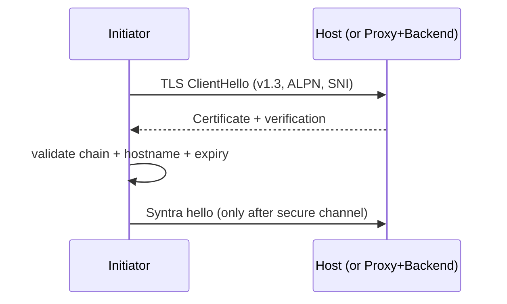

# Syntra v1 Security — Transport Security

- Identifier: `specifications/security/transport-security.md`
- Title: TLS and Transport Profile Security
- Status: Accepted (2026-10-29) — includes the RFC 0007/ADR-011 SC1/WSS amendment
- Version: 1.0.0 (2026-10-29)
- Normative references:
  - BCP 14; RFC 8446 (TLS 1.3); RFC 5280 (PKIX); RFC 6125 / RFC 9110 §4.3.3 (hostname verification principles); RFC 7301 (ALPN)
  - `threat-model.md` (T1, T2, T10); `authentication-security.md`; `opaque-payloads.md`
  - `specifications/architecture.md` SYN-ARCH-030/031/050/051; `specifications/core/handshake.md`, `versioning.md`
- Scope: Transport security for the v1 profiles, including `SNTR-SC1-WSS-V1`. Defines TLS 1.3 requirements, validation, downgrade rejection, rotation, termination/proxy rules, ALPN, and permitted plaintext development use. Per-profile byte framing belongs to the transport specs and MUST NOT weaken this document.
- Terminology: Per `core/protocol.md` and `threat-model.md`. **Secure profile** = TLS 1.3/TCP, HTTPS/H1, HTTPS/H2, WSS/H1, and SC1/WSS. **Plaintext profile** = TCP, HTTP/1.1, WS/H1 and SC1 TCP/WS for restricted development only.

The key words "MUST", "MUST NOT", etc. are per BCP 14.

## 1. Protocol requirements

**SNTR-TSEC-001** — Public deployments MUST use only secure profiles. Plaintext profiles MUST NOT be used for public traffic, MUST be disabled by default in any distribution claiming production readiness, and MUST emit an explicit insecure-mode warning when enabled.

**SNTR-TSEC-002** — Secure profiles MUST use TLS 1.3 (RFC 8446) via an established implementation. TLS 1.2 or lower MUST NOT be negotiated for Syntra public traffic; if offered by the peer, negotiation MUST fail. No custom TLS, cipher, or handshake implementation SHALL be introduced.

**SNTR-TSEC-003** — Server certificate validation: initiators MUST validate the full chain to a trusted root (system or explicitly configured), check expiry/revocation status per deployment policy, reject invalid/expired/revoked/self-signed-untrusted certificates with a terminal handshake failure, and MUST NOT fall back to plaintext or skip validation on failure.

**SNTR-TSEC-004** — Endpoint hostname verification: initiators MUST verify the presented identity matches the intended endpoint (SAN dNSName/iPAddress preferred; CN only per RFC 6125 fallback rules) before sending `ClientHello.credential` or any application payload. Wrong-hostname certificates MUST be rejected even if chain-valid. Credentials MUST never be sent to an unverified endpoint.

**SNTR-TSEC-005** — Permitted plaintext development: plaintext profiles MAY be used only in restricted environments (loopback or isolated test networks with no public routing). Distributions MUST document that they provide no confidentiality, integrity, or authentication, and MUST NOT accept production credentials over them.

**SNTR-TSEC-006** — Certificate rotation: hosts MUST support rotation without requiring a protocol version change; initiators MUST NOT pin certificates or keys unless the deployment explicitly documents pinning with rotation procedures. During rotation, hosts SHOULD prefer overlapping validity windows; initiators MUST accept any currently valid chain, not a single hard-coded leaf.

**SNTR-TSEC-007** — TLS downgrade rejection: peers MUST NOT negotiate below TLS 1.3 for secure profiles and MUST NOT downgrade from a secure to a plaintext profile on failure. Automatic retry over plaintext after TLS failure is FORBIDDEN. Version/capability downgrade attempts at the Syntra layer (see `versioning.md` SNTR-VER-007) MUST be refused when they would weaken transport security.

**SNTR-TSEC-008** — TLS termination and trusted proxies: if TLS terminates at a reverse proxy before the host, (a) the proxy-to-host leg MUST be explicitly secured (TLS or isolated private network documented as such — otherwise treated as hostile per SNTR-TMOD-010), (b) endpoint identity verified by the initiator MUST be the proxy's presented identity only if the proxy is the deployment's authenticated front door AND the proxy validates the backend identity, (c) `Host`/SNI/ALPN and principal context MUST be propagated without alteration or with explicitly documented mapping, and (d) misconfiguration (mismatched SNI, stripped identity) MUST cause handshake failure, not silent fallback.

**SNTR-TSEC-009** — Authentication over secure connections: `ClientHello.credential` and any follow-up authentication payloads MUST be sent only after the secure channel is established (or over loopback-restricted plaintext for development). Resumption/re-authentication MUST NOT transmit reusable secrets over plaintext.

**SNTR-TSEC-010** — ALPN: where the transport uses ALPN (HTTPS/H2, WSS handshakes layered on HTTPS), peers MUST negotiate per the transport profile's registered identifiers; ALPN mismatch MUST fail the connection rather than fall back to an unintended protocol. ALPN MUST NOT be used as an authentication or authorization signal.

**SNTR-TSEC-011** — No custom cryptography: cipher suite selection MUST use the TLS 1.3 implementation's secure defaults; deployments MUST NOT enable deprecated/weak suites, MUST NOT implement custom ciphers, and MUST NOT negotiate application-level encryption as a substitute for transport security (see `opaque-payloads.md` — transport integrity/authentication remain REQUIRED even for opaque encrypted payloads).

## 2. Client behavior

- **SNTR-TSEC-020** — Initiators MUST fail closed on any validation failure (invalid chain, wrong hostname, expired, revocation-indicated), surface a non-oracle error, and MUST NOT retry the same endpoint without operator action.
- **SNTR-TSEC-021** — Initiators MUST include SNI/hostname consistently, MUST verify before credential presentation, and MUST NOT send credentials in URLs (see `authentication-security.md` SNTR-ASEC-003 — no query-string or path credential carriage).

## 3. Server behavior

- **SNTR-TSEC-030** — Hosts MUST present a valid chain for the claimed endpoint, MUST enforce TLS 1.3 minimum, MUST log (without credentials) negotiation failures for operations, and MUST close on downgrade attempts.
- **SNTR-TSEC-031** — Hosts behind proxies MUST validate the proxy-to-host binding and MUST reject requests with inconsistent identity propagation.

## 4. Failure handling

Invalid/wrong-hostname/expired/revoked certificates → terminal handshake failure (`UNAVAILABLE` to waiters; no Syntra `hello` sent). Downgrade attempts → handshake failure + close. Proxy inconsistency → handshake failure. All failures MUST NOT leak private key or credential material.

## 5. Security considerations

TLS protects the channel, not application semantics: it does not provide idempotency, authorization, or payload-validity (see `replay-protection.md`). Private-key protection, root-store hygiene, and revocation freshness are deployment responsibilities documented alongside conformance claims.

## 6. Compatibility considerations

Tightening (e.g., removing a weak configuration) is a minor clarification; permitting a weaker TLS version or new plaintext public use is major and FORBIDDEN for v1 public deployments. New secure transports REQUIRE transport-profile RFCs that cite this document.

### Accepted policy interaction

[RFC 0007](../../rfcs/0007-secure-channel-device-authorization.md) and
[ADR-011](../decisions/ADR-011-noise-device-authorization.md) add
`SNTR-SC1-WSS-V1` as a secure production profile. This is an additive
amendment; it does not create an exception to SNTR-TSEC-001–011. Existing
TLS/TCP, HTTPS and WSS certificate, hostname, rotation, downgrade and
termination rules still apply.

SC1/WSS authenticates a provisioned server static key with Noise, uses NK for
authorized bootstrap and NKpsk0 with a per-enrollment shared AK on return, and
gates Syntra readiness on current host policy. TLS 1.3 certificate and hostname
verification are required before SC1 bytes; the Noise pin is independent of TLS
trust. There is no fallback to plaintext or another profile. The canonical
`syntra.sc1.v1` context, WSS endpoint `/syntra/v1/sc1/ws`, subprotocol, Upgrade
admission and first-envelope rule are owned by
[noise-bindings.md](../transports/noise-bindings.md). The initial permitted
production topology is direct verified TLS termination by the host; proxy
termination is deferred and MUST NOT be claimed. SC1 over HTTP/HTTPS
request-response is excluded, and UDP is deferred.

Registration is not execution. Independent vectors, interoperability, mobile
and recovery evidence and independent security review remain release gates.

## 7. Conformance requirements

- **SNTR-TSEC-900** — Fixtures: valid chain accepted; invalid chain / wrong hostname / expired / revoked rejected before any credential is sent; TLS <1.3 refused; plaintext-to-secure auto-fallback absent; rotation (old+new valid) accepted; proxy mismatch rejected.
- **SNTR-TSEC-901** — Downgrade proof: active attacker offering weaker version/profile MUST NOT cause credential disclosure or session establishment.
