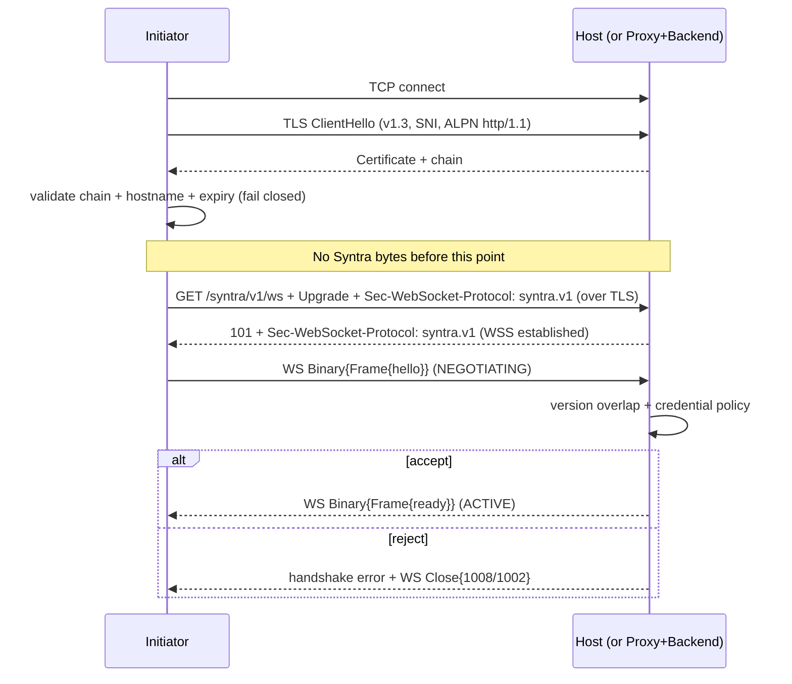
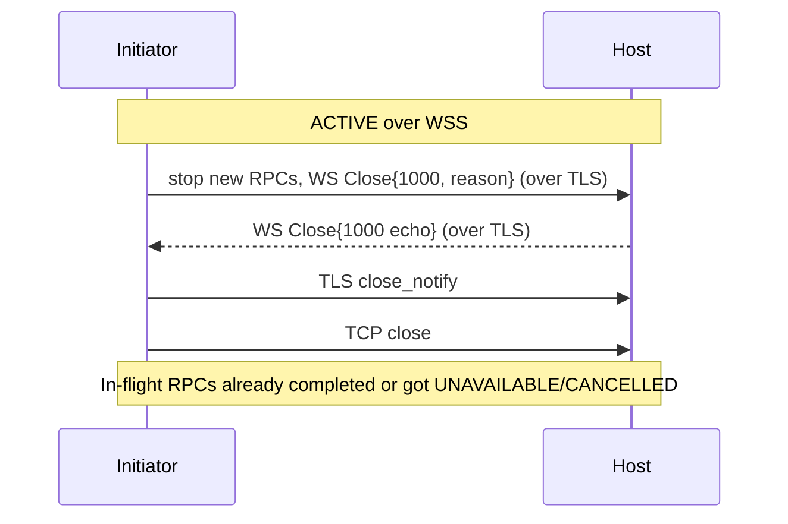

# Syntra v1 Transport — Secure WebSocket (WSS)

- Identifier: `specifications/transports/secure-websocket.md`
- Title: WebSocket over TLS (WSS) Transport Profile
- Status: Draft (pending maintainer approval via RFC)
- Version: 1.0.0-draft.1 (2026-10-19)
- Normative references:
  - BCP 14 (RFC 2119, RFC 8174)
  - RFC 6455 (The WebSocket Protocol)
  - RFC 8446 (TLS 1.3); RFC 5280 (PKIX); RFC 6125 / RFC 9110 §4.3.3 (hostname verification principles); RFC 7301 (ALPN)
  - RFC 7692 (compression policy only — disabled by default)
  - RFC 9110 (HTTP Semantics; Upgrade and redirect handling)
  - Companion profile: `specifications/transports/websocket.md` (WS; all non-TLS rules incorporated by reference)
  - `proto/syntra/v1/envelope.proto` (`Frame` — authoritative, SYN-ARCH-040)
  - `specifications/architecture.md` (SYN-ARCH-010/011/012, 030/031/032, 042, 050/051)
  - `specifications/core/protocol.md`, `framing.md`, `serialization.md`, `handshake.md`, `authentication.md`, `sessions.md`, `reliability.md`, `errors.md`, `versioning.md`
  - `specifications/security/transport-security.md` (SNTR-TSEC-* — owns TLS rules), `authentication-security.md` (SNTR-ASEC-*), `threat-model.md` (SNTR-TMOD-*), `replay-protection.md`
- Scope: The production-capable Secure WebSocket adapter for Syntra v1: RFC 6455 over HTTP/1.1 Upgrade layered on TLS 1.3 over TCP, with the same binary-message-to-envelope mapping as WS plus TLS establishment, validation, downgrade rejection, termination/proxy, and secure-redirect rules. Where this document does not restate a rule, the WS profile (`websocket.md` §1B–§1L, §2–§4) applies unchanged; in case of conflict this document prevails for WSS.
- Terminology: Per `core/protocol.md` and `websocket.md`. **WSS connection** = TCP + TLS 1.3 + HTTP/1.1 Upgrade (101) + RFC 6455 framing. **Secure profile** includes this transport per SNTR-TSEC-001. Lowercase **frame** = RFC 6455 wire frame; capitalized **`Frame`** = Syntra protobuf envelope.

The key words "MUST", "MUST NOT", etc. are per BCP 14.

## 1. Protocol requirements

### 1A. Transport scope and relation to WS

**SNTR-WSS-001** — This profile is exactly: TCP → TLS 1.3 (RFC 8446, via an established implementation) → HTTP/1.1 WebSocket Upgrade → RFC 6455 framing → Syntra envelopes in binary messages. All WS rules on message mapping (§1D), no-length-prefix (§1E), handshake layering order (§1F, extended below), subprotocol (§1C), Origin (§1H), Ping/Pong (§1I), close codes (§1J), compression default (§1K), and backpressure (§1L) apply unchanged unless this document tightens them.

**SNTR-WSS-002** — Exclusions (same as WS plus TLS): WebSocket over HTTP/2 Extended CONNECT, WebSocket over HTTP/3, QUIC, and any non-RFC-6455 framing MUST NOT be claimed as Syntra v1 WSS (SYN-ARCH-051). No custom TLS, cipher, or handshake implementation SHALL be introduced (SNTR-TSEC-002/011).

**SNTR-WSS-004** — Stable profile identifier is `SNTR-WSS-V1`: TCP, then a TLS 1.3 session, then HTTP/1.1 Upgrade to RFC 6455 carrying Syntra v1 envelopes per `websocket.md` §1C–§1L (default maximum 1,048,576 bytes; `syntra.v1` subprotocol; one binary message per `Frame`). TLS records are transport segmentation only and MUST NOT be treated as Syntra envelopes. Implementations MUST document `SNTR-WSS-V1` support per SYN-ARCH-050 to claim production-capable WSS conformance.

**SNTR-WSS-003** — Production posture: this is a production-capable secure profile (SYN-ARCH-030, SNTR-TSEC-001). Public deployments MUST use this profile (or another secure profile), MUST NOT fall back to plaintext WS for public traffic, and MUST follow every rule in §1M. Conformance claims for public use MUST cite this profile, not WS.

### 1B. Endpoint

**SNTR-WSS-010** — Canonical endpoint: path MUST be `/syntra/v1/ws` (same canonical path as WS). Hosts MUST serve WSS handshakes at that path; clients MUST default to it. Scheme is `wss` (`wss://host[:port]/syntra/v1/ws`, default port 443 where not otherwise configured). A `ws` URI MUST NOT be treated as equivalent; the two profiles are distinct transports.

**SNTR-WSS-011** — Query parameters: same rules as WS (SNTR-WS-012) and additionally tightened — credentials MUST NOT appear in the query even over TLS (SNTR-ASEC-003, SNTR-TSEC-021). Servers MUST ignore unknown query parameters for Syntra semantics, MUST document any honored parameters, and conformance traces MUST show no credential-pattern query values.

**SNTR-WSS-012** — Authentication placement: unchanged from WS — the only Syntra credential carrier is `ClientHello.credential` after WSS establishment, never the Upgrade target, query, or headers (§1G of WS as incorporated). The difference from WS is channel permission: over WSS, `ClientHello.credential` and follow-up authentication payloads MAY carry production credentials (SNTR-TSEC-009, SNTR-ASEC-002); over WS they MUST NOT.

**SNTR-WSS-013** — Secure redirect handling: hosts SHOULD NOT redirect WSS Upgrades. Where a redirect is unavoidable (e.g., canonical-host consolidation), it MUST obey all of: (a) the redirect target MUST also be `wss` (same or stronger security; `wss`→`ws` is a downgrade and is FORBIDDEN per SNTR-TSEC-007); (b) a `ws`→`wss` upgrade redirect is permitted only with explicit application consent and MUST NOT forward credentials automatically; (c) clients MUST re-validate the new endpoint (certificate chain, hostname, port, path) from scratch before re-issuing the Upgrade; (d) clients MUST NOT forward `Authorization`/`Cookie`/custom credential headers to the redirect target automatically; (e) a non-101 response (including any 3xx the client chooses not to follow) is a transport failure, never a Syntra `result`. Deployments MUST document any redirect they emit.

### 1C. Subprotocol

**SNTR-WSS-020** — Same token and negotiation as WS: `syntra.v1`, client MUST offer it first, server MUST select exactly `syntra.v1` in the 101 response, missing/unsupported/multiple handling per SNTR-WS-020…023 applies verbatim. The TLS layer adds no subprotocol and changes no rule here. ALPN, where the TLS stack negotiates it for the underlying HTTP/1.1 connection, MUST be `http/1.1` (or absent where the stack does not use ALPN for H1); ALPN mismatch MUST fail the connection rather than fall back to an unintended protocol, and ALPN MUST NOT be used as an authentication or authorization signal (SNTR-TSEC-010).

**SNTR-WSS-021** — Version relationship unchanged: `syntra.v1` names this adapter profile, not the negotiated core version. Core versioning still runs inside Syntra via `hello`/`ready` (SNTR-HS-003/010).

### 1D. Message mapping (identical to WS)

**SNTR-WSS-030** — Exactly one complete binary WebSocket message contains exactly one serialized Syntra `Frame`. Binary-only (opcode 0x2); text (0x1) is invalid and closes with 1003; empty binary messages are protocol errors; fragmentation with reassembly-before-decode is REQUIRED; frame boundaries are irrelevant; decode runs on assembled bytes; the maximum assembled size is the effective maximum envelope size (default 1 MiB) enforced during assembly with code 1009 on exceedance. All per SNTR-WS-030…035, incorporated without change.

### 1E. No TCP length prefix

**SNTR-WSS-031** — Identical to WS: the binary message payload MUST be exactly the protobuf-serialized `Frame` bytes (`WS-Binary-Message [protobuf]`), never `[length][protobuf]` (SNTR-WS-036). Receivers MUST decode directly and reject trailing garbage or embedded prefixes as `INVALID_ARGUMENT`.

### 1F. Handshake layering (TLS-first)

**SNTR-WSS-040** — Normative layering order:

```text
TCP established
  -> TLS 1.3 handshake (ClientHello/ServerHello per RFC 8446, SNI, cert validation)
    -> HTTP/1.1 WebSocket Upgrade over the TLS channel (GET + 101, syntra.v1)
      -> WebSocket established (CONNECTED)
        -> Syntra handshake (Frame{hello} -> Frame{ready} / error)
          -> Authentication evaluated (principal bound at ServerReady)
            -> ACTIVE
```

**SNTR-WSS-041** — No Syntra byte (including `hello`) is legal before the TLS handshake completes and the 101 response is received. Initiators MUST NOT send `ClientHello.credential` or any application payload before certificate + hostname verification succeeds (SNTR-TSEC-004). WS Upgrade success over TLS still proves nothing about Syntra authentication (SNTR-WS-041 incorporated). The Syntra handshake timer (default 5 s) starts at WSS establishment (CONNECTED), not at TCP connect; deployments SHOULD additionally bound TLS establishment itself and MUST document the value.



### 1G. Authentication over WSS

**SNTR-WSS-050** — Single source of truth unchanged: `ClientHello.credential` → principal bound at `ServerReady` (SNTR-AUTH-007); no parallel HTTP-layer Syntra session (SNTR-WS-050/051 incorporated). HTTP `Authorization`/`Cookie` admission, if used, remains transport admission only, MUST be documented, and MUST NOT merge with the Syntra binding; disagreement MUST fail the handshake rather than union privileges.

**SNTR-WSS-051** — Channel permission: production credentials MUST traverse only this (or another secure) profile or loopback-restricted plaintext for development (SNTR-TSEC-009, SNTR-ASEC-002). Resumption and re-authentication MUST NOT transmit reusable secrets over plaintext. All no-log/no-persist/no-echo rules (SNTR-ASEC-001) apply.

### 1H. Origin over WSS

**SNTR-WSS-060** — SNTR-WS-060…062 apply unchanged: `Origin` is never authentication; missing `Origin` is permitted (native clients); browser-serving deployments SHOULD enforce a documented allowlist with HTTP-layer (403, no 101) rejection. Over WSS the Origin check remains defense-in-depth behind TLS and the Syntra handshake — it MUST NOT weaken either.

### 1I. Ping/Pong over WSS

**SNTR-WSS-070** — SNTR-WS-070…073 apply unchanged: WS Ping/Pong is the liveness mechanism; no Syntra heartbeat is required; Pong payloads echo; timeouts are documented and implementation-configurable; liveness loss closes (typically 1001) with `UNAVAILABLE` to in-flight RPCs; control frames never reach the core. TLS record-layer keepalive (if any) is independent and MUST NOT be treated as Syntra activity.

### 1J. Close over WSS

**SNTR-WSS-080** — Graceful sequence: stop new RPCs → close grace period → WS Close handshake (over TLS) → TLS `close_notify` → TCP close. There is no `CloseSession` message in v1. In-flight RPCs receive `UNAVAILABLE`/`CANCELLED` per SNTR-HS-006/013; state is discarded on CLOSED.

**SNTR-WSS-081** — Close-code mapping is identical to WS (SNTR-WS-081): 1000 normal, 1001 going away, 1002 protocol error, 1003 unsupported data (text), 1007 invalid payload (malformed protobuf), 1008 policy violation (auth denial), 1009 message too big, 1011 internal error; MUST NOT send 1005/1006/1015; 1015 (TLS handshake failure) is never sent — TLS failures fail below WS per SNTR-TSEC. The same table in `websocket.md` §1J is normative for WSS.



### 1K. Compression over WSS

**SNTR-WSS-090** — Same default as WS and more strongly motivated: `permessage-deflate` disabled unless explicitly configured (SNTR-WS-090…092 incorporated). Over a production channel the side-channel risk (secret-bearing envelopes under compression) is material, not theoretical; deployments MUST keep the default off, MUST document any opt-in with window/context settings, and MUST enforce the decompressed-size bound (effective maximum envelope size) with 1009 + `RESOURCE_EXHAUSTED` on exceedance. Compression MUST NOT be treated as a security boundary.

### 1L. Backpressure over WSS

**SNTR-WSS-100** — Same bounds and behaviors as WS (SNTR-WS-100…102, with core SNTR-REL-007/008 and SNTR-ASEC-020): bounded inbound/outbound queues, ≥16 concurrent RPCs minimum, documented handshake/RPC/queue/rate limits, `RESOURCE_EXHAUSTED` for excess RPCs (connection stays usable), 1009/1011 close for connection-level exhaustion, bounded write grace before closing on a slow receiver, stream-policy shedding for events, jittered client backoff. TLS framing adds no extra queueing exemption: TLS records MUST NOT be mistaken for Syntra backpressure signals, and TLS-level flow control MUST NOT bypass the documented Syntra queue bounds.

### 1M. TLS requirements (WSS-specific; owns this section)

**SNTR-WSS-110** — TLS version: peers MUST use TLS 1.3 (RFC 8446) via an established implementation. TLS 1.2 or lower MUST NOT be negotiated for Syntra WSS traffic; if the peer offers only <1.3, negotiation MUST fail with no Syntra `hello` sent and no plaintext fallback (SNTR-TSEC-002/007). No custom TLS, cipher, or handshake implementation SHALL be introduced. Cipher-suite selection MUST use the implementation's secure defaults; deprecated/weak suites MUST NOT be enabled (SNTR-TSEC-011).

**SNTR-WSS-111** — Server certificate validation: initiators MUST validate the full chain to a trusted root (system or explicitly configured), check expiry and revocation status per deployment policy, and reject invalid/expired/revoked/self-signed-untrusted certificates with a terminal failure before sending any Syntra byte (SNTR-TSEC-003). Validation failure MUST NOT fall back to plaintext or skip validation on retry; initiators MUST fail closed and surface a non-oracle error (SNTR-TSEC-020).

**SNTR-WSS-112** — Hostname verification: initiators MUST verify the presented identity matches the intended endpoint (SAN dNSName/iPAddress preferred; CN only per RFC 6125 fallback) before presenting `ClientHello.credential` or any application payload (SNTR-TSEC-004). Wrong-hostname certificates MUST be rejected even if chain-valid. Credentials MUST never be sent to an unverified endpoint. SNI MUST be sent consistently with the intended hostname (SNTR-TSEC-021).

**SNTR-WSS-113** — No downgrade: peers MUST NOT negotiate below TLS 1.3 and MUST NOT downgrade from WSS to WS on failure. Automatic retry over `ws://` after a TLS failure is FORBIDDEN (SNTR-TSEC-007). Version/capability downgrade attempts at the Syntra layer that would weaken transport security MUST be refused (SNTR-VER-007 per `transport-security.md`).

**SNTR-WSS-114** — TLS termination and trusted proxies: if TLS terminates at a reverse proxy before the Syntra host, all of SNTR-TSEC-008 MUST hold: (a) the proxy-to-host leg MUST be explicitly secured (TLS or an isolated private network documented as such — otherwise treated as hostile per SNTR-TMOD-010); (b) the endpoint identity verified by the initiator is the proxy's presented identity only if the proxy is the deployment's authenticated front door AND the proxy validates the backend identity; (c) `Host`/SNI/ALPN and principal context MUST propagate without alteration or with explicitly documented mapping; (d) misconfiguration (mismatched SNI, stripped identity, altered context) MUST cause handshake failure, never silent fallback. Hosts behind proxies MUST validate the proxy-to-host binding and MUST reject inconsistent identity propagation (SNTR-TSEC-031).

**SNTR-WSS-115** — Certificate rotation: hosts MUST support rotation without a protocol version change; initiators MUST NOT pin certificates or keys unless the deployment explicitly documents pinning with rotation procedures (SNTR-TSEC-006). During rotation hosts SHOULD prefer overlapping validity windows; initiators MUST accept any currently valid chain, not a single hard-coded leaf.

### 1N. Session resumption after WSS reconnect

**SNTR-WSS-120** — Identical rule to WS (SNTR-WS-120): a new WSS connection REQUIRES a new Syntra handshake; WS(S) reconnection alone restores nothing; `request_id` space, subscriptions, cursors, and in-flight RPCs do not survive; resumption is allowed ONLY under a negotiated RFC-defined resumption capability with validated token/lifetime/replay rules (SNTR-SESS-006); cross-transport resumption (e.g., TLS/TCP session resumed over WSS, or WSS session resumed over HTTPS/H2) is forbidden unless an RFC explicitly allows the named pair with re-validated endpoint identity and no security downgrade (SNTR-SESS-§1D). Clients MUST re-authenticate per connection and re-subscribe explicitly (SNTR-SESS-010/011); servers MUST generate a fresh `connection_id` per connection and MUST reject `connection_id`-as-credential (SNTR-SESS-020).

```mermaid
sequenceDiagram
  participant C as Initiator
  participant H as Host
  Note over C,H: WSS connection A ACTIVE, then loss/close
  C->>C: report UNAVAILABLE (outcome unknown) for in-flight RPCs
  C->>H: new TCP + new TLS 1.3 handshake (re-validate chain + hostname)
  C->>H: new WSS Upgrade + new Syntra hello{fresh credential}
  H->>H: no resumption capability → evaluate as fresh auth
  alt resumption capability negotiated + valid token per RFC
    H->>H: validate token, principal, capability, version bindings
    H-->>C: ready (principal re-bound; nothing else restored)
  else default v1
    H-->>C: ready (new session) or handshake error
    Note over C,H: Subscriptions and RPCs re-issued explicitly, fresh IDs
  end
```

## 2. Client behavior

- **SNTR-WSS-200** — The client MUST complete TCP + TLS 1.3 (with SNI, ALPN where applicable, full chain + hostname + expiry/revocation validation) before sending the Upgrade; MUST abort on any validation failure without sending credentials (SNTR-TSEC-020); MUST then follow SNTR-WS-200…202 (correct Upgrade to `/syntra/v1/ws` with `syntra.v1`, 101 validation, exactly one `hello` first, binary-only, masked frames, reassembly, Ping/Pong, bounded receive, clean Close); MUST include SNI/hostname consistently and MUST NOT send credentials in URLs (SNTR-TSEC-021).
- **SNTR-WSS-201** — The client MUST fail closed on TLS errors (no plaintext retry, no validation skip), MUST NOT retry the same endpoint without operator action after a validation failure, MUST re-validate on every reconnect and every redirect target, and MUST surface `UNAVAILABLE` distinctly for loss (outcome unknown).

## 3. Server behavior

- **SNTR-WSS-210** — The server MUST present a valid chain for the claimed endpoint, MUST enforce a TLS 1.3 minimum (close on downgrade attempts), MUST log negotiation failures without credentials (SNTR-TSEC-030), and MUST then follow SNTR-WS-210…212 (Upgrade validation, single terminal handshake outcome, shape-before-policy credential evaluation, one principal per connection, no pre-ACTIVE dispatch/events, all bounds with isolation, Ping replies, documented endpoint/Origin/query/compression/bounds/grace configuration).
- **SNTR-WSS-211** — Hosts behind proxies MUST validate the proxy-to-host binding and MUST reject inconsistent identity propagation (SNTR-TSEC-031). Hosts MUST support rotation per §1M and MUST close (not fall back) on ALPN/SNI mismatch.

## 4. Failure handling

WS Table (SNTR-WS-§4) applies in full, plus the TLS rows below. Failures MUST NOT leak key or credential material; error text stays generic (SNTR-ASEC-011/024); transport loss maps to `UNAVAILABLE` without a synthesized `result`.

| Cause | Local code / signal | Wire action | Transition |
|---|---|---|---|
| Invalid/wrong-hostname/expired/revoked certificate | Terminal handshake failure, `UNAVAILABLE` to waiters | TLS alert + no Syntra `hello` sent | No Syntra connection (SNTR-TSEC-003/004) |
| TLS version <1.3 offered | Handshake failure | Negotiation fails; no fallback | No Syntra connection (SNTR-TSEC-002/007) |
| WSS→WS downgrade attempt or auto-retry | Refused | Connection fails; no plaintext retry | No session (FORBIDDEN) |
| Proxy identity inconsistency (SNI/ALPN/`Host` mismatch, stripped context) | Handshake failure | TLS/Upgrade fails | No session (SNTR-TSEC-008) |
| Post-TLS failures (Upgrade, subprotocol, envelope, auth, size, overload, deadline, liveness, loss, internal) | Per WS Table | Per WS Table (1000/1001/1002/1003/1007/1008/1009/1011) | Per WS Table |

**SNTR-WSS-220** — Downgrade attempts and proxy inconsistencies MUST close rather than fall back. All bounds violations remain terminal for the affected RPC (not the connection) unless the connection itself is exhausted or misbehaving per documented policy.

## 5. Security considerations

TLS protects the channel, not application semantics: it does not provide idempotency, authorization, or payload-validity (see `replay-protection.md`). This profile satisfies T1–T10 within its scope when every §1M rule is followed: credentials cross only a validated TLS channel; hostname binding prevents misdirected disclosure; downgrade rejection prevents stripping; proxy rules prevent identity break; rotation keeps validity windows sane. Remaining deployment duties — private-key protection, root-store hygiene, revocation freshness, revocation-propagation windows, timing/size oracles, and application authorization — MUST be documented alongside the conformance claim (SNTR-TSEC, SNTR-TMOD-050/051). Using this profile with validation disabled, with <1.3, or behind an undocumented plaintext proxy leg is non-conformant and MUST NOT be described as safe for public deployment.

## 6. Compatibility considerations

Same independence as WS (SYN-ARCH-012): `Frame` and TLS evolve separately. Tightening (removing a weak configuration) is a minor clarification; permitting a weaker TLS version, permitting public plaintext fallback, or changing the one-message-one-envelope rule is major and FORBIDDEN for v1 public deployments. New secure transports or subprotocol tokens REQUIRE transport-profile RFCs citing `security/transport-security.md`. Clients that do not implement optional capabilities remain conformant; hosts MUST NOT require them.

## 7. Conformance requirements

- **SNTR-WSS-900** — All SNTR-WS-900 fixtures run over WSS (valid Upgrade + subprotocol; missing/unsupported rejection; binary round-trip; text rejection 1003; fragmentation; MAX+1 with 1009; empty-binary rejection; no-length-prefix proof; Ping/Pong; normal and protocol-error closes; abrupt disconnect; reconnect statelessness; concurrent/out-of-order RPCs; server events; slow-consumer backpressure), PLUS the TLS fixtures from `transport-security.md` SNTR-TSEC-900/901 scoped to WSS: valid chain accepted; invalid chain / wrong hostname / expired / revoked rejected before any credential is sent; TLS <1.3 refused; WSS→WS auto-fallback absent (active attacker offering weaker version/profile MUST NOT cause disclosure or establishment); rotation (old+new valid) accepted; proxy mismatch rejected; `wss`→`ws` redirect refused.
- **SNTR-WSS-901** — Downgrade proof: an active attacker that offers a weaker TLS version, strips the Upgrade to `ws`, or replays a redirect to plaintext MUST NOT cause credential disclosure or session establishment. Byte traces MUST show credentials only inside `ClientHello.credential` after validated TLS.

Conformance case IDs and expected outputs live in `conformance/requirements/secure-websocket.md`; deterministic vectors (Upgrade bytes, stop-vector certificates references, binary message hex, close-code table) live in `conformance/test-vectors/websocket/` (shared with WS; WSS-only TLS vectors reference the security suite rather than embedding key material).
