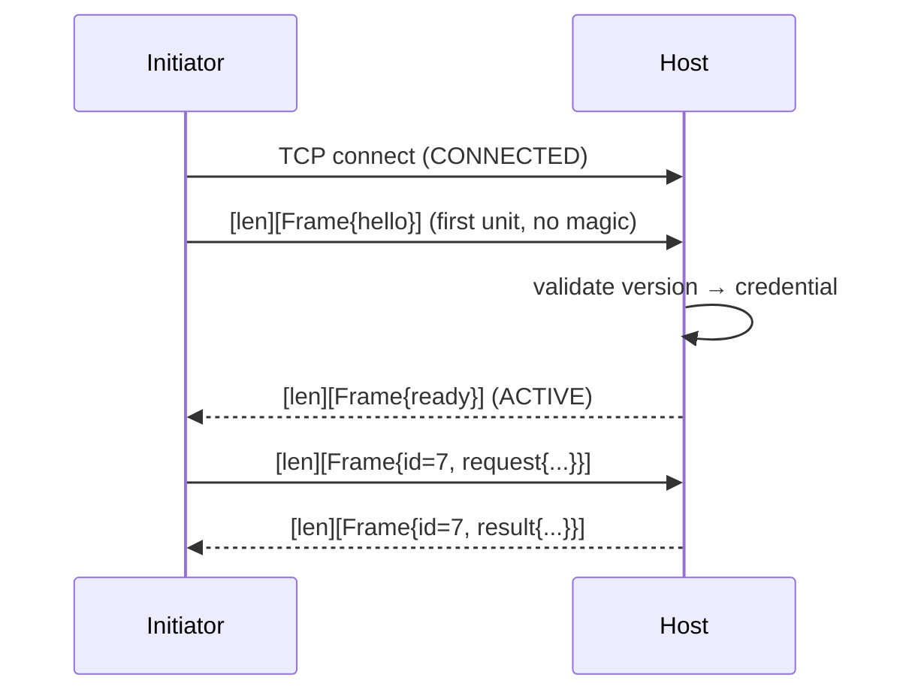
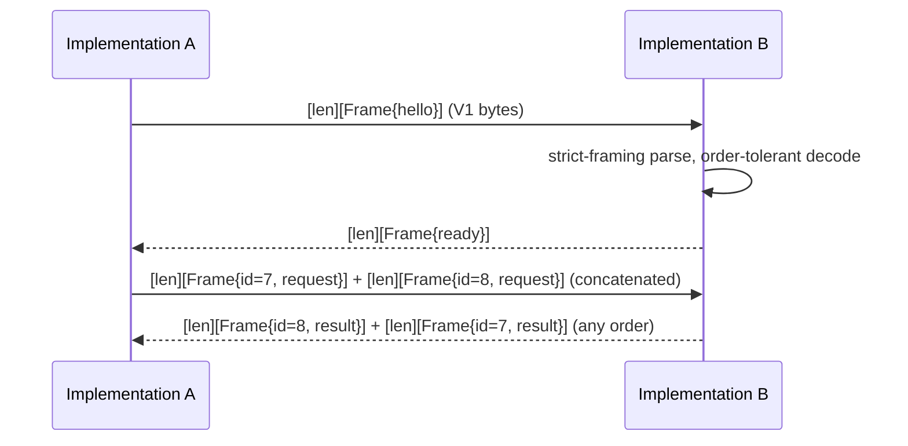

# Syntra v1 Transport — TCP (plaintext, restricted)

- Identifier: `specifications/transports/tcp.md`
- Title: TCP Transport Profile (restricted development only)
- Status: Draft (pending maintainer approval via RFC)
- Version: 1.0.0-draft.1 (2026-10-26)
- Normative references: BCP 14; `specifications/architecture.md` (SYN-ARCH-010/012/030/050/051); `specifications/core/protocol.md`, `serialization.md`, `framing.md` (SNTR-WIRE-*), `handshake.md` (SNTR-HS-*), `sessions.md`, `rpc.md`, `reliability.md`, `errors.md`; `specifications/security/transport-security.md` (SNTR-TSEC-001/005/009), `threat-model.md` (T1/T6/T7); `proto/syntra/v1/envelope.proto` (`Frame`).
- Scope: The plaintext TCP byte-stream binding: connection setup, the 4-byte length-prefixed frame format, limits, framing errors, handshake order, close, backpressure, keepalive, intermediaries, test vectors, and conformance. TLS behavior belongs to `tls-tcp.md`. Other transports (HTTP/WS profiles) belong to their own future specifications.
- Terminology: Per `core/protocol.md`. **Connection** = one TCP socket carrying one Syntra handshake-to-teardown sequence. **Unit** = one length-prefixed serialized `Frame`. **Profile identifier** = the stable string naming this binding.

The key words "MUST", "MUST NOT", etc. are per BCP 14.

## 1. Profile identifiers

**SNTR-TCP-001** — The stable identifiers are `SNTR-TCP-V1` (this profile: plaintext TCP carrying length-prefixed Syntra v1 envelopes) and `SNTR-TLS-TCP-V1` (defined in `tls-tcp.md`: the same framing over a TLS 1.3 session). The `-V1` suffix marks profile identifiers and distinguishes them from requirement IDs (`SNTR-TCP-###`). Implementations MUST document which identifiers they support per SYN-ARCH-050; insecure-only implementations MUST NOT claim production conformance.

### Candidate secure-channel binding (informative)

[Draft RFC 0007](../../rfcs/0007-secure-channel-device-authorization.md)
selects a [shared Noise channel](../security/secure-channel.md) independent
of socket I/O, with a separate [TCP carrier candidate](noise-bindings.md#2-tcp-stream-candidate).
That candidate precedes Syntra `hello` with channel establishment and carries
an encrypted inner `u32BE length || Frame` stream across bounded ciphertext
records delimited by `u16BE` lengths. It is not the plaintext mapping here:
SNTR-TCP-V1 still begins directly with the four-byte `hello` length prefix,
and its vectors, restrictions and tests retain that meaning.

The new binding identifier and context encoding are freeze blockers. Returning
authorization would reuse a scoped enrollment AK, but each new channel uses
fresh ephemeral/directional keys and a new Syntra handshake, without migrating
traffic state from TCP, WebSocket or any future UDP binding. UDP remains
deferred until its complete binding is frozen, reviewed and accepted. Current
public deployments still follow the TLS policy pending RFC acceptance.

## 2. TCP connection (clarifies SYN-ARCH-010/012, SNTR-HS-002)

**SNTR-TCP-002** — The client initiates the transport connection (TCP active open); the server accepts it (passive open). Each accepted socket carries exactly one Syntra connection (one handshake-to-teardown state machine); multiplexing multiple Syntra connections over one socket is forbidden, and sharing one Syntra connection across sockets is impossible.

**SNTR-TCP-003** — TCP is a byte stream: it provides no message boundaries, no preservation of write sizes, and no delivery of partial datagrams as units. All message boundaries come from §3 framing. Implementations MUST NOT infer framing from Protobuf parsing alone (e.g., by decoding until the parser stops); framing is determined solely by the 4-byte prefix counts.

Connection-timeout expectations: the TCP establishment timeout is platform-defined; once established, the Syntra handshake timer starts (`CONNECTED`, SNTR-HS-002, default 5 s). There is no Syntra-level TCP retransmission policy beyond the platform stack.

## 3. Stream frame format (clarifies SYN-ARCH-012, SNTR-SER-001, SNTR-WIRE-001)

**SNTR-TCP-004** — Every unit on the stream is exactly:

```text
0                   1                   2                   3
+-------------------+-------------------+-------------------+
|                  Payload Length                           |
+-----------------------------------------------------------+
|                                                           |
|              Serialized Syntra Envelope                   |
|                                                           |
+-----------------------------------------------------------+
```

- **Payload Length:** unsigned 32-bit integer, network byte order (big-endian), equal to the length in bytes of the serialized `Frame` that follows. It counts the Protobuf payload only and excludes its own 4 bytes.
- **Serialized Syntra Envelope:** exactly Payload Length bytes, decoded as one `Frame` per `serialization.md` and validated per `framing.md` SNTR-WIRE-*.

No magic bytes, version preface, or greeting precede the first unit; the first 4 bytes on a fresh connection are the length prefix of the `hello` unit (§6).

## 4. Frame limits (clarifies SNTR-WIRE-006, SNTR-SER-006, SNTR-TMOD T6/T7)

**SNTR-TCP-005** — The default maximum is `DEFAULT_MAX_FRAME_BYTES = 1,048,576` (1 MiB) of serialized `Frame`, matching the core envelope bound. A deployment MAY configure a lower maximum; it MUST document the value and MUST NOT silently raise it. There is no negotiation mechanism for this bound in v1.

Receivers MUST decode the 4-byte prefix first and reject a length exceeding their allowed maximum **before allocating the declared payload buffer** (bounded pre-allocation; exceeding the bound MUST NOT cause large allocation, panic, or unbounded buffering). Violating this rule fails closed: exceeding the maximum requires **immediate connection termination** in all states (close after local alerting; no `result` is emitted because no envelope — and therefore no `request_id` — can be safely established).

## 5. Prefix edge cases and stream behavior (clarifies SNTR-WIRE-001/005)

**SNTR-TCP-006** — Readers MUST implement a byte-stream loop with no assumption that one `read()` returns a prefix, a payload, or a whole unit (partial reads are normal). After a complete unit, any immediately following bytes begin the next unit (concatenated frames MUST be supported).

- **Length smaller than the sender's intended bytes:** the receiver reads exactly Length bytes as one unit and treats the remainder as the start of the next unit. Receivers MUST frame strictly by counts and MUST NOT resynchronize by scanning for a plausible next message.
- **Length larger than the bytes so far:** wait for more bytes within the handshake/RPC/close timers; on clean EOF or timeout first, treat as truncated (§7).
- **EOF during the 4-byte prefix:** zero bytes read after complete units means the peer closed cleanly (§8); 1–3 prefix bytes means a truncated unit (§7).
- **EOF during the payload:** truncated unit (§7).

## 6. Handshake order over TCP (clarifies SNTR-HS-001/003, SNTR-CORE-010)

**SNTR-TCP-007** — After TCP establishment (`CONNECTED`): the initiator sends exactly one length-prefixed `Frame{hello}` as the first unit; the host validates version then credential and replies with exactly one `Frame{ready}` or a terminal handshake error per `handshake.md` §5, then the connection proceeds per the six-state machine. No preface or magic bytes exist — this is stated explicitly so peers never emit or expect any.



## 7. Framing errors (clarifies SNTR-WIRE-002/005/008, SNTR-SER-005/007/008)

A **transport framing failure** (prefix/length/stream level) is distinct from a **protocol validation failure** (a parsed `Frame` violating core rules). Framing failures have no `request_id` and therefore no RPC context: they are connection-level failures and always terminate the connection. Validation failures of a parsed unit follow the core tables (per-RPC error where a context exists, handshake failure pre-`ACTIVE`).

| Condition | Classification | Behavior |
|---|---|---|
| Zero-length prefix (`00 00 00 00`) | Framing failure (decodes to bodyless `Frame`, SNTR-WIRE-002) | Reject without dispatch; close in all states |
| Oversized length (> allowed max) | Framing failure, fail-closed (SNTR-TCP-005) | Reject before allocating; close immediately in all states |
| Truncated prefix (1–3 bytes then EOF) | Framing failure | Close; discard the partial unit |
| Truncated payload (EOF before Length bytes) | Framing failure | Close; discard the partial unit |
| Invalid Protobuf (malformed varint, bad wire type, invalid UTF-8, depth/size violation) | Framing-adjacent decode failure (SNTR-SER-007) | Pre-`ACTIVE`: close. `ACTIVE`: close (no safe correlation without a decoded envelope) |
| Valid Protobuf but invalid Syntra envelope (empty body, `request_id` misuse, unknown variant, reserved tag 16/17, wrong-state variant) | Protocol validation failure | Follow core tables: `INVALID_ARGUMENT` / `FAILED_PRECONDITION` / `UNIMPLEMENTED` / reserved-malformed handling (SNTR-WIRE-003/004/008, SNTR-SER-008); handshake-phase failures close |

## 8. Plain TCP security (clarifies SYN-ARCH-030, SNTR-TSEC-001/005/009, T1)

**SNTR-TCP-008** — This profile provides no transport confidentiality, integrity beyond checksums, or peer authentication. It is intended ONLY for explicitly trusted environments: loopback or isolated test networks with no public routing.

- Implementations MUST NOT enable it as a public production endpoint by default, MUST disable it by default in any distribution claiming production readiness, and MUST emit an explicit insecure-mode warning when enabled.
- Authentication credentials requiring confidentiality MUST NOT be sent over plaintext TCP (clients MUST NOT present them; SNTR-TSEC-009).
- Servers are permitted to reject authentication entirely over plaintext TCP — including refusing credentialed `hello` messages with `UNAUTHENTICATED` + close or accepting only anonymous policy where documented. Such refusal MUST be documented and MUST NOT leak whether any given credential would be valid elsewhere.

## 9. Connection close (clarifies SNTR-HS-006/013/014, SNTR-SESS-004, SNTR-REL-009)

**SNTR-TCP-009** — Graceful close: stop new RPCs, observe the transport profile's close grace period, then TCP FIN (either direction may initiate; half-close via `shutdown(SHUT_WR)` carries NO Syntra semantics and peers MUST NOT depend on it — treat any FIN as end-of-stream: process buffered complete units, then teardown `CLOSING`→`CLOSED`). Abrupt reset (RST) or loss: map to `UNAVAILABLE` for all in-flight RPCs with unknown outcome (SNTR-REL-009); event streams end; the session ends with no resumption by default (SNTR-SESS-003/008).

```mermaid
sequenceDiagram
  participant C as Initiator
  participant H as Host
  C->>H: stop new RPCs (grace)
  C->>H: TCP FIN
  H->>C: TCP FIN
  Note over C,H: per-connection state discarded; new socket = new handshake
```

**SNTR-TCP-010** — Half-close behavior: a FIN in one direction MUST NOT be interpreted as a Syntra signal (no cancel, no close handshake, no truncation marker). Peers MUST complete their side and close fully; they MUST NOT leave half-open connections retained indefinitely (bound by the close grace timer).

## 10. Backpressure (references core limits; no duplicate values)

**SNTR-TCP-011** — This profile adds no independent queue numbers. Slow readers exert TCP flow control naturally; hosts and initiators MUST still enforce the core bounds (envelope size SNTR-WIRE-006, ≥16 concurrent RPCs with documented max per SNTR-RPC-008, inbound queue/event-buffer bounds per SNTR-REL-007, per-principal limits per SNTR-ASEC-020) and MUST document pending-write-queue bounds. Excessive senders trigger `RESOURCE_EXHAUSTED` (RPC context) or connection closure (framing/exhaustion), never unbounded retention.

## 11. Keepalive and liveness (clarifies SNTR-HS-002/011, SNTR-REL-006)

**SNTR-TCP-012** — OS-level TCP keepalive MAY be enabled by deployment but MUST NOT be required for interoperability; peers MUST NOT assume it is active. There is NO Syntra heartbeat message in v1 — liveness is observed through the handshake timer, per-RPC deadlines, and transport loss detection. Application heartbeats, if needed, are application-defined RPCs above Syntra (e.g., periodic echo calls under application policy).

## 12. Network intermediaries (byte-preserving path only)

**SNTR-TCP-013** — NAT is transparent to this profile (connection-oriented, no migration supported: TCP connection migration does not exist; a new address means a new transport and therefore a new handshake). Only byte-preserving intermediaries are compatible; any proxy that reframes, buffers indefinitely, or alters bytes violates this profile. TLS-terminating or identity-altering proxies are governed by `tls-tcp.md` and SNTR-TSEC-008. Idle connections MAY be dropped by intermediaries without notice; deployments SHOULD document idle-timeout expectations, and peers MUST treat such drops as abrupt loss (reconnect with a fresh handshake; session resumption only under a negotiated resumption capability, which does not exist in default v1).

## 13. Test vectors (exact bytes; canonical order plus required tolerance)

Payloads below are serialized `Frame`s; each unit on the wire is the 4-byte big-endian length followed by exactly those bytes. Fixtures V1–V2 are verified to decode to `Frame{version:1, hello{min_version:1, max_version:1}}`; V0 decodes to a bodyless `Frame`. Parsers MUST accept V1 and V2 as logically identical (field order is insignificant, SNTR-SER-002) and MUST reject V0/V5–V8 as specified. Machine-readable copies live in `conformance/test-vectors/tcp/vectors.json` (identical hex).

| ID | Meaning | Wire bytes (hex) | Expected handling |
|---|---|---|---|
| V1 | Valid `hello` unit (canonical order) | `00 00 00 08` + `08 01 52 04 08 01 10 01` | Accept; →NEGOTIATING |
| V2 | Same logical `hello`, fields reordered | `00 00 00 08` + `52 04 08 01 10 01 08 01` | Accept identically to V1 (order tolerance) |
| V3 | Two concatenated `hello`s (second is a protocol violation pre-`ACTIVE`) | V1 unit followed immediately by V1 unit (24 bytes total) | First accepted; second triggers handshake failure (`FAILED_PRECONDITION`) + close |
| V4 | Maximum-boundary construction | prefix `00 10 00 00` + exactly 1,048,576 payload bytes forming a valid `Frame` | Accepted iff payload is a valid unit within the bound |
| V5 | Zero-length frame | `00 00 00 00` (no payload) | Reject as malformed; close in all states |
| V6 | Oversized length prefix | `00 10 00 01` (max+1), no payload bytes required | Reject on the prefix alone, before allocating; close immediately |
| V7 | Truncated prefix | `00 00` then EOF | Truncated unit; close |
| V8 | Truncated payload | `00 00 00 08 08 01 52` then EOF | Truncated unit; close |
| V9 | Short length (strict framing) | `00 00 00 02` + `08 01` then next unit `52 04 08 01 10 01 …` | First unit = `Frame{version:1}` with no body → invalid envelope; remainder frames the next unit; MUST NOT rescan |

## 14. Conformance requirements

- **SNTR-TCP-900** — Fixtures: V1 accept; V2 order-tolerance equality; V3 second-unit failure; V4 boundary accept; V5/V6 reject-and-close (V6 without allocation); V7/V8 truncation close; V9 strict-framing behavior; handshake order (first unit must be `hello`, no magic); graceful FIN vs RST mapping; backpressure bound enforcement.
- **SNTR-TCP-901** — Interop proof: the same logical `Frame` sequence exchanged over this profile and at least one other profile with only adapter changes (SNTR-WIRE-901); two independent implementations exchange V1–V3 correctly.



## Appendix: References

- `tls-tcp.md` (secure profile sharing this framing); core `framing.md`, `serialization.md`, `handshake.md`, `reliability.md`, `errors.md`; `transport-security.md` SNTR-TSEC-001/005/009; `threat-model.md` T1/T6/T7; `conformance/requirements/tcp.md`; `conformance/test-vectors/tcp/`.
