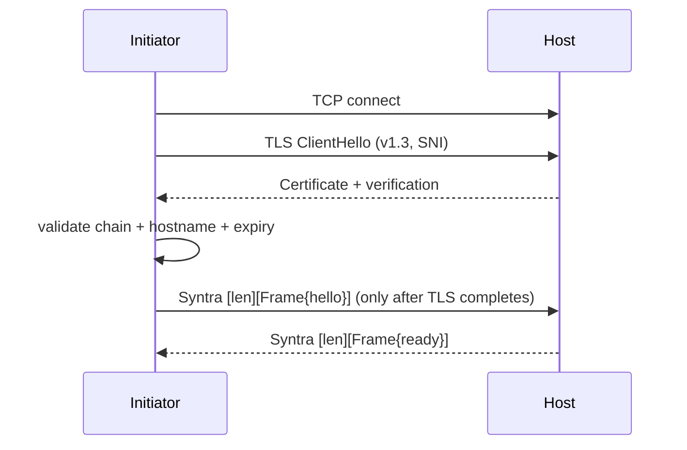

# Syntra v1 Transport — TLS 1.3 over TCP (production-capable)

- Identifier: `specifications/transports/tls-tcp.md`
- Title: TLS-over-TCP Transport Profile (production-capable)
- Status: Draft (pending maintainer approval via RFC)
- Version: 1.0.0-draft.1 (2026-10-26)
- Normative references: BCP 14; RFC 8446 (TLS 1.3); RFC 5280 (PKIX); RFC 6125 / RFC 9110 §4.3.3 (hostname verification); `specifications/architecture.md` (SYN-ARCH-010/012/030/031/050); `specifications/core/protocol.md`, `handshake.md` (SNTR-HS-*), `framing.md`, `reliability.md`, `errors.md`; `specifications/security/transport-security.md` (SNTR-TSEC-001–011/020–021/030–031), `threat-model.md` (T1/T2/T10); `proto/syntra/v1/envelope.proto` (`Frame`); companion profile `tcp.md` (SNTR-TCP-004/005/006/009/010/011/012/013).
- Scope: The production-capable profile stacking TCP → TLS 1.3 → the §3-framed Syntra byte stream of `tcp.md`. TLS negotiation, validation, alerts, termination, ALPN position, close mapping, and mTLS extension posture. Plain-TCP rules belong to `tcp.md`; HTTPS/WebSocket bindings belong to their future specifications.
- Terminology: Per `core/protocol.md`. **Secure channel** = the TLS 1.3 session over which Syntra units flow. **Endpoint identity** = the server certificate identity verified before any credential is sent.

The key words "MUST", "MUST NOT", etc. are per BCP 14.

## 1. Profile identity and layering

**SNTR-TLS-001** — The stable identifier is `SNTR-TLS-TCP-V1`: TCP, then a TLS 1.3 session, then the exact unit framing of `tcp.md` §3 (4-byte big-endian length + serialized `Frame`; default maximum 1,048,576 bytes; strict stream loop; no magic bytes). TLS records are transport segmentation only and MUST NOT be treated as Syntra frames: one TLS record may carry part of a unit, one unit, or several units, and receivers MUST reassemble the byte stream before applying `tcp.md` §3–§5.

The [TCP Noise candidate](noise-bindings.md#2-tcp-stream-candidate) under
[Draft RFC 0007](../../rfcs/0007-secure-channel-device-authorization.md) is
a separately selected binding, not a replacement interpretation of
`SNTR-TLS-TCP-V1`. Its shared channel would have fresh ephemeral and
directional traffic keys per connection and different outer record framing.
It neither inserts a handshake into this profile nor permits fallback after
TLS failure. This profile's framing, TLS/certificate requirements and
SNTR-TLS-900/901 tests remain current pending RFC acceptance and an explicit
compatibility decision.

## 2. TLS version and implementations (clarifies SNTR-TSEC-002, SYN-ARCH-031)

**SNTR-TLS-002** — Secure profiles MUST use TLS 1.3 (RFC 8446) via an established implementation. TLS 1.2 or lower MUST NOT be negotiated; if offered by the peer, negotiation MUST fail and no Syntra bytes are sent. No custom TLS, cipher, or handshake implementation SHALL be introduced; cipher suites follow the implementation's secure defaults (SNTR-TSEC-011).

## 3. Certificate validation and trust anchors (clarifies SNTR-TSEC-003)

**SNTR-TLS-003** — Initiators MUST validate the full chain to a trusted root (system or explicitly configured trust anchors), check expiry and revocation status per deployment policy, and reject invalid, expired, revoked, or self-signed-untrusted certificates with a terminal handshake failure. Validation failure MUST NOT fall back to plaintext or skip validation, and no Syntra `hello` is sent.

## 4. Hostname verification (clarifies SNTR-TSEC-004/021, T1)

**SNTR-TLS-004** — Initiators MUST verify the presented identity matches the intended endpoint (SAN dNSName/iPAddress preferred; CN only per RFC 6125 fallback rules) **before** sending `ClientHello.credential` or any application payload. Wrong-hostname certificates MUST be rejected even if chain-valid; credentials MUST never be sent to an unverified endpoint. SNI/hostname MUST be included consistently.

## 5. Alerts and handshake gating (clarifies SNTR-TSEC-007/009, T2)

**SNTR-TLS-005** — TLS alerts or failures terminate the attempt at the transport layer: the Syntra handshake MUST begin only after TLS completes successfully, and no Syntra bytes (including `hello`) are sent or processed on a failed or incomplete TLS session. Automatic retry over plaintext after TLS failure is FORBIDDEN; Syntra-layer version/capability downgrades that would weaken transport security MUST be refused.

## 6. Termination and proxies (clarifies SNTR-TSEC-008/031, T10)

**SNTR-TLS-006** — Where TLS terminates at a reverse proxy before the host, the proxy-to-host leg MUST be explicitly secured (TLS or isolated private network documented as such — otherwise treated as hostile), endpoint identity MUST be validated and propagated per SNTR-TSEC-008 (SNI/`Host`/principal context consistent or explicitly mapped), and misconfiguration MUST cause handshake failure, not silent fallback. The initiator's verified identity is the proxy's presented identity only if the proxy is the deployment's authenticated front door AND the proxy validates the backend identity.

## 7. ALPN position for this profile (decision: deferred)

**SNTR-TLS-007** — No Syntra-specific ALPN identifier (e.g., `syntra/1`) is defined or required for `SNTR-TLS-TCP-V1` in v1. Rationale: this profile multiplexes nothing, so ALPN negotiation is unnecessary; inventing an identifier casually would create interop surface with no benefit. Clients MUST NOT require ALPN to complete this profile, and servers MUST accept handshakes with no ALPN negotiated. Clients MAY offer ALPN only for a different profile's registered identifiers where that profile's specification requires it; such offers have no meaning here. Registering a Syntra ALPN identifier in the future REQUIRES a transport-profile RFC.

## 8. Mutual TLS posture (extension, not defined)

**SNTR-TLS-008** — Client certificates (mTLS) MAY be used by a deployment as additional transport authentication, but they are NOT part of this profile, MUST NOT be treated as the Syntra principal binding (`ServerReady`-established per SNTR-AUTH-007), and MUST NOT substitute for `ClientHello.credential` evaluation. Standardizing mTLS binding (e.g., channel binding of credentials to the TLS session) REQUIRES a dedicated RFC (see security `open-questions.md` item 1); until then implementations MUST NOT claim channel binding.

## 9. Framing over TLS (same units; records are not frames)

**SNTR-TLS-009** — Above the TLS session, all `tcp.md` rules apply unchanged: §3 frame format (no magic), §4 limits with pre-allocation checks, §5 strict stream loop and partial-read tolerance, §7 framing-vs-validation error distinction (framing failures close; validation follows core tables). TLS record boundaries MUST NOT influence Syntra framing decisions.

## 10. Close mapping (clarifies SNTR-HS-006/013/014)

**SNTR-TLS-010** — Graceful close: stop new RPCs, observe the close grace period, send TLS `close_notify`, then TCP FIN; abrupt paths (RST, timeout, alert, missing `close_notify` with truncated stream) map to `UNAVAILABLE` for in-flight RPCs with unknown outcome, end event streams, and end the session with no resumption by default. `close_notify` without prior Syntra graceful shutdown is still an abrupt transport loss for outstanding work.

## 11. Client behavior

- **SNTR-TLS-020** — Initiators MUST fail closed on any validation failure, surface a non-oracle error, include SNI/hostname consistently, verify before credential presentation, and MUST NOT retry the same endpoint without operator action (SNTR-TSEC-020/021).

## 12. Server behavior

- **SNTR-TLS-030** — Hosts MUST present a valid chain for the claimed endpoint, enforce the TLS 1.3 minimum, log negotiation failures without credentials, close on downgrade attempts, and validate the proxy-to-host binding where proxies exist (SNTR-TSEC-030/031).

## 13. Backpressure, keepalive, intermediaries (same as TCP plus TLS notes)

**SNTR-TLS-011** — `tcp.md` §10 (backpressure via core bounds), §11 (no required OS keepalive; no Syntra heartbeat message), and §12 (no connection migration; idle drops are abrupt loss) apply unchanged. TLS adds no keepalive requirement and no heartbeat; session tickets or resumption at the TLS layer (if the implementation uses them) MUST NOT be confused with Syntra session resumption, which does not exist by default.

## 14. Conformance requirements

- **SNTR-TLS-900** — Fixtures: valid chain accepted and `hello` sent only after TLS completes; invalid chain / wrong hostname / expired / revoked rejected with no credential sent; TLS <1.3 refused; no-ALPN handshake accepted; plaintext auto-fallback absent; proxy mismatch rejected; rotation (old+new valid) accepted.
- **SNTR-TLS-901** — Downgrade proof: an active attacker offering a weaker TLS version or profile MUST NOT cause credential disclosure or session establishment.

## Appendix: References

- `tcp.md` (framing, limits, close, vectors); core `handshake.md`, `framing.md`, `reliability.md`, `errors.md`; `transport-security.md` SNTR-TSEC-*; `threat-model.md` T1/T2/T10; `conformance/requirements/tls-tcp.md`; `conformance/test-vectors/tcp/` (shared framing vectors).
