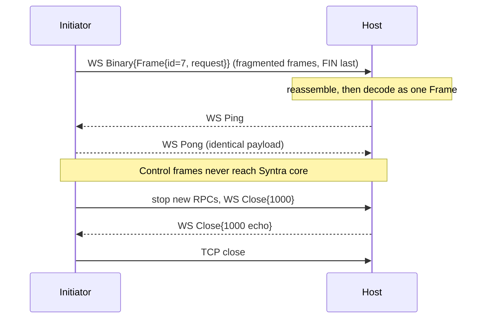

# Syntra v1 Transport — WebSocket (WS)

- Identifier: `specifications/transports/websocket.md`
- Title: WebSocket over HTTP/1.1 Transport Profile (Plaintext)
- Status: Draft (pending maintainer approval via RFC)
- Version: 1.0.0-draft.1 (2026-10-19)
- Normative references:
  - BCP 14 (RFC 2119, RFC 8174)
  - RFC 6455 (The WebSocket Protocol)
  - RFC 7692 (Compression Extensions for WebSocket; policy only — disabled by default)
  - RFC 9110 (HTTP Semantics; Upgrade and redirect handling)
  - `proto/syntra/v1/envelope.proto` (`Frame` — authoritative representation, SYN-ARCH-040)
  - `specifications/architecture.md` (SYN-ARCH-010/011/012, 030, 042, 050/051)
  - `specifications/core/protocol.md`, `framing.md` (SNTR-WIRE-*), `serialization.md` (SNTR-SER-*), `handshake.md` (SNTR-HS-*), `authentication.md` (SNTR-AUTH-*), `sessions.md` (SNTR-SESS-*), `reliability.md` (SNTR-REL-*), `errors.md` (SNTR-ERR-*), `versioning.md`
  - `specifications/security/transport-security.md` (SNTR-TSEC-*), `authentication-security.md` (SNTR-ASEC-*), `threat-model.md` (SNTR-TMOD-*)
  - Companion profile: `specifications/transports/secure-websocket.md` (WSS; production-capable)
- Scope: The plaintext WebSocket (WS) adapter for Syntra v1: RFC 6455 over HTTP/1.1 only, binary-message-to-envelope mapping, endpoint, subprotocol, handshake layering, authentication and Origin rules, liveness, close, compression, backpressure, resumption, and conformance. This is a restricted-development profile per SYN-ARCH-030 and SNTR-TSEC-001/005. It MUST NOT be used for public production traffic. Production deployments MUST use the WSS profile instead.
- Terminology: Per `core/protocol.md`. **Initiator** = WebSocket client (opens HTTP Upgrade). **Host** = WebSocket server (accepts Upgrade). **WS connection** = one RFC 6455 connection after a successful HTTP/1.1 Upgrade. **Message** = one complete WebSocket message (one or more frames with FIN set, opcode 0x2 for binary). **Frame** (capitalized, `Frame`) = the Syntra protobuf envelope; **frame** (lowercase) = an RFC 6455 wire frame. The two MUST NOT be conflated.

The key words "MUST", "MUST NOT", etc. are per BCP 14.

## 1. Protocol requirements

### 1A. Transport scope and exclusions

**SNTR-WS-001** — This profile is exactly RFC 6455 WebSocket layered on HTTP/1.1 Upgrade over TCP, carrying persistent bidirectional Syntra communication. Peers MUST implement RFC 6455 client and server roles as applicable, MUST use HTTP/1.1 for the Upgrade (not HTTP/2 or HTTP/3 framing), and MUST carry Syntra only in binary messages per §1D.

**SNTR-WS-002** — Explicitly excluded and MUST NOT be claimed as Syntra v1 WS: WebSocket over HTTP/2 Extended CONNECT (RFC 8441 / RFC 9220), WebSocket over HTTP/3, QUIC or QUIC DATAGRAM carriage, and any non-RFC-6455 framing. Specifications MAY reserve extension points for them but MUST label them future work per SYN-ARCH-051. An implementation that negotiates any excluded transport MUST NOT report it as conformant Syntra v1 WS.

**SNTR-WS-003** — This profile is plaintext and restricted-development only (SYN-ARCH-030, SNTR-TSEC-001/005). Distributions MUST disable it by default in any build claiming production readiness, MUST emit an explicit insecure-mode warning when enabled, MUST document that it provides no confidentiality, integrity, or endpoint authentication, and MUST NOT accept production credentials over it.

**SNTR-WS-004** — Stable profile identifiers are `SNTR-WS-V1` (this profile: RFC 6455 over HTTP/1.1 carrying Syntra v1 envelopes) and `SNTR-WSS-H1-V1` (defined in `secure-websocket.md`: the same framing over a TLS 1.3 session). The `-V1` suffix marks profile identifiers and distinguishes them from requirement IDs (`SNTR-WS-###`). Implementations MUST document which identifiers they support per SYN-ARCH-050; insecure-only implementations MUST NOT claim production conformance.

### 1B. Endpoint

**SNTR-WS-010** — Canonical endpoint: the path MUST be `/syntra/v1/ws`. A host conforming to this profile MUST serve Syntra WS handshakes at that path and MAY serve additional deployment-specific paths only if documented; clients MUST default to that path. The path is case-sensitive and has no trailing-slash variant: `/syntra/v1/ws/` is a different target and MUST be rejected with an HTTP error (404 or 426) unless the deployment explicitly documents aliasing.

**SNTR-WS-011** — Scheme: this profile uses the `ws` URI scheme (`ws://host[:port]/syntra/v1/ws`). The `wss` scheme belongs exclusively to the secure profile and MUST NOT be served by a plaintext WS endpoint. A `ws` URI MUST NOT be upgraded to `wss` implicitly; scheme selection is explicit configuration.

**SNTR-WS-012** — Query parameters: clients MUST NOT place credentials, tokens, session handles, or any Syntra authentication material in the query string (SNTR-ASEC-003, SNTR-TSEC-021). Servers MUST NOT require any query parameter for Syntra semantics and MUST NOT interpret any query parameter as authentication or authorization. Servers MUST ignore unknown query parameters for Syntra processing (they MAY use them for routing or load-balancing hints) and MUST document any query parameters they do honor. Wire traces used for conformance MUST contain no credential-pattern query values (negative grep).

**SNTR-WS-013** — Authentication placement: no Syntra credential travels in the HTTP Upgrade request-target, headers, or query. The only Syntra credential carrier is `ClientHello.credential` inside the first Syntra envelope after WS establishment (§1F/§1G). HTTP-layer credentials (e.g., `Authorization`, `Cookie`) are not Syntra authentication (see §1G).

**SNTR-WS-014** — Redirect handling: hosts SHOULD NOT redirect WS Upgrade requests; they SHOULD serve `/syntra/v1/ws` directly. If a host does redirect (HTTP 3xx to an HTTP(S) URL), the redirect target MUST preserve the effective security level: a `ws` endpoint MUST NOT redirect to a less-trusted location and MUST document any redirect it emits. Clients MUST NOT automatically follow a redirect that changes the security context without explicit operator or application consent, MUST re-validate the new host (hostname, port, path) before re-issuing the Upgrade, MUST NOT forward any HTTP-layer credential from the original request to the redirect target automatically, and MUST NOT treat a redirect response as a successful WS establishment. An HTTP error status (4xx/5xx) or a non-101 response to the Upgrade is a transport failure, not a Syntra handshake error, and MUST be surfaced locally without synthesizing a Syntra `Frame`.

### 1C. Subprotocol

**SNTR-WS-020** — Subprotocol token: `syntra.v1`. The client MUST include a `Sec-WebSocket-Protocol` header in the Upgrade request offering `syntra.v1` as its first preference. The server MUST select exactly `syntra.v1` by returning `Sec-WebSocket-Protocol: syntra.v1` in the 101 response when it accepts the connection as Syntra. A WS connection without a selected `syntra.v1` subprotocol MUST NOT carry Syntra envelopes.

**SNTR-WS-021** — Missing subprotocol: if the client omits `Sec-WebSocket-Protocol`, or the server's 101 response omits it, the connection is not a Syntra connection. The client MUST abort (close the transport without sending any Syntra envelope) and MUST report a local handshake failure (`FAILED_PRECONDITION`). The server MUST reject an Upgrade without the offered token by failing the HTTP Upgrade (HTTP 426 or 400 with no 101) rather than establishing a bare WebSocket and waiting for Syntra bytes.

**SNTR-WS-022** — Unsupported subprotocol: if the server does not support `syntra.v1`, it MUST fail the Upgrade (no 101) and MUST NOT select a different token as a substitute for Syntra. If the client receives a 101 selecting a token other than `syntra.v1`, it MUST abort without sending Syntra envelopes and report `UNIMPLEMENTED` locally.

**SNTR-WS-023** — Multiple proposed protocols: a client MAY offer additional tokens after `syntra.v1` only where a future RFC defines them (e.g., a future major profile). Servers MUST select `syntra.v1` when it is offered and they implement v1, regardless of what follows it, and MUST NOT select an unknown future token in preference to `syntra.v1`. Servers MUST NOT treat additional offered tokens as capabilities, versions, or authorization signals.

**SNTR-WS-024** — Version relationship: `syntra.v1` identifies the WebSocket adapter profile (this document), not the negotiated Syntra core version. The core wire version is negotiated independently inside Syntra via `ClientHello{min_version, max_version}` / `ServerReady` per `handshake.md` SNTR-HS-003/010, with every post-handshake `Frame.version` equal to the selected version. A core minor-version change MUST NOT change the subprotocol token; a future core major version MUST define a new token via RFC and MUST NOT reuse `syntra.v1`.

### 1D. Message mapping

**SNTR-WS-030** — Normative mapping: exactly one complete binary WebSocket message (opcode 0x2, assembled across all its constituent frames) contains exactly one serialized Syntra `Frame` (envelope). Peers MUST send each `Frame` as a single binary message and MUST decode each received binary message as exactly one `Frame`. One WebSocket frame is not one Syntra envelope; one complete binary message is one Syntra envelope.

The [SC1/WSS mapping](noise-bindings.md#4-wss-mapping)
under [RFC 0007](../../rfcs/0007-secure-channel-device-authorization.md)
implements v1 with one M1, M2 or bounded ciphertext per complete binary
message. Authenticated plaintext feeds an inner length-prefixed envelope
stream, potentially spanning messages. That is a distinct binding requiring
the `SNTR-SC1-WSS-V1` profile and explicit endpoint/subprotocol selection,
not `SNTR-WS-V1` or `syntra.v1`. This profile's binary-message-to-`Frame`,
no-prefix, close and test rules remain unchanged; plaintext WS stays
restricted-development.
The proposed shared channel uses fresh ephemeral/directional keys on every
new carrier connection, even with a persistent enrollment AK; it restores no
logical session, subscriptions or in-flight RPCs. The exact context and
`syntra.sc1.draft1` subprotocol are defined in the carrier contract, with
[executed implementation evidence](../../docs/sc1-implementation.md).
RFC acceptance and formal profile registration remain pending.

**SNTR-WS-031** — Binary required: peers MUST send only binary messages (opcode 0x2) for Syntra data. Text messages (opcode 0x1) are invalid and MUST be rejected per §1D/§4 (close code 1003, `UNIMPLEMENTED` context). No Syntra envelope is ever encoded as UTF-8 text, JSON, or base64 inside a text message.

**SNTR-WS-032** — Empty binary message: a zero-length binary message is invalid. It contains no protobuf bytes and therefore no valid `Frame`. Recipients MUST reject it as a protocol error (`INVALID_ARGUMENT` context) and close per §1J. It MUST NOT be treated as a keepalive, an empty payload invocation, or a successful no-op. (Empty *payloads inside a valid envelope* remain meaningful per SNTR-WIRE-007; this rule concerns empty *messages*.)

**SNTR-WS-033** — Fragmentation: senders MAY fragment a binary message into multiple frames (continuation frames, FIN on the last). Receivers MUST support fragmented binary messages and MUST reassemble the complete message before Syntra decoding. Frame boundaries (including any sender-chosen fragment sizes) are irrelevant to Syntra semantics and MUST NOT be interpreted as envelope boundaries, RPC boundaries, or processing hints.

**SNTR-WS-034** — Decode after assembly: the Syntra decode pipeline (protobuf well-formedness, size/depth per SNTR-SER-006/007, envelope validation per SNTR-WIRE-005) runs on the assembled message bytes only. Recipients MUST NOT begin envelope validation on partial fragments and MUST NOT dispatch application handlers on partial input.

**SNTR-WS-035** — Maximum assembled message size: the assembled binary message (before protobuf decode) MUST fit within the effective maximum envelope size (DEFAULT_MAX_FRAME_BYTES = 1 MiB / 1,048,576 bytes of serialized `Frame` per SNTR-WIRE-006, unless a deployment or negotiated capability states a different bound). Recipients MUST enforce the bound during assembly with a bounded accumulator: if the accumulated length exceeds the bound, they MUST stop accumulating, discard the message, and fail per §4 (close code 1009, `RESOURCE_EXHAUSTED` context). The bound applies to the on-wire message length; senders MUST NOT emit messages larger than the bound.

### 1E. No TCP length prefix inside WebSocket

**SNTR-WS-036** — The TCP Syntra length-prefix framing (used by the TCP/TLS profiles, if defined) MUST NOT be used inside WebSocket messages. The binary message payload MUST be exactly the protobuf-serialized `Frame` bytes and nothing else. Implementations MUST NOT prepend or append a varint length, a 4-byte length, a type tag, or any other framing header inside the message, i.e. they MUST produce `WS-Binary-Message [protobuf]` and MUST NOT produce `WS-Binary-Message [length][protobuf]`. Receivers MUST decode the message payload directly as a `Frame` and MUST reject trailing garbage or an embedded prefix as malformed (`INVALID_ARGUMENT`).

### 1F. Handshake layering

**SNTR-WS-040** — Normative layering order:

```text
TCP established
  -> HTTP/1.1 WebSocket Upgrade (GET + 101, subprotocol syntra.v1)
    -> WebSocket established (RFC 6455 framing active)
      -> Syntra handshake (Frame{hello} -> Frame{ready} / handshake error)
        -> Authentication evaluated (principal bound at ServerReady)
          -> ACTIVE (RPCs, cancellation, optional notifications)
```

Each layer MUST complete before the next begins. TCP success does not imply WS success; WS Upgrade success does not imply Syntra authentication or ACTIVE.

**SNTR-WS-041** — WebSocket Upgrade is not Syntra authentication. A 101 response with `syntra.v1` selected proves only that both peers speak the adapter profile. It grants no principal, authorizes no RPC, and MUST NOT be treated as `ServerReady`. No `request`, `result` (except the handshake outcome carrier per core blocker B1), `cancel`, or `notification` is legal before the Syntra handshake completes (SNTR-HS-012, SNTR-WIRE-003). The Syntra handshake timer (default 5 s per SNTR-HS-002, unless the deployment documents otherwise) starts when the WS connection is established (CONNECTED) and bounds the `hello`→`ready` exchange.

**SNTR-WS-042** — Re-handshake on the same WS connection is forbidden (SNTR-HS-040). After any handshake failure, the connection MUST go to CLOSING/CLOSED; a new WS connection is REQUIRED for a new handshake. `hello` after ACTIVE, or a second `hello` at any time, is a protocol violation (`FAILED_PRECONDITION`) and closes the connection.

### 1G. Authentication

**SNTR-WS-050** — Syntra credentials travel only in `ClientHello.credential` (initial) and, for multi-round mechanisms, in explicitly documented follow-up RPC payloads after ACTIVE (SNTR-AUTH-002/004, SNTR-ASEC-003). There is exactly one Syntra authentication state per WS connection: the principal bound at `ServerReady` (SNTR-AUTH-007). Implementations MUST NOT create a second, parallel HTTP-layer Syntra session.

**SNTR-WS-051** — HTTP Upgrade headers (including `Authorization`, `Cookie`, custom headers) MUST NOT be treated as Syntra authentication and MUST NOT establish, replace, or merge with the Syntra principal binding. A deployment MAY use HTTP-layer admission (e.g., an edge proxy requiring a bearer token before completing the Upgrade) only as transport admission: it MUST be documented as such, MUST be evaluated before the 101 response, MUST NOT be logged or echoed with Syntra credentials, and the Syntra handshake MUST still complete afterwards with its own `ClientHello.credential`. Where both an HTTP admission credential and a Syntra credential are present, the Syntra principal bound at `ServerReady` is the sole authority for all Syntra authorization decisions on that connection; disagreement between the two layers MUST cause handshake failure rather than privilege union.

**SNTR-WS-052** — Credential confidentiality on this plaintext profile: because WS provides no transport protection, credentials presented here are observable on the network. This is why §1A restricts this profile to loopback or isolated test networks with no public routing (SNTR-TSEC-005) and forbids production credentials on it. Implementations MUST enforce the no-log/no-persist/no-echo rules (SNTR-ASEC-001) identically on this profile.

### 1H. Origin

**SNTR-WS-060** — Origin semantics: the `Origin` header, when present on the Upgrade request, is a browser-context signal, not an authentication mechanism. Servers MUST NOT treat any `Origin` value (present, absent, or allowlisted) as proof of identity, authority, or credential validity. Origin validation MUST NOT replace the Syntra handshake.

**SNTR-WS-061** — Missing Origin is permitted. Native and non-browser clients (services, devices, test harnesses) MAY omit `Origin`. Servers MUST accept Upgrades without `Origin` unless the deployment explicitly documents a browser-only policy, in which case the policy and its rejection behavior MUST be documented.

**SNTR-WS-062** — Server validation responsibilities: deployments that serve browser clients SHOULD enforce an explicit Origin allowlist as anti-CSRF defense-in-depth (reject disallowed Origins by failing the Upgrade with HTTP 403 without establishing the WS connection). Deployments MUST document their Origin policy (accept-all with rationale, allowlist, or browser-only). Rejection MUST occur at the HTTP layer (no 101, no Syntra processing) and MUST NOT leak whether a Syntra endpoint would otherwise exist beyond what the status code already reveals. Allowed-Origin decisions MUST be logged without credential material.

### 1I. Ping/Pong (transport liveness)

**SNTR-WS-070** — WebSocket Ping (opcode 0x9) / Pong (opcode 0xA) is the transport liveness mechanism for this profile. There is no Syntra core heartbeat in v1; Ping/Pong does not duplicate one. Implementations MUST NOT require both a WS-level and a Syntra-level heartbeat; where application keepalive is desired above Syntra, it belongs to the application as ordinary RPCs, not to the core.

**SNTR-WS-071** — Ping handling: either peer MAY send Ping at any time after WS establishment (including during NEGOTIATING/AUTHENTICATING/ACTIVE). Receivers MUST reply with a Pong carrying the identical payload promptly (per RFC 6455 §5.5.2/5.5.3), MUST NOT delay Pong behind application work, and MUST enforce a documented maximum Ping payload (125 bytes per RFC 6455; deployments MUST NOT extend it).

**SNTR-WS-072** — Pong handling and timeouts: unsolicited Pong MUST be accepted and ignored (it MAY satisfy an outstanding liveness expectation but MUST NOT be treated as Syntra activity, RPC progress, or authentication). Liveness timeout policy (Ping interval, expected Pong latency, idle-close behavior) is implementation-configurable but MUST be bounded and documented per deployment; a peer that detects liveness loss MUST close the WS connection (typically code 1001, going away) and surface `UNAVAILABLE` to in-flight RPCs per SNTR-REL-009. Deployments MUST document defaults.

**SNTR-WS-073** — Control frames (Ping, Pong, Close) MUST NOT be exposed to the Syntra core as envelopes, events, or RPC signals. Interleaved control frames during a fragmented binary message MUST be handled at the WS layer without disturbing reassembly.

### 1J. Close

**SNTR-WS-080** — Graceful close sequence (normative): there is no `CloseSession` message in v1 (see `sessions.md` §1F). Graceful shutdown is:

```text
stop new RPCs (either peer decides to close)
  -> allow the transport profile's close grace period for in-flight results
    -> WS Close handshake (Close frame sent, peer echoes Close, per RFC 6455 §7)
      -> TCP close (TLS close first, for WSS)
```

In-flight RPCs at close receive `UNAVAILABLE` or `CANCELLED` per SNTR-HS-006/013. Peers MUST discard per-connection state on CLOSED except diagnostics.

**SNTR-WS-081** — Close-code mapping (normative). Peers MUST use the smallest applicable code below and MUST NOT send reserved codes 1005, 1006, or 1015 on the wire (these are local-only statuses per RFC 6455 §7.4). Receipt of an unknown application code (4000–4999 range misuse or future codes) MUST be treated as 1000-equivalent abnormal-then-closed locally without Syntra semantic effect.

| Syntra condition | WS close code to send | Syntra error context where an RPC/handshake context exists |
|---|---|---|
| Normal shutdown, handshake-complete session ending cleanly | 1000 (normal closure) | No error; in-flight RPCs get `UNAVAILABLE`/`CANCELLED` per SNTR-HS-006 |
| Going away (host shutdown, client navigation away, idle timeout) | 1001 (going away) | `UNAVAILABLE` to in-flight RPCs |
| Envelope validation failure: bad version range overlap, wrong-state frame, second `hello`, pre-ACTIVE RPC, `request_id` misuse, unknown `Frame.body` variant during handshake | 1002 (protocol error) | `UNIMPLEMENTED` (version/variant) or `FAILED_PRECONDITION` (state) + close per SNTR-HS-040 |
| Text message received (opcode 0x1) | 1003 (unsupported data) | `UNIMPLEMENTED`; connection closes; no Syntra `result` synthesized |
| Malformed protobuf in an assembled binary message (truncated varint, illegal wire type, invalid UTF-8 in `string` fields, reserved numbers 16/17) | 1007 (invalid frame payload data) | `INVALID_ARGUMENT`; affected RPC fails where context exists, else close |
| Authentication failure at handshake (invalid/expired/revoked credential) or authorization refusal requiring close; Origin/HTTP-admission rejection after 101 should prefer HTTP-layer rejection, but post-101 auth denial | 1008 (policy violation) | `UNAUTHENTICATED` / `PERMISSION_DENIED` + close (generic message, SNTR-ASEC-011) |
| Assembled message exceeds the bound (§1D) or decompressed size exceeds the bound (§1K) | 1009 (message too big) | `RESOURCE_EXHAUSTED` + close |
| Host internal failure that prevents continuing the connection | 1011 (internal error) | `INTERNAL` (generic message); in-flight RPCs get `UNAVAILABLE` where no `result` was sent |
| TLS handshake failure (WSS only) | Never send 1015; fail TLS per `transport-security.md` | Terminal handshake failure, no Syntra `hello` sent |

**SNTR-WS-082** — Additional close rules: the first Close frame sent SHOULD carry the mapped code plus a short human-readable reason (no credentials, no raw bytes, UTF-8 per RFC 6455). The peer MUST echo a Close in reply and then close TCP. If a peer receives Close while fragmented input is pending, it MUST discard the partial message. Abrupt TCP loss without a Close handshake is reported per SNTR-HS-014 / SNTR-REL-009 (`UNAVAILABLE`, outcome unknown), never as success.

### 1K. Compression

**SNTR-WS-090** — Default: `permessage-deflate` (RFC 7692) is disabled. Peers MUST NOT offer (`Sec-WebSocket-Extensions: permessage-deflate`) or accept compression unless the deployment explicitly enables it in configuration, and deployments MUST document the default-off state. Test and conformance harnesses MUST run with compression off unless the compression-specific case is being exercised.

**SNTR-WS-091** — Rationale: Syntra envelopes routinely carry secret-bearing bytes (credentials, tokens, opaque application secrets). Compression over mixed secret/attacker-controlled content enables CRIME/BREACH-class side channels; it also adds negotiation complexity and decompression-bomb risk. Disabling by default removes all three at negligible cost on loopback/test networks where this profile runs.

**SNTR-WS-092** — If enabled (explicit opt-in only): both peers MUST enforce a decompressed-size limit equal to the effective maximum envelope size (§1D) during inflation with a bounded accumulator; exceeding it MUST abort the message and fail per §1J (code 1009, `RESOURCE_EXHAUSTED`). Implementations MUST NOT advertise compression they cannot bound, MUST document window-bit and context-takeover settings, and MUST NOT treat compression as a security boundary (transport integrity/authentication still REQUIRED per SNTR-OPQ rules; for this plaintext profile that means: still restricted-development only).

### 1L. Backpressure and resource limits

**SNTR-WS-100** — All core bounds apply unchanged (SNTR-REL-007/008, SNTR-ASEC-020, SNTR-WIRE-006): maximum envelope size, maximum concurrent RPCs (minimum supported 16), handshake deadline, per-RPC deadlines, handshake-attempt rate limits, and queue bounds MUST be enforced on this profile and MUST be documented per deployment. Undocumented unbounded behavior is non-conformant (SNTR-REL-031).

**SNTR-WS-101** — Required behaviors:

- Excessive incoming messages (rate or burst beyond the documented inbound bound): reject excess with `RESOURCE_EXHAUSTED` where an RPC context exists, else close with code 1009/1011 per documented policy; MUST trigger rate-limiting or temporary blocking of the offending source before affecting conformant principals.
- Slow receiver / full outbound queue: peers MUST bound outbound queues; when full for longer than the documented write grace period, they MUST close the connection (typically 1001 or 1011) and report `UNAVAILABLE` to affected in-flight RPCs. They MUST NOT block the core indefinitely or drop silently.
- Oversized assembled message: per §1D (1009 + `RESOURCE_EXHAUSTED`).
- Too many outstanding RPCs: reject the new `request` with `RESOURCE_EXHAUSTED` (single terminal `result{error}`), keep the connection usable, keep existing RPCs unaffected.
- Event-stream overload: apply the negotiated stream's drop/reject policy (never unbounded buffering, never silent deadlock); overload beyond the stream policy closes or sheds per SNTR-REL-007 with `RESOURCE_EXHAUSTED` signaling.

**SNTR-WS-102** — Clients MUST handle `RESOURCE_EXHAUSTED` with bounded, jittered backoff (never tight retry loops) and MUST surface `UNAVAILABLE` distinctly from application errors (SNTR-REL-020/021).

### 1M. Relation to WSS

**SNTR-WS-110** — This document does not define Secure WebSocket. All TLS, certificate, hostname, redirect-upgrade, downgrade-rejection, and termination rules live in `secure-websocket.md` and `security/transport-security.md`. A `ws` endpoint MUST NOT claim WSS properties; upgrading a deployment from WS to WSS means moving to the WSS profile, not toggling a flag on this profile.

### 1N. Session resumption over WS

**SNTR-WS-120** — WS reconnection never restores a Syntra session by itself. Every new WS connection (after graceful close or abrupt loss) REQUIRES a new Syntra handshake with a fresh credential presentation; the `request_id` space is fresh; subscriptions, cursors, and in-flight RPCs do not survive (SNTR-SESS-003/008, SNTR-REL-009). Resumption across connections is permitted ONLY where an RFC-defined resumption capability was negotiated for the original session AND its token/lifetime/replay rules are satisfied (SNTR-SESS-006); cross-transport resumption (e.g., TCP-established session resumed over WS) is forbidden unless such an RFC explicitly allows the named profile pair (SNTR-SESS-§1D). Otherwise hosts MUST reject any `connection_id` or stale token presented as resumption with `FAILED_PRECONDITION` or `UNAUTHENTICATED`, and clients MUST NOT send `connection_id` as a credential (SNTR-SESS-010/020).

```mermaid
sequenceDiagram
  participant C as Initiator
  participant H as Host
  C->>H: TCP connect
  C->>H: GET /syntra/v1/ws + Upgrade + Sec-WebSocket-Protocol: syntra.v1
  H-->>C: 101 + Sec-WebSocket-Protocol: syntra.v1 (WS established, CONNECTED)
  C->>H: WS Binary{Frame{hello}} (NEGOTIATING)
  H->>H: version overlap? credential policy?
  alt accept
    H-->>C: WS Binary{Frame{ready}} (ACTIVE)
    C->>H: WS Binary{Frame{id=7, request}}
    H-->>C: WS Binary{Frame{id=7, result}}
    H-->>C: WS Binary{Frame{notification}} (optional, ACTIVE only)
  else reject
    H-->>C: handshake error + WS Close{1008/1002}
  end
  Note over C,H: No TCP length prefix inside Binary; one Binary = one Frame
```



## 2. Client behavior

- **SNTR-WS-200** — The client MUST open TCP, issue a correct RFC 6455 Upgrade to `/syntra/v1/ws` with `syntra.v1` offered, validate the 101 (status, `Upgrade`, `Sec-WebSocket-Accept`, selected subprotocol), abort on any mismatch without sending Syntra bytes, then send exactly one `hello` as the first binary message and await `ready` or a terminal error before any RPC (SNTR-CORE-010, SNTR-HS-020).
- **SNTR-WS-201** — The client MUST mask all frames it sends (RFC 6455 §5.3), MUST send only binary messages for Syntra data, MUST reassemble fragmented responses before decode, MUST reply to Ping with Pong, MUST enforce the handshake timer and per-RPC timers, MUST enforce the receive-size bound before full allocation, and MUST close the WS cleanly (Close handshake) rather than abandoning TCP except on unrecoverable failure.
- **SNTR-WS-202** — The client MUST NOT send credentials in the Upgrade target, query, or headers as Syntra authentication (SNTR-TSEC-021); MUST verify the selected subprotocol is `syntra.v1`; MUST NOT treat Origin as authentication; MUST handle `RESOURCE_EXHAUSTED` with backoff; MUST re-authenticate on every new WS connection and MUST re-establish subscriptions after reconnect.

## 3. Server behavior

- **SNTR-WS-210** — The server MUST validate the Upgrade (method, version 13, key, path, subprotocol offer) before 101, MUST return `Sec-WebSocket-Protocol: syntra.v1` only when it will speak Syntra, MUST fail non-conformant Upgrades at the HTTP layer (4xx/426, never a bare WS awaiting Syntra), MUST enforce concurrent-handshake caps and handshake rate limits (excess → `RESOURCE_EXHAUSTED` + close, SNTR-HS-031), and MUST emit exactly one terminal Syntra handshake outcome per WS connection (SNTR-HS-030).
- **SNTR-WS-211** — The server MUST validate `hello` shape and size bounds before policy lookup (SNTR-AUTH-030), MUST select or reject deterministically, MUST bind exactly one principal at `ready` for the connection lifetime (SNTR-AUTH-007), MUST NOT dispatch handlers or emit `notification` before ACTIVE (SNTR-CORE-021), MUST enforce all §1L bounds with principal isolation, MUST reply to Ping, and MUST log negotiation failures without credentials.
- **SNTR-WS-212** — The server MUST document its endpoint paths, Origin policy, query-parameter handling, compression posture (default off), every bound and default deadline, and its close grace period. Undocumented behavior in any of these is non-conformant.

## 4. Failure handling

| Cause | Local code / signal | WS wire action | Transition |
|---|---|---|---|
| Upgrade missing path / wrong version / missing `syntra.v1` offer | Local transport failure (no Syntra context) | HTTP 400/404/426, no 101 | No Syntra connection |
| 101 selects wrong/missing subprotocol (client detects) | `FAILED_PRECONDITION` / `UNIMPLEMENTED` locally | Client closes (Close 1002) without Syntra bytes | →CLOSING→CLOSED |
| Text message received | `UNIMPLEMENTED` | Close 1003 | Close; affected RPC never existed |
| Empty binary message | `INVALID_ARGUMENT` | Close 1007 (or 1002) | →CLOSING |
| Malformed protobuf / reserved numbers / invalid UTF-8 | `INVALID_ARGUMENT` | Close 1007 | Affected unit fails; handshake-phase closes |
| Version mismatch / second `hello` / pre-ACTIVE RPC / `request_id` misuse / unknown variant | `UNIMPLEMENTED` / `FAILED_PRECONDITION` per `handshake.md` §5 | Close 1002 | →CLOSING (SNTR-HS-040) |
| Auth rejection | `UNAUTHENTICATED` / `PERMISSION_DENIED` (generic message) | Close 1008 | →CLOSING |
| Oversize assembled (or decompressed) message | `RESOURCE_EXHAUSTED` | Close 1009 | Affected unit fails; connection closes |
| Overload (concurrency/rate/queue) | `RESOURCE_EXHAUSTED` | `result{error}` for excess RPC where context exists, else Close 1011 | Usable (isolate offenders) |
| Deadline expiry (handshake or RPC) | `DEADLINE_EXCEEDED` | Handshake: Close 1001/1008; RPC: `result{error}` | Handshake closes; RPC stays usable |
| Liveness timeout | `UNAVAILABLE` to waiters | Close 1001 | →CLOSED |
| Abrupt TCP loss | `UNAVAILABLE` (outcome unknown) | None (transport gone) | →CLOSED; new WS required |
| Host internal failure | `INTERNAL` (generic) | Close 1011 | Per policy |

**SNTR-WS-220** — All failures MUST be deterministic and bounded: no panics on untrusted input, no unbounded allocation, no error text containing credentials, tokens, raw bytes, or private diagnostics (SNTR-ERR-003, SNTR-ASEC-011/024). Transport loss MUST NOT be synthesized into a `result` the host did not send (SNTR-ERR-§1D).

## 5. Security considerations

WS is plaintext: every T1 (disclosure) mitigation that depends on transport confidentiality is absent here, which is exactly why this profile is restricted-development only. Validators MUST bound before allocating (DoS boundary); MUST NOT echo envelope bytes in errors; MUST NOT treat `connection_id`, `request_id`, `Origin`, HTTP headers, query strings, or subprotocol tokens as authenticators; MUST rate-limit handshakes and isolate principals. Compression, if ever enabled, adds side-channel and bomb risk (§1K). See `threat-model.md` T1–T10 and `transport-security.md` for the full model; this profile satisfies that model only within loopback/isolated networks.

## 6. Compatibility considerations

The `Frame` schema evolves independently of this adapter (SYN-ARCH-012): a `Frame` change MUST NOT require a new WS framing design except for the message-size bound owned here. Tightening a bound or an Origin/compression default is a minor clarification if documented; loosening a security-relevant limit, permitting public plaintext use, or altering the one-message-one-envelope rule is major and FORBIDDEN for v1. New WS-affecting behavior (new subprotocol token, new extension, new close-code meaning) REQUIRES an RFC and capability negotiation where it touches mandatory interop.

## 7. Conformance requirements

- **SNTR-WS-900** — Fixtures (each with fixed bytes, neutral methods `/example.Echo/Echo`, `/example.KV/Get`): valid Upgrade + subprotocol selection; missing/unsupported subprotocol rejection; binary envelope round-trip (empty, small, arbitrary non-UTF-8 payloads); text-message rejection with 1003; fragmented binary reassembly; oversize (MAX+1) rejection with 1009; empty-binary rejection; no-length-prefix proof (a `[length][protobuf]` message MUST fail decode); Ping/Pong exchange with interleaved fragmentation; normal close 1000 handshake; protocol-error close 1002; abrupt disconnect → `UNAVAILABLE`; reconnect loses state; concurrent and out-of-order RPCs over one WS; server event delivery; slow-consumer backpressure (`RESOURCE_EXHAUSTED`, recovery without restart).
- **SNTR-WS-901** — Transport-independence proof: the same logical `Frame` sequence used in SNTR-WIRE-901 MUST interoperate over WS and at least one other profile with only adapter changes; byte traces MUST show no TCP length prefix inside WS messages.

Conformance case IDs, preconditions, inputs, and expected outputs live in `conformance/requirements/websocket.md`; deterministic byte vectors live in `conformance/test-vectors/websocket/`.
